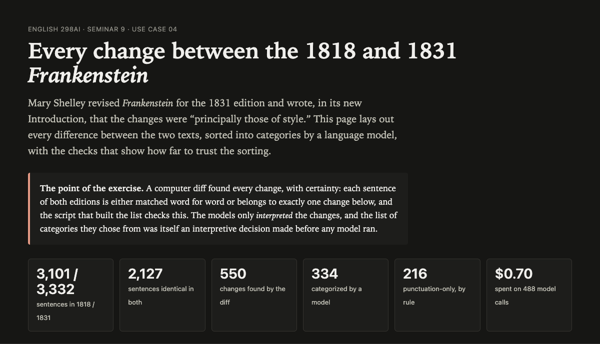
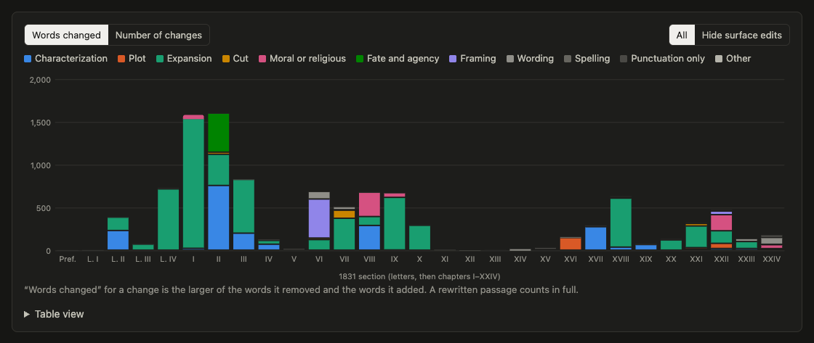
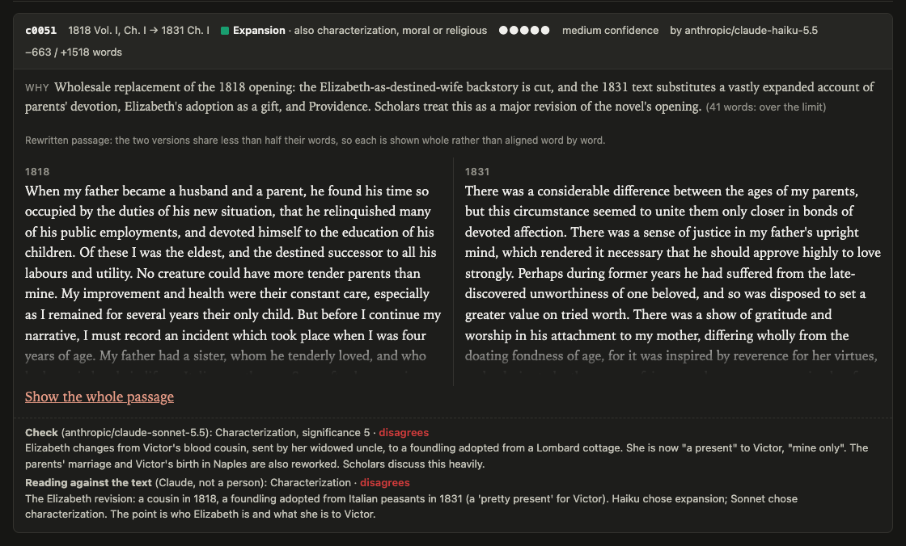
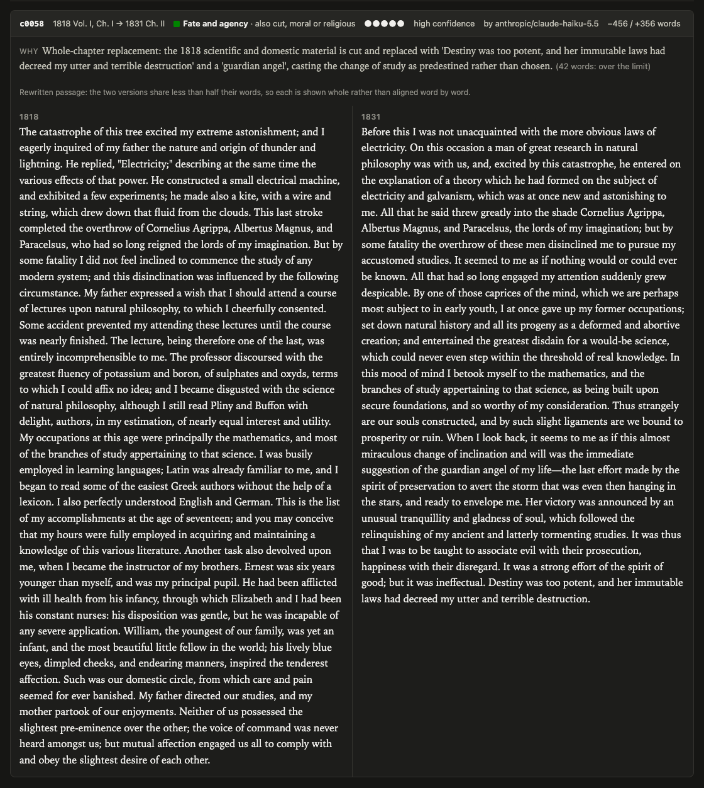
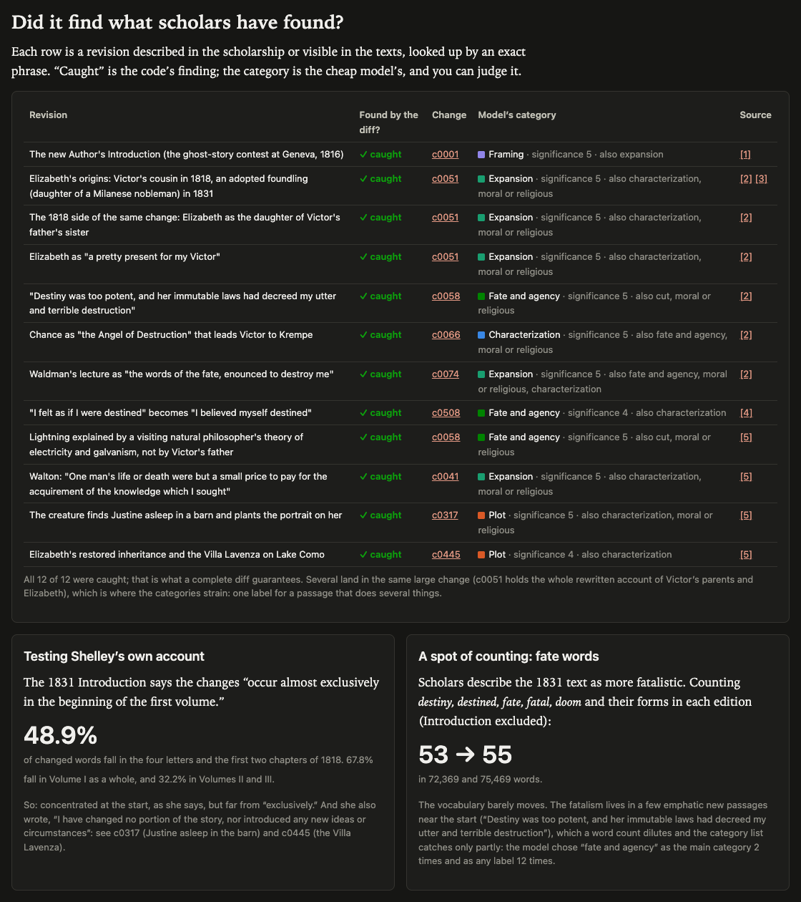
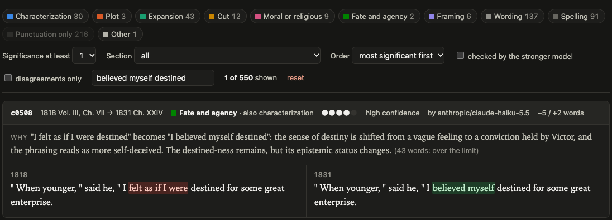
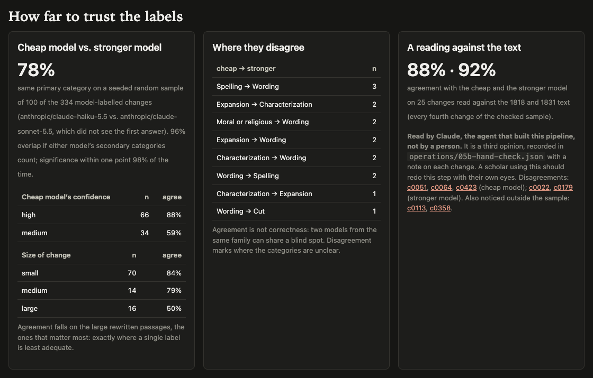
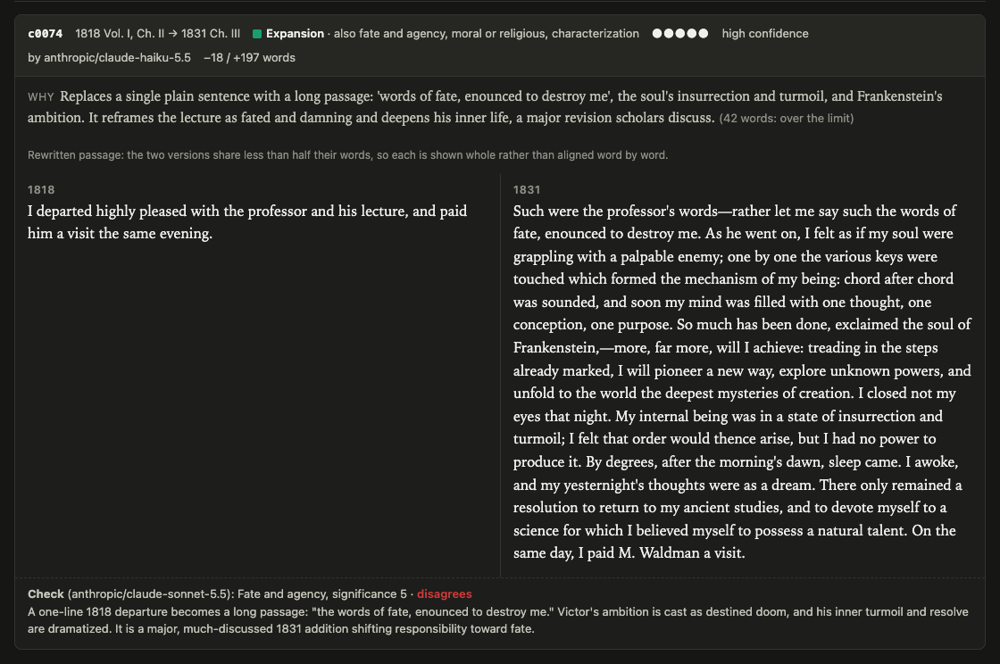

# Every change, accounted for: the 1818 and 1831 *Frankenstein*

*Code found all 550 changes between the two editions with certainty, and a language model sorted them into categories chosen in advance and written down. This essay walks through how the project was built, what it found, where the familiar story about the revision holds and where it doesn't, and how to borrow the pattern for any two versions of a text.*

In 1831 Mary Shelley published a revised *Frankenstein* in Colburn and Bentley's Standard Novels, with a new Introduction that tells the story of the ghost-story contest at Geneva. At the end of that Introduction she says a word about what she changed:

> I will add but one word as to the alterations I have made. They are principally those of style. I have changed no portion of the story, nor introduced any new ideas or circumstances. I have mended the language where it was so bald as to interfere with the interest of the narrative; and these changes occur almost exclusively in the beginning of the first volume.

That paragraph is a set of testable claims. Are the changes mostly stylistic? Do they sit at the start? Did she really change "no portion of the story"? Scholars have answered by collation, and a familiar summary, which the project takes from Anne K. Mellor, is that the 1831 text makes Victor the pawn of a destiny beyond his control. Worked example 04 asks a narrower, more mechanical question first: what, exactly, is every difference between the two texts? Only once that is closed does it ask a model what kind of difference each one is.

The project is one of six worked examples for ENGLISH 298AI, *AI Humanities Lab*, prepared for its session on vibe-coding. Like the others it runs from inputs (two public-domain texts from Project Gutenberg) through numbered operations (scripts, one prompt, and the data files they pass along) to one self-contained HTML page. The syllabus hopes such work will expose "assumptions that implementation forces us to specify." This essay is mostly about which assumptions this project was forced to specify.



*The output page (`outputs/index.html`) opens with the lesson and the run's totals: 3,101 sentences in 1818 and 3,332 in 1831, 2,127 identical, 550 changes, 334 sent to a model, 216 handled by rule, $0.70 spent.*

# Why "compare these two editions" is brittle

The obvious way to use a language model on this question is to paste both novels into a chat and ask what changed. The two texts run to about 72,000 and 75,000 words (the project counts 72,369 and 75,469, excluding the Introduction), so both fit in a modern context window. The answer will be fluent, and much of it will be right. It will probably mention Elizabeth and destiny, because that is what the scholarship talks about.

The trouble is what you cannot see. A one-shot answer gives you no way to know what it left out, because nothing in the process makes completeness checkable. Ask twice and you may get two different lists. Every reported change still has to be found in both texts by hand. And the answer fuses two kinds of work: finding differences, which is a matter of fact, and characterizing them, which is a matter of judgment. Fused, the confident tone of the judgment leaks into the facts, and the gaps in the facts hide behind the fluency of the judgment.

The project's README puts the lesson in one line: "code finds every change with certainty; models only interpret them." What makes the first half true is that the diff script ends with a completeness check: every sentence in both editions must be matched exactly in the other or belong to exactly one change, or the script stops. The aggregate file records: "passed: every sentence in both editions is either matched exactly or inside exactly one change." A one-shot answer can never say that about itself. Once the finding is closed, every remaining question is interpretive, and can be asked one change at a time, in a fixed form, with the answers recorded and checked.

# Code finds, a model interprets

The operations folder is numbered, and each number is a step a reader can open. Each one carries a decision.

## Steps 01 and 02: align, then diff

The inputs are Project Gutenberg eBook #41445, "produced from a photo-reprint of the 1818 edition," and #42324, from a photo-reprint of the 1831 edition. The first script strips boilerplate, title pages, illustrations, and footnotes; standardizes quotation marks, dashes, and italics; and splits each text into sections, paragraphs, and sentences. Then it solves a structural problem: 1818 has three volumes with chapters numbered within each, while 1831 numbers its chapters continuously. Aligning by shared five-word sequences, the script finds that 1818's Volume I, Chapter I became 1831's Chapters I and II, and every later chapter maps one to one. The opening of Victor's narrative grew enough to be split.

Inside each aligned pair of sections, the second script matches sentences by longest common subsequence, the method family behind ordinary text-comparison tools. Each run of unmatched sentences becomes one change, with the exact words removed and added marked inside it. Passages that share less than half their words are marked as rewrites and shown whole. Changes that differ only in punctuation, capitals, or hyphens are marked as punctuation by rule, without any model.

The output, `02-changes.json`, is the factual backbone of the project. Here is one entry, lightly trimmed, for a line Walton reports Victor saying near the end of the novel:

```json
{
  "id": "c0508",
  "label1818": "Vol. III, Ch. VII",
  "label1831": "Ch. XXIV",
  "before": "\"When younger,\" said he, \"I felt as if I were destined for some great enterprise.",
  "after": "\"When younger,\" said he, \"I believed myself destined for some great enterprise.",
  "segments": [
    ["=", "\" When younger, \" said he, \" I"],
    ["-", "felt as if I were"],
    ["+", "believed myself"],
    ["=", "destined for some great enterprise."]
  ],
  "similarity": 0.821,
  "kind": "substitution",
  "size": "medium",
  "wordsRemoved": 5,
  "wordsAdded": 2
}
```

Nothing in that record is a judgment. The totals are of the same kind: 297 substitutions, 19 removals, 18 insertions, and 216 punctuation-only changes; 51 large, 59 medium, 224 small, 216 trivial; 6,878 words removed and 12,315 added.

## Step 03: the categories

Step 03 is not a script but a Markdown file, `03-schema-prompt.md`, holding the categories, the instructions, and a JSON schema for the answer. The chain table labels it "prompt, human decision," and the file says of itself: "This file is an operation, not documentation." Step 04 reads it directly, so editing the categories and rerunning changes the result.

## Steps 04 to 08: the model, the checks, the page

Step 04 sends each of the 334 non-punctuation changes, one per call, to a cheap model (`anthropic/claude-haiku-5.5` via OpenRouter) with the schema enforced as a strict structured output. Each call carries both versions, the marked-up diff, and a sentence of context on either side. The prompt is plain: "The diff is complete and exact; do not second-guess what changed. Your job is only to say what *kind* of change it is and how much it matters for interpretation." The answer must be a category, up to two secondary categories, a significance from 1 to 5, a rationale, and a confidence. Code validates each answer again; there were 0 failed calls.

Step 05 sends a seeded random sample of 100 changes, blind, to a stronger model (`anthropic/claude-sonnet-5.5`) with the same prompt, and 05b reads 25 of those against the text. Step 06 looks up twelve revisions described by scholars and by Shelley's Introduction, by exact phrase; tests Shelley's claim about where the changes fall; and counts fate vocabulary. Step 07 aggregates, and step 08 builds one HTML page with a hand-built chart and no libraries.

Every model request and response is cached, so rerunning costs nothing and returns the same labels. The total was $0.70: $0.10 for 374 cheap-model calls (including a test run and a rerun after a fix) and $0.60 for 114 stronger-model calls. Neither model accepted a temperature setting through OpenRouter, so, in the README's words, "the cache, not temperature, is what makes reruns repeatable."

# The schema is an argument

A diff can tell you that "felt as if I were" became "believed myself." It cannot tell you whether that matters. For that the project needs categories, and that is where interpretation enters. The schema file is candid: "Deciding *what kind* of change each one is, is interpretation, and the list of kinds is the first interpretive decision."

## What the ten categories are

The list has two sources. Four categories describe the plainest kinds of edit: `spelling`, `wording`, `expansion`, and `cut`. The rest come from questions scholars have asked of the 1831 revision: `plot`, `characterization` (Elizabeth's origins), `moral-religious`, `fate-agency` (Victor's increasing sense of destiny), and `framing` (the Introduction, the letters as letters, chapter divisions). `other` catches the rest, and `punctuation` is assigned by rule. Each category has a one-line definition the model sees; `fate-agency`, for instance, "changes how far events are presented as destined, fated, or beyond the characters' control, versus chosen." Significance runs from 1 ("no interpretive consequence") to 5 ("a major revision that scholars would discuss").

## What the categories assume

Writing the categories down forces three assumptions into the open.

The first is that the revision is best described in the scholarship's existing terms. That makes results comparable, but it also sets the pipeline up to find what it was told to look for. A `fate-agency` category exists because critics have argued the 1831 text is more fatalistic; its existence proves nothing, and the counts end up complicating the argument.

The second is that one change has one main kind. The schema allows up to two secondary categories, but the page counts only the primary. For a comma, one label is plenty. For the largest change in the novel, c0051, which replaces 663 words of the 1818 opening with 1,518, it is plainly too few: that passage rewrites the parents' marriage, moves Victor's birth to Naples, replaces Elizabeth's origins, and adds a providential frame. The cheap model called it `expansion`; the stronger model and the reading called it `characterization`. The disagreement is a symptom of the schema, not of either model.

The third is what is left out. The schema file names the gaps itself: "Tone and rhythm fold into *wording*," and "Gender, class, politics, and science are not their own categories." In this novel that is a real loss. The 1831 Elizabeth is not only a foundling but the daughter of an Italian patriot, "one among the schiavi ognor frementi, who exerted himself to obtain the liberty of his country," who may still linger "in the dungeons of Austria." A reader interested in the politics of the revision would want that counted somewhere; here it can only be part of an `expansion` or a `characterization`. (That observation is my reading, not a finding of the pipeline.) Likewise, replacing the father's kite experiment with a visitor's theory of "electricity and galvanism" changes the novel's science, and there is no category for science.

## What the rules hide

The punctuation rule looks neutral and isn't quite. If two sentences contain the same letters once punctuation, capitals, and hyphens are removed, the change is punctuation, significance 1, no model. That handles 216 changes cheaply: `sea-faring` becoming `seafaring`, a semicolon becoming a comma. But it also catches c0012, in Walton's first letter, where "And now, dear Margaret, do I not deserve to accomplish some great purpose" ends with a period in 1818 and a question mark in 1831. A reader might think that turning a flat statement into a rhetorical question changes Walton's tone. The rule cannot see that. It is a trade the project made openly, and the page marks which changes were labelled by rule, but it is exactly the kind of assumption implementation makes visible.

The line between `spelling` and `wording` is also a judgment. The reading of 25 changes notes that c0179, "further → farther," is "arguably a word choice, not spelling; borderline." The two models split on it. And `other` received exactly one primary label: c0358, where "the insolent Gower" in the Oxford passage becomes "the insolent Goring." The model's rationale asserts that Goring is the historical courtier and Gower was invented; the project flags that as "a factual claim the pipeline never checked." The category list had no slot for a correction of fact, so the model put it in `other` and supplied a fact of its own.

# What the revisions look like

With the facts fixed and the categories chosen, the page can show where the changes fall. The chart stacks each section's changes by primary category, in words changed (for each change, the larger of the words removed and added).



*"Where the changes fall," measured in words changed, with the 2,263-word Introduction left out so it doesn't flatten the rest. Chapters I and II dominate; Chapter II's dark green block is c0058, the "Destiny was too potent" passage.*

## Testing Shelley's account

Shelley's account holds up in part. Excluding the Introduction, 48.9% of changed words fall in the four letters and the first two chapters of 1818, 67.8% in Volume I, and 32.2% in Volumes II and III. As the page puts it, the changes are "concentrated at the start, as she says, but far from 'exclusively.'" Her other claim fares worse. "I have changed no portion of the story" is contradicted by at least two changes the models both labelled `plot`: c0317, in which the creature now finds Justine asleep in a barn before planting the portrait on her, and c0445, which replaces the couple's planned house near Cologny with Elizabeth's restored inheritance and the Villa Lavenza on Lake Como.

## Elizabeth

The best-known revision is Elizabeth's origin. In 1818 she is Victor's cousin: his father "had a sister, whom he tenderly loved," and after her death her widower asks him "to take charge of the infant Elizabeth, the only child of his deceased sister." Victor's mother resolves "to consider Elizabeth as my future wife."

In 1831 the blood relation is gone. Visiting the poor near Lake Como, Victor's mother finds a fair-haired child among a peasant family's dark-eyed children, "not her child, but the daughter of a Milanese nobleman." The adoption follows, and with it a sentence readers of the 1831 text tend to remember: "I have a pretty present for my Victor—to-morrow he shall have it." Victor, "with childish seriousness," takes the words literally and looks "upon Elizabeth as mine—mine to protect, love, and cherish."



*Change c0051 in the explorer: 663 words out, 1,518 in, shown whole because the versions share less than half their words. The cheap model says expansion; the stronger model and the reading say characterization.*

What makes this useful for method is the change it forced elsewhere. The reading of c0064, in Chapter III after Caroline's death, notes the 1831 phrase "those whom she had been taught to call her uncle and cousins": once Elizabeth is no longer a cousin, a later sentence had to change too, a change "which a keyword search for 'Milanese' would miss." A complete diff catches the consequences of a revision, not only its famous words.

## "Destiny was too potent"

The second famous revision sits in the next chapter. In 1818, after lightning destroys "an old and beautiful oak," Victor asks his father about thunder and lightning; his father answers "Electricity," builds "a small electrical machine," and flies a kite. In 1831 the explanation comes from "a man of great research in natural philosophy," with "a theory which he had formed on the subject of electricity and galvanism." Then the passage turns. Victor abandons natural history for mathematics and looks back on the change as "the immediate suggestion of the guardian angel of my life," a last effort to save him that failed:

> It was a strong effort of the spirit of good; but it was ineffectual. Destiny was too potent, and her immutable laws had decreed my utter and terrible destruction.



*Change c0058: the 1818 kite and the domestic portrait on the left; the 1831 galvanism, the guardian angel, and "Destiny was too potent" on the right. One of the only two changes with "fate and agency" as the main label.*

This one change holds two of the twelve known revisions. Notice something else in the left column. The 1818 text already says, "But by some fatality I did not feel inclined to commence the study of any modern system." The 1831 text keeps the phrase: "by some fatality the overthrow of these men disinclined me." The 1818 Victor was already reaching for fate. The 1831 Victor says so at much greater length.

## Twelve of twelve

Step 06 looked up twelve revisions by exact phrase. Six are cited to Anne K. Mellor's chapter "Revising Frankenstein" (in *Mary Shelley: Her Life, Her Fiction, Her Monsters*, 1988), one to Stuart Curran's Romantic Circles edition, one to the 1831 Introduction itself, and four to the texts alone, as revisions commonly noted in teaching editions for which no scholarly source was checked. (A caution the project records: Mellor's online page refused automated access on the day, so these passages were confirmed against the two texts, not against her chapter. A reader should check her chapter.)



*All twelve described revisions fall inside a change. "Caught" is the code's finding; the category beside it is the cheap model's, and several share one large change.*

All twelve were caught, which the page treats with modesty: "that is what a complete diff guarantees." The category column is more revealing. Several revisions share one change (c0051 holds three, c0058 two), and the labels for these famous passages vary: Elizabeth's origins are `expansion`; Chance as "the Angel of Destruction" is `characterization`; Waldman's lecture as "the words of fate, enounced to destroy me" is `expansion`; Walton's "One man's life or death were but a small price to pay for the acquirement of the knowledge which I sought" is `expansion`. Each is defensible. Together they show how much `expansion` absorbs: 43 primary labels but 6,189 words changed, more than any other category.

# The fatalism story, recounted

The standard account of the revision, as the project summarizes Mellor, is that the 1831 text makes Victor "the pawn of a destiny beyond his control." The revisions above support that account vividly. The project's counts complicate it without refuting it, and the way they do so is the most instructive result in the folder.

## Counting fate words

Step 06 counts a fixed set of fate words (destiny and its forms, fate, fated, fatal and its forms, doom and its forms, predestined) in each edition, excluding the Introduction. The count is 53 in 1818 and 55 in 1831, in 72,369 and 75,469 words. The vocabulary barely moves. Proportionally it is essentially flat.

To see why, I ran the same pattern over the removed and added text of every change (the new Introduction excluded). Six fate words are removed and eight added, which accounts exactly for the difference of two. Some are the same words carried across a rewrite: inside c0052, the rewritten account of Victor's childhood in Chapter II, both versions say that a passion "afterwards ruled my destiny" and that "Natural philosophy is the genius that has regulated my fate." The 1818 opening also loses a fate word when Victor stops being "the destined successor to all his labours and utility." The new ones come from a handful of emphatic passages: "Destiny was too potent," "the words of fate, enounced to destroy me," the "inexorable fate" of Victor's lament after Justine's execution.

This fits Curran's annotation, which the project cites: in 1831 "I believed myself destined" is substituted for "I felt as if I were destined," and Victor "has consistently appealed to a ruling destiny" already in 1818.



*A search filter applied in the explorer, showing c0508 with its label, rationale, and the exact words removed and added. The rationale runs 43 words, and the page flags that it is over the 40-word limit.*

## Counting labels

The categories tell the same story from another side. Of 334 changes the model labelled, only 2 have `fate-agency` as the main category: c0058 and c0508. Counting secondary labels, 12 do. The page's summary is that the fatalism "lives in a few emphatic new passages near the start ... which a word count dilutes and the category list catches only partly."

## What to make of it

Here is my interpretation, offered as interpretation. "More fatalistic" is not a claim about frequency but about emphasis and placement: a few sentences, mostly early in Victor's narrative, in which he reads his own choices backward as doom, at moments that shape how a reader takes everything after. A word count treats "fate" in a passing phrase and "Destiny was too potent" as equal units. A one-label schema sees fatalism only when it is the main thing a change does, and in the long rewrites it rarely is: c0074, the "words of fate" passage, is also about Victor's ambition and turmoil, and the two models split between `expansion` and `fate-agency`.

So the counts do not show the critics were wrong. They show what kind of claim the critics were making, and that it cannot be confirmed by counting. This is the syllabus's point about assumptions implementation forces us to specify. To count fatalism you must decide what it is made of. Made of words, it nearly disappears; made of changes whose main point is fate, it shrinks to two. The scholarly reading lives in neither, and has to be argued from the passages.

# How far to trust the labels



*"How far to trust the labels." Agreement is high overall and falls to 50% on large rewritten passages; disagreements cluster on the borders between neighbouring categories.*

## The stronger model

On the seeded sample of 100, the two models chose the same primary category 78 times; counting secondary categories as overlap, 96%. On significance they agreed exactly 66% of the time and within one point 98%.

The breakdown matters more than the headline. Agreement is 84% on small changes (59 of 70), 79% on medium (11 of 14), and 50% on large (8 of 16). The large rewrites are the ones scholars write about, so the labels are least reliable where they matter most. Disagreements fall mostly at borders between neighbouring categories: spelling and wording (five cases in either direction), expansion and characterization (three), moral-religious and wording (two). The page states the lesson plainly: "Disagreement marks where the categories are unclear."



*Change c0074, Waldman's lecture recast as "the words of fate, enounced to destroy me." The cheap model chose expansion, with fate and agency as a secondary; the stronger model, shown in the check line, put fate and agency first.*

The cheap model's confidence is a weak signal. Where it said "high," it agreed with the stronger model 88% of the time (58 of 66); where "medium," 59% (20 of 34). But it never said "low," even where the stronger model disagreed. Its confidence ranks labels roughly; it cannot flag its own guesses.

## The reading

The 25-change reading (every fourth change of the checked sample) agrees with the cheap model on 88% and the stronger model on 92%. The cheap model's three misses are c0051 and c0064 (both Elizabeth, both `expansion` where the reading said `characterization`) and c0423, Victor's return through France rewritten around his guilt ("I abhorred the face of man. Oh, not abhorred!"), which it called `moral-religious`.

The project is clear about who did this reading: Claude, the agent that built the pipeline, not a person. The file says so and adds: "It is a third opinion, and a scholar using this pipeline should redo this step with their own eyes, on their own sample." That matters for the 88% and 92%. Agreement among three readers from one family of models is not correctness, and the page warns that "two models from the same family can share a blind spot." (I am also a Claude model, which is one more reason to treat my interpretations here as a reader's, not a verdict.)

## Rationales that are wrong about the text

Labels can be checked against each other; rationales are prose, and prose can be wrong while sounding right. The reading noticed two outside the sample. For c0113, the rationale says the 1818 letter "is wholly replaced by a new letter from Elizabeth herself," but both versions are Elizabeth's letters ("MY DEAR COUSIN" in 1818, "My dearest Cousin" in 1831). For c0358, the rationale asserts a historical fact the pipeline never verified.

The schema also failed in one small, telling way. The prompt asks for rationales of "at most 40 words," but a JSON schema can force a category from a list and cannot count words. 42 rationales ran over, and the page flags each rather than trimming it silently. The structure guaranteed the form of the answer, not every instruction in the prompt.

## The texts themselves

The deepest uncertainty is upstream of the models. Both texts are volunteer transcriptions of photo-reprints, by different people, so a few differences, especially in punctuation and spelling, may be the transcribers'. Spelling changes such as *sympathize* and *sympathise* may be the 1831 printer's house style. The model labelled 91 changes `spelling`; the pipeline cannot say whose spelling each one is.

There was also a surprise in choosing the inputs. A reader reaching for the most-downloaded *Frankenstein* on Project Gutenberg, eBook #84, might expect the first edition. It is not the 1818 text. The project records that it has the 1831 Elizabeth ("the daughter of a Milanese nobleman") and continuous chapter numbers, but no 1831 Introduction; where the project checked, it follows 1831, not 1818. Compared with #42324, it would presumably have made the Elizabeth revision vanish. The README's advice is short: "Check which edition an online text is before comparing."

One limit belongs to the diff itself. It aligns sentences inside matched chapters, so a passage moved far away would appear as a removal in one place and an addition in another. The completeness check guarantees every sentence is accounted for, not that each change is described in the most natural way.

# Borrowing the pattern

The pattern generalizes to any two versions of a text in the same language: two editions, a manuscript and a print, an author's revision, a serial and a book. Wordsworth's *Prelude* in its 1805 and 1850 versions, the editions of *Leaves of Grass*, or Henry James's revisions for the New York Edition are obvious candidates, and so is anything closer to home, such as two drafts of a chapter or two versions of a policy document. The README's instructions are brief: "replace the inputs, adjust the heading patterns in step 01, and rewrite the categories in 03 for your question." Behind those three steps are decisions worth making on purpose.

## Decide what counts as the same

Normalization is a theory of what doesn't matter. This project standardizes quotation marks, dashes, and italics, so a curly quote equals a straight one. It does not fold ligatures, so *phænomena* and *phenomena* show up as a change, which the model labels `spelling`. Each such choice decides what a reader will be shown. If your texts come from different transcriptions, decide what counts as noise before you look at the results.

## Decide the unit, and check completeness

The sentence is the unit here, and chapters are aligned first. For poetry the line or stanza may serve better; for a heavily restructured text, moves will be a real problem. Either way, make the script check that every unit is accounted for, and stop if not. That check turns a list of changes into the list.

## Write the categories from your question

These categories come from the scholarship on *Frankenstein*. Yours should come from what you want to know. If your question is about gender, politics, or science, give it its own category, or it will be scattered across `wording` and `characterization`. Write down what the categories leave out. Send each unit, one at a time, through a schema that forces the answer into your list, and keep every request and response.

## Check the interpretation, not just the finding

The checks transfer cheaply. A seeded sample sent blind to a stronger model shows where the categories are unclear. A reading of a smaller sample against the text, by a person, shows where the models are wrong. Changes you already know about, looked up by exact phrase, test whether the finding is complete. And measuring a claim made about the texts (here Shelley's own) turns a debate into a number that can be argued with.

## Expect the counts to change the question

The most valuable result here was not a confirmation. It was the fate-word count coming back 53 and 55, which forced a more precise statement of what "more fatalistic" could mean. The code made every change visible for seventy cents. The model sorted them quickly and, on small changes, mostly well. But the questions that mattered most (which categories to use, what a famous passage is mainly doing, whether a pattern of emphasis can be counted at all) stayed with the reader. The pipeline did not answer them. It made them impossible to avoid.
