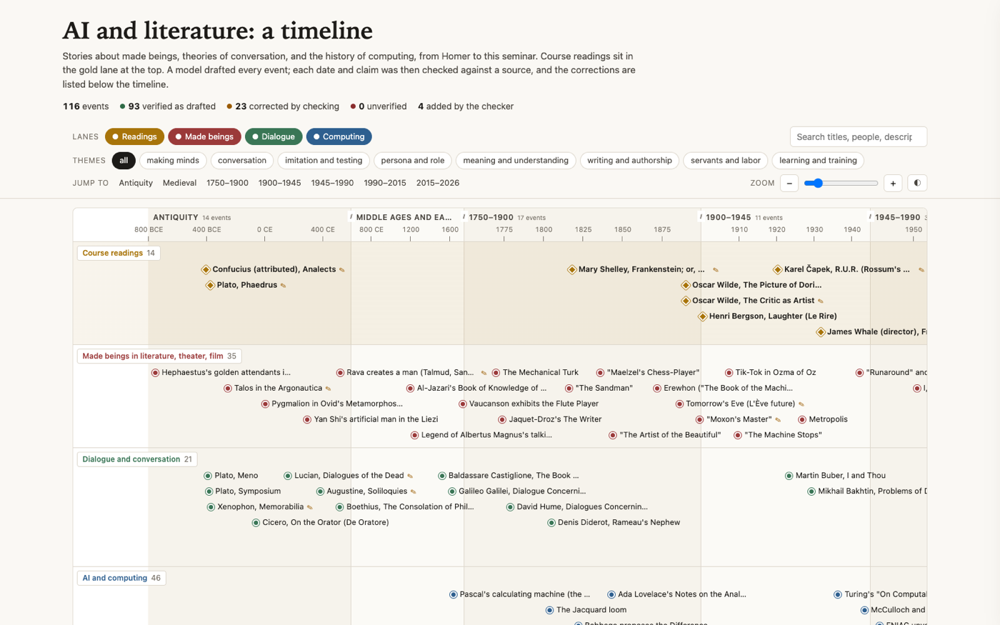
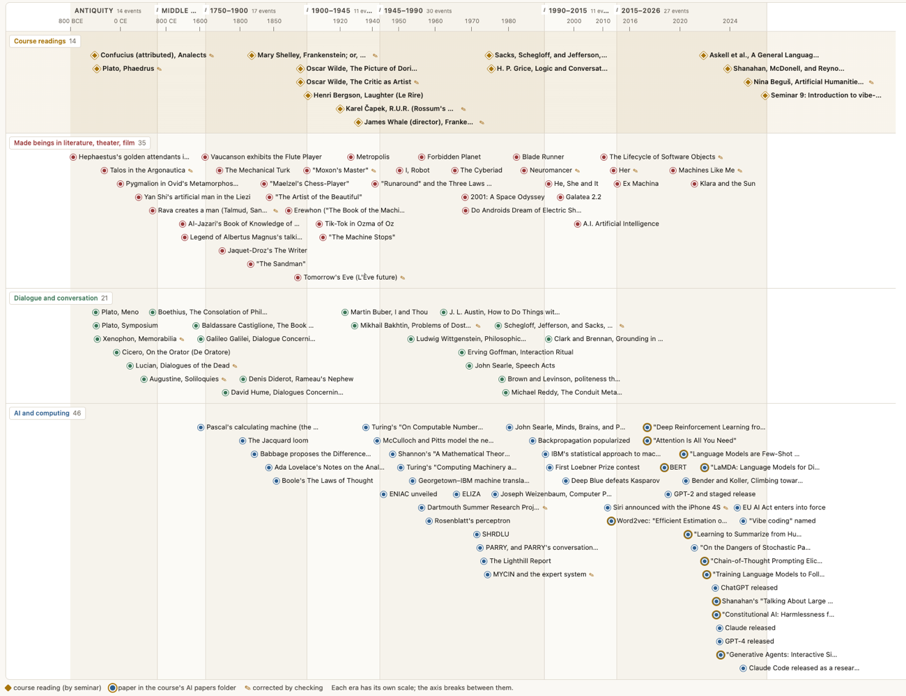
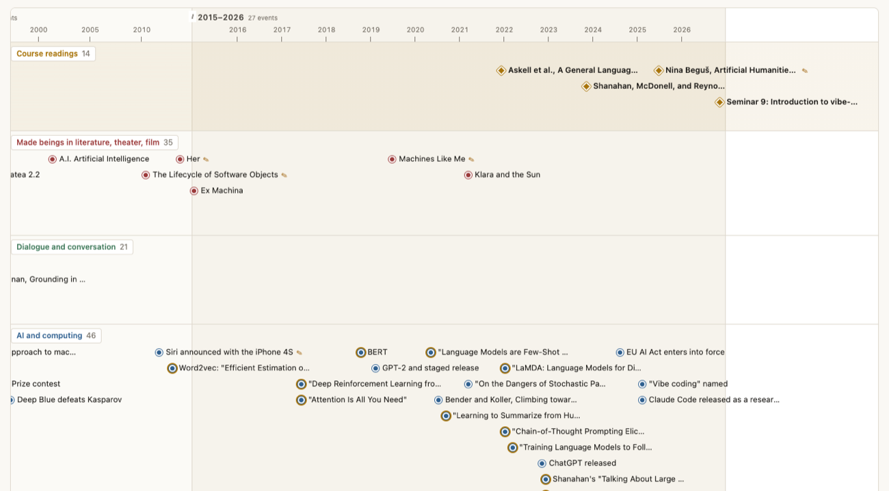
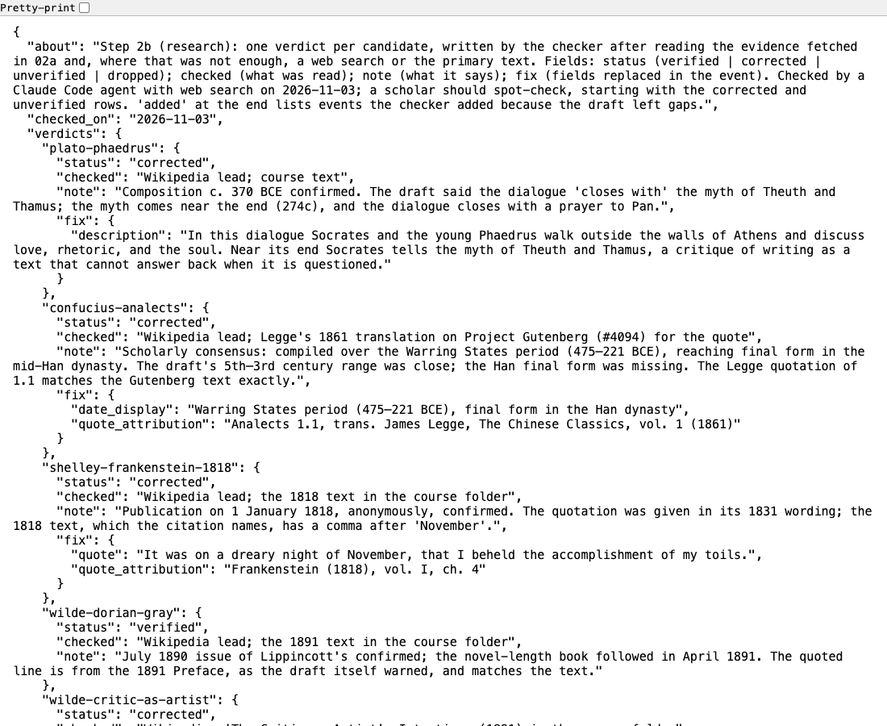
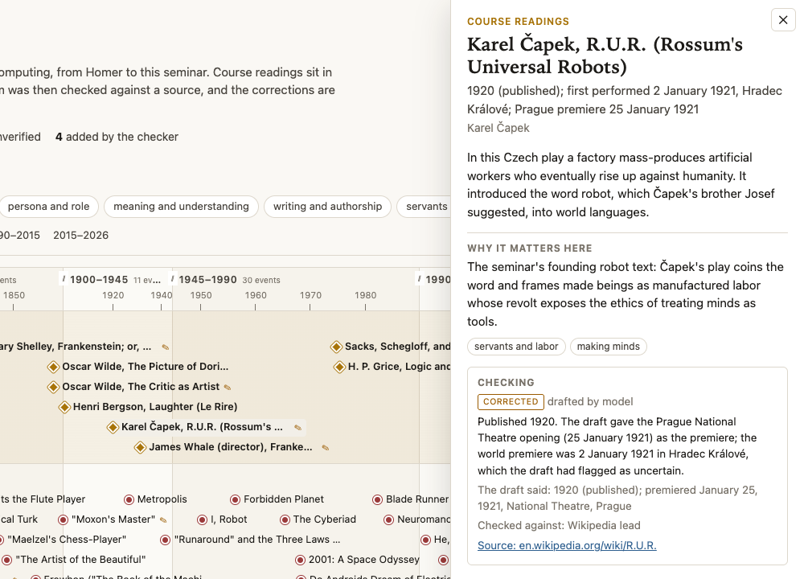
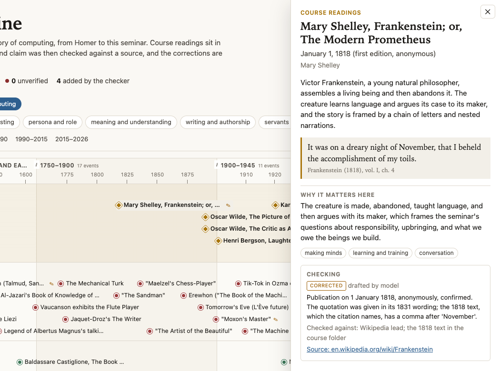
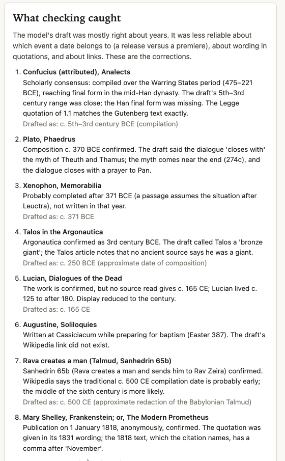
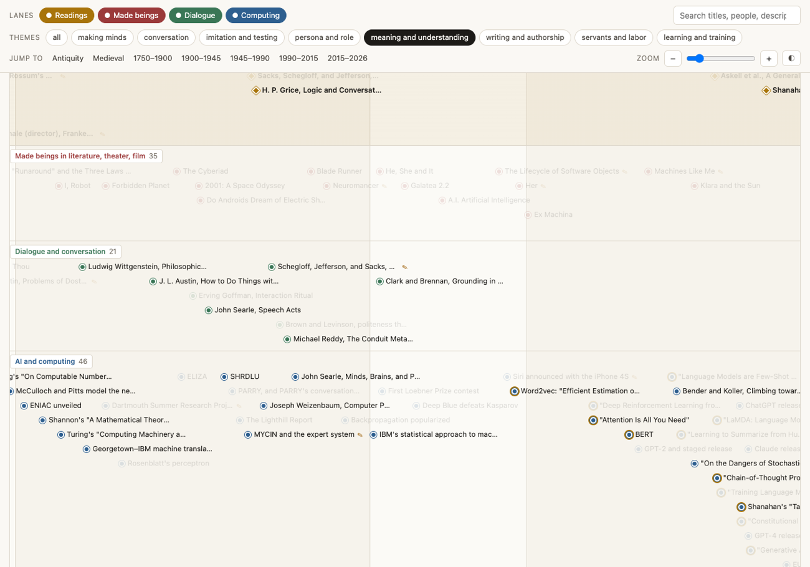

# Checking the machine's history

*A model drafted 112 events for a timeline of AI and literature. Each one was then checked against a source, and a second model sorted them into lanes. The year was almost never the problem. This essay is about what was.*

The third worked example for today's session of ENGLISH 298AI is a timeline. It runs from the golden attendants Hephaestus builds in the *Iliad* to this seminar's own meeting on November 3, 2026, and it puts 116 events into four horizontal lanes: the course readings, made beings in literature, theater, and film, theories and forms of dialogue, and the history of AI and computing. Open `outputs/index.html` and the page shows a header with its own scorecard (116 events, 23 corrected by checking, 0 unverified, 4 added by the checker), a row of lane and theme filters, and the timeline itself, which scrolls sideways through seven eras.

*The page as it opens, with the scorecard under the title and the lane, theme, era, and zoom controls above the timeline.*

The page is the output of a four-step chain kept in the project's `operations/` folder. A model (`anthropic/claude-opus-5.5`, called through OpenRouter) proposed the events. A Claude Code agent then checked each one against Wikipedia, arXiv, Crossref, a publisher's page, or the primary text, and wrote a verdict. A second model (`anthropic/claude-sonnet-5.5`) gave each verified event a lane, up to three themes from a fixed list of eight, and a sentence on why it matters for the course. A script with no model in it poured the result into an HTML template. The model calls cost $1.76 in all.

A timeline looks like the most neutral of forms: dates in order, nothing more. It is not neutral, and this one is a useful case because nearly every choice that shapes it was made by a model, and those choices are written down.

# What a timeline argues

A timeline makes claims before anyone reads a single entry: that the things on it belong to one story, and that its categories are the right ones to see that story through.

## Four lanes, one story

The first claim is in the lanes. Putting Ovid's Pygmalion, Galileo's *Dialogue*, the Jacquard loom, and Grice's "Logic and Conversation" on one sheet says that stories about made beings, theories of conversation, and the history of computing are one history, each clearer beside the others. That is close to the premise of the seminar, which reads *Frankenstein* and *R.U.R.* alongside the *Phaedrus* and conversation analysis before turning to chatbots.

The lanes also separate. A lane is a category, and every event has to be in exactly one. Turing's 1950 paper on the imitation game sits in computing, not dialogue, though it is a paper about a conversation. Searle's *Speech Acts* (1969) sits in dialogue while his Chinese Room paper (1980) sits in computing, so one author's work is split across two lanes, eleven years apart. Each of those placements is defensible, and each is a reading. The final counts are uneven: 46 events in computing, 35 in made beings, 21 in dialogue, and 14 course readings. The prompt asked for about 38, 30, 24, and 13. The lane that grew is computing, which says something about which history was easiest for the model to supply in dated, checkable units.

*The whole timeline at its smallest zoom. Gold diamonds are course readings; ringed blue dots are papers from the course's AI papers folder; a small pencil marks an event that checking corrected.*

## The broken axis

The second claim is in the scale. The events run from about 750 BCE to 2026. On a single linear axis, the 27 events since 2015 would collapse into a sliver at the right edge, and antiquity would be a long, nearly empty plain. The template avoids this by splitting the axis into seven eras, from Antiquity (800 BCE to 600 CE) to 2015 to 2026. Each era gets its own linear scale and a width proportional to the number of events it holds plus four. A small double slash marks each break.

The effect is large. Antiquity holds 14 events across fourteen centuries; the last era holds 27 events across twelve years. By the template's weights, the recent era gets about two hundred times as much horizontal space per year as antiquity does. The README is honest about this ("Each era has its own scale, so distances between eras mean nothing"), and the legend under the timeline says so too. But a reader's eye still reads distance as time. At the smallest zoom, the twelve years since 2015 take up more of the page than the fourteen centuries of antiquity.

That is the right choice for a teaching tool whose subject is a recent technology, and it is still an argument. It says that the present is dense and the past is sparse, which is partly a fact about history and partly a fact about documentation: the recent past is crowded because it is easy to date, well covered on Wikipedia, and close to the model's training data. The broken axis makes the timeline readable; it also quietly enlarges the period the course is about.

*The last era, zoomed in. The computing lane is crowded with papers and product releases; the dialogue lane is empty.*

## What the selection says

The third claim is in what is there at all. A model chose 112 events, guided by a prompt that named many of them (Hephaestus, Talos, the golem, Vaucanson, the Mechanical Turk, *L'Ève future*, *Metropolis*, ELIZA, PARRY, SHRDLU, and so on), and the checker added four. Some non-European material made it in: the *Analects* as a course reading, the artificial man presented to King Mu in the *Liezi*, Al-Jazari's *Book of Knowledge of Ingenious Mechanical Devices* (1206), and Rava's golem in the Babylonian Talmud. But the canon is heavily Anglo-European and English-language, as the README says. There is no Japanese, Indian, or Latin American fiction of made beings, no non-Western theory of dialogue beyond the *Analects*, and nothing in computing that is not American or European.

The recent end has a particular shape. Since 2015, the computing lane is papers and products: the transformer, BERT, GPT-2, the human-feedback papers, ChatGPT, Claude, GPT-4. The made-beings lane over the same years has three works, all famous: *Ex Machina*, *Machines Like Me*, and *Klara and the Sun*. The dialogue lane, as discussed below, has nothing at all after 1991. Read literally, the timeline says that in the last decade the history of talking machines became a history of engineering. That may be a view worth defending, but on this page it is mostly a side effect of what the model found easy to list and what the categorizer did with it.

# From draft to page

Every project in today's set is laid out as inputs, operations, and outputs. This one keeps its chain unusually visible, and each step is labeled by who decides: deterministic code, model judgment, or verified research.

## Input: a reading list without dates

The only input is `inputs/course-readings.json`: the course's readings by seminar (author, title, role) and the arXiv IDs of the 22 papers in the course's AI papers folder. No text from any reading is included. The file does contain years, but `01-draft.mjs` deliberately leaves them out of what it sends. Its comment explains why: "The model gets authors and titles but NOT the years, so the dates it proposes are its own and step 2 is a real test of them." Had the model been handed the dates, checking them would test nothing.

## Step 1: the draft

The draft prompt (`operations/01-draft-prompt.md`) asks for about 105 events in four tracks and specifies the fields for each, among them a display date, a numeric year for the axis, a precision (`day`, `year`, `circa`, or `century`), a two-sentence description in the model's own words, an optional short quotation only for public-domain texts, a source URL to check against, and an `uncertain` field for anything the model is not sure of. It tells the model to distinguish composition, first publication, first performance, and translation, and "Do not invent quotations."

The first attempt asked for all four lanes in one call. The cost log shows it: 32,000 completion tokens and $0.65 for nothing usable. The README explains that the model spent two thirds of its output budget thinking and ran out mid-JSON. The script now makes one call per lane, and those four calls produced 112 candidates (13 readings, 40 computing, 35 made beings, 24 dialogue). Keeping the failed call in the log is a good habit: it records what the method actually cost.

## Step 2: checking, in three parts

The checking step is split so that each part does one kind of work.

`02a-fetch-sources.mjs` is deterministic code. For each candidate it fetches what a checker would read first: the lead section of the Wikipedia article through the MediaWiki API, the arXiv record with its first-submission date, or the Crossref record for a DOI. Then it runs a crude test: does the claimed year appear anywhere in the fetched text? According to the README, 80 of 112 passed. The script's own comment is careful about what that means: "The test only sorts the work." Passing is not verification. A year can appear in an article for an unrelated reason, and a correct year can be missing from a short lead section. (The fetched extracts themselves are not in the folder: Wikipedia text is CC BY-SA, so the file is gitignored and the script downloads it again.)

`02b-verdicts.json` is the research record, and it is the heart of the project. It holds one verdict per event, with a status (`verified`, `corrected`, `unverified`, or `dropped`), what was read, what it said, and any fields that were replaced. Where the fetched lead was not enough, the checker read further, searched the web, or went to the primary text: the course's copies of Shelley, Wilde, and Bergson, Legge's *Analects* on Project Gutenberg, Lovelace's 1843 notes on Wikisource. It also lists the four events the checker added.

`02c-merge.mjs` is deterministic again. It applies the verdicts, writes a CSV for people and a JSON file for the next step, and strips quotations from anything not marked public domain, so a copyright rule is enforced by code rather than by hope.

*The start of `02b-verdicts.json`. Each entry records a status, what was read, a note on what it said, and the exact fields replaced.*

## Steps 3 and 4: sorting and building

`03-categorize.mjs` sends the verified events in batches of 20 to a second model, whose reply must fit a JSON schema (the next section looks at what it decided). Finally `04-build.mjs` embeds the data in `04-template.html`, which is hand-written HTML, CSS, and JavaScript with no libraries, and writes a single file that opens by double-click without a server or an internet connection.

The draft cost $1.40 over five calls, one of them the failed one. Categorizing cost $0.36 over nine calls: six batches, then three rerun after title corrections. The checking used web searches and page fetches inside the Claude Code session, which the cost log does not count, and it took, as the README says of anyone repeating the method, "most of the time."

# What the checking caught

Of the 112 drafted events, 89 were confirmed as drafted and 23 were corrected; none were dropped or left unverified. The corrections are more interesting than the ratio, because they show where a fluent model goes wrong when it writes history.

## Rarely the year

Only three of the 23 corrections changed the year used to place an event on the axis. MYCIN moved from 1976 (the date of the book) to 1974, because the checker could confirm only that the system was developed in the early 1970s. The Talmud's account of Rava creating a man moved from 500 to 525, because Wikipedia says the traditional date of about 500 CE for the Talmud's redaction is probably early. Xenophon's *Memorabilia* moved from 371 BCE to 365, because the work was probably completed after 371, not written in that year. None of these is a gross error. The model knew roughly when things happened. It was less reliable about everything around the date.

## Which event a date belongs to

The most instructive errors attach a correct date to the wrong event. The 1931 *Frankenstein* film: the draft gave November 21, 1931 as the New York premiere. That is the release date; the film opened at the Mayfair in New York on December 4. *R.U.R.*: the draft gave the Prague National Theatre opening on January 25, 1921 as the premiere. The first performance was weeks earlier, on January 2, 1921, in Hradec Králové. Siri: the draft's title said Siri "ships on the iPhone 4S" on October 4, 2011, which was the announcement; the phone shipped on October 14.

These are the errors a scholar most needs to know about, because the dates are real: search "November 21, 1931" and you will find it. The error is in the relation between date and event, which a crude year test cannot see.

*Clicking an event opens its panel. For R.U.R., the "Checking" box shows the status, the note, what the draft said, and the source read.*

## Wording, titles, and details

Six events carried quotations, all from public-domain texts. Four matched their sources exactly. Two did not, and both were caught only by reading the course's own copies. The *Frankenstein* line was given in its 1831 wording but cited to the 1818 edition; the 1818 text, which the citation names, has a comma after "November." Wilde's line from "The Critic as Artist" was given as "rewrite"; *Intentions* prints "re-write". These are tiny differences of exactly the kind a literary scholar is trained to care about. A plausible explanation (an interpretation, not something the files show) is that a model reproducing a famous line drifts toward its most familiar form, which is not always the form in the edition cited.

*The 1818 Frankenstein, with the quotation in its 1818 wording. The checking note records the missing comma.*

Titles slipped too. The draft called Bakhtin's 1929 book *Problems of Dostoevsky's Art*. The 1929 book was *Problems of Dostoevsky's Creative Art*; the expanded 1963 edition is *Problems of Dostoevsky's Poetics*. The draft's title matched neither. The draft gave Nina Beguš's book only its main title, *Artificial Humanities*; the full title adds "A Fictional Perspective on Language in AI."

Details inside descriptions were the hardest errors to see, because they read as harmless color. The draft called Talos a "bronze giant"; the Wikipedia article on Talos notes that no ancient source says he was a giant. It described Ted Chiang's "The Lifecycle of Software Objects" as the story of "former zookeepers"; only one of the two protagonists is a former zookeeper, and the other is an animator. It said the *Phaedrus* "closes with" the myth of Theuth and Thamus; the myth comes near the end, at 274c, and the dialogue closes with a prayer to Pan. For a seminar that reads the *Phaedrus* closely, that last one matters.

## Links and false precision

Five source URLs were broken or wrong. Three pointed to Wikipedia articles that do not exist (`Intentions_(book)`, `Soliloquies_(Augustine)`, and `Repair_(linguistics)`). One, for Beguš's book, pointed to the press's home page rather than the book. The fifth, for Spike Jonze's *Her*, the verdict describes as "the disambiguation page for the word 'her'". In the files as they now stand, though, the drafted URL and the corrected URL for *Her* are the same string, `https://en.wikipedia.org/wiki/Her_(film)`. The record therefore does not let a reader see the error it reports: either it was fixed somewhere upstream of the saved draft, or the note is mistaken. This essay cannot settle which. It is a small instance of the general rule that a verification record is itself a document that can be checked, and should be.

False precision was the subtlest pattern. For *Neuromancer* the draft said "July 1984" and for *Machines Like Me* "April 2019"; the sources read gave only the year, so the display was cut back to the year. For Lucian's *Dialogues of the Dead* the draft said "c. 165 CE"; no source read supported that, and Lucian lived from about 125 to after 180, so the display became "2nd century CE." For MYCIN, as above, the date was widened to "early 1970s." In each case the model offered more precision than it could support, and the fix was to say less.

Some corrections added what the draft left out: the *Analects* gained its Han-dynasty final form, and *L'Ève future* its 1878 beginning and partial 1880 publication as *L'Ève nouvelle*. The draft's note that Bierce's "Moxon's Master" was collected in 1909 was wrong; it appeared in the 1910 edition of *Can Such Things Be?* And in one case the sources disagreed with each other. The Dartmouth proposal is dated August 31, 1955 on the document and September 2, 1955 on Wikipedia, so the page now says "proposal of late summer 1955" and asserts neither day.

## The model's own doubts

The draft's `uncertain` field turned out to be informative, but not in the way one might hope. Of the 23 corrected events, 20 had something written in that field. Several notes pointed straight at the problem: for the 1931 film, "The premiere date should be checked against the general release date"; for Beguš, that the subtitle and the press URL should be verified and the URL replaced; for "The Critic as Artist," that the quotation's wording "should be checked against the 1891 text." For Siri, the note itself said Siri "was announced October 4, 2011 and shipped October 14," yet the title still said "ships." The model knew the distinction and did not apply it to its own heading.

The trouble is that 78 of the 112 drafted events had a note in that field. About a quarter of the flagged events were corrected (20 of 78), against about one in eleven of the unflagged (3 of 34). The flag raises the odds of an error but does not isolate it, and the three unflagged corrections (*Neuromancer*, *Machines Like Me*, and the Chiang novella) were all cases of confident detail. Interpretation: a model's self-reported uncertainty is a reasonable way to order the checking, and a poor reason to skip any of it.

*Below the timeline, the page lists every correction with its note and, where the date changed, what the draft said.*

## What checking did not catch, or claim

The page's header says "93 verified as drafted." The verdicts file has 89 verified drafted events; the other four of the 93 are the events the checker added, which were never drafted. It is a minor labeling slip, the sort that shows up only when the page is read against the files that made it. The README's account (89 confirmed, 23 corrected, 4 added) is the accurate one.

# Sorting into lanes and themes

The draft already placed each event in a lane, since it was made one lane at a time. The categorizing model was shown each event's drafted lane and asked for the lane it belongs in, one to three themes, and a sentence on why it matters. The schema limits the lane to four values and the themes to a fixed list of eight, so the model cannot invent a category or skip a field. It disagreed with the draft six times. The script records each disagreement in `03-events-categorized.json` under `track_disagreements`.

## Six disagreements, three accepted

Three of the model's proposals were overruled by the one rule written as code: nothing goes in or out of the readings lane except by the course list. The model wanted to move the 1931 *Frankenstein* film to made beings, Beguš's *Artificial Humanities* to computing, and the entry for today's seminar to computing. All three stayed in readings, because all three are on the syllabus.

The other three moves were accepted, and they are the interesting ones. Weizenbaum's *Computer Power and Human Reason* (1976), Searle's "Minds, Brains, and Programs" (1980, the Chinese Room), and Bender and Koller's "Climbing towards NLU" (2020, the octopus test) were all drafted as dialogue and all moved to computing. The case for each move is clear: all three are arguments about what computers can and cannot do. The case against is just as clear: all three are arguments about what it means to take part in a conversation, and whether fluent replies amount to understanding. Searle's thought experiment is a scene of question and answer passed under a door. The octopus listens in on a conversation and tries to join it.

The consequence shows on the page. After these moves, the dialogue lane's last event is Clark and Brennan's "Grounding in Communication" (1991). Nothing in that lane follows, not even the octopus paper, which was drafted there precisely as a theory of dialogue for the age of language models. Interpretation: the categorizer has written a history in which the theory of conversation stops in 1991 and its questions are taken over by computing. A seminar that reads Grice and Sacks, Schegloff, and Jefferson in order to think about chatbots might want to argue the opposite: that the questions of the dialogue lane are exactly the ones computing has not settled.

## Themes as a second set of lanes

Each event also has one to three themes from a fixed list: making minds, conversation, imitation and testing, persona and role, meaning and understanding, writing and authorship, servants and labor, and learning and training. The most common are making minds (54 events) and conversation (51); the least common is learning and training (19). Clicking a theme on the page dims every event without it, which makes the themes into lanes that cut across the lanes.

*Filtered to "meaning and understanding," the 1945 to 2026 stretch shows the theme moving from the dialogue lane (Wittgenstein, Austin, Searle's Speech Acts, Reddy) into computing (the Chinese Room, word vectors, the octopus test).*

This view partly repairs what the lane assignments did: the theme runs out of the dialogue lane and on into computing, a continuity the lanes hide. That is a good argument for building more than one grouping into any visualization. Each grouping is a claim, and a second one lets a reader test the first.

The themes and the "why it matters" sentences are the most interpretive part of the data, and the README treats them that way: "Treat them as prompts for discussion, not findings." The sentence for *R.U.R.*, for example, calls it "the seminar's founding robot text" and says its revolt "exposes the ethics of treating minds as tools." That is a reasonable classroom gloss. It is not a fact the checking step could confirm, and it was written after the checking, by a different model, with nobody checking it.

# What is still unreliable

The project's README has a section called "What a scholar must still check," a good model for describing the limits of AI-assisted research. Several of its points deserve emphasis.

## The checker was also an AI

The verdicts were written by a Claude Code agent reading sources and searching the web, not by a person, as the file itself says. The record's value is that it makes a human check possible: every row says what was read. The README suggests spot-checking the corrected rows first, then a sample of the verified ones. The *Her* entry above shows what such a spot-check can find.

## Most of it rests on Wikipedia

For about 71 of the 112 drafted events, the only source named in the verdict is Wikipedia, usually the lead section of one article. Thirteen verdicts cite arXiv, eleven Crossref, nine a web search, and seven a primary text (the course's copies of Shelley, Wilde, and Bergson, Legge's *Analects*, Lovelace's notes). Wikipedia is a reasonable first check of a date and a poor final authority on a contested one, as the README puts it. It is also, very likely, a source the drafting model learned from, so agreement between the two is weaker evidence than it looks: in large part, a model's history checked against its own encyclopedia.

Ancient and medieval dates are scholarly estimates. The page places Homer, the *Analects*, the *Liezi*, and the Talmud at single points only so that it can draw them; their display dates say "c." or name a period, but the dot on the axis does not.

## Descriptions were read, not proved

The date and the main claim of each event were checked. A secondary detail in a two-sentence paraphrase may still be off. The Talos, Chiang, and *Phaedrus* corrections all came from details of exactly this kind, which suggests that others remain among the 89 events marked verified.

## The selection is the model's

Beyond the Anglo-European canon discussed above, the four events the checker added (the "Stochastic Parrots" paper, the naming of "vibe coding," Claude Code, and today's seminar) reflect only what the checker noticed was missing. The most recent events rest on recent reporting. The date of the "vibe coding" post, February 2, 2025, comes from reports and embedded copies, and one source gives February 6; the README says to check the original post.

None of these limits makes the timeline useless. They make it a draft with an audit trail, which is a more honest object than a finished-looking timeline whose sources are invisible. What a scholar should not do is cite a date from it without opening the source in its panel.

# Adapting the pattern

The pattern here is simple to state: let a model draft broadly, check every claim against a named source and record the check, let a model sort under tight constraints, and build the page with plain code. Each piece can be reused.

## Swap the inputs and the lanes

The README gives the recipe: replace `inputs/course-readings.json` with your own list, rewrite the lanes in the two prompts and the `TRACKS` and `ERAS` lists in the template, and expect verification to take most of the time. A student working on the reception of one author could use lanes for editions, translations, adaptations, and criticism. A student working on a theme (automata, oracles, translation machines) could use lanes by language or region, which would force the selection question into the open: a lane with three events in it is a visible gap. The era breaks deserve the same care. Try weighting the eras by years instead of by events and compare the two pictures; the difference is a lesson in how much a scale decides.

## Keep the checking honest

Several small decisions in this project are worth copying exactly:

- **Withhold what you will check.** The draft was not given the readings' years, so its dates could be tested.
- **Ask the model to separate kinds of date.** Composition, publication, first performance, release, announcement, translation. Most of the real errors were confusions among these.
- **Ask for a source URL and an uncertainty note, then distrust both.** Five of 112 URLs were wrong, and the uncertainty flags were too common to filter on.
- **Check quotations against the edition you cite.** Both quotation errors were invisible on the web and obvious in the course's own texts.
- **Write the verdict down, field by field.** A status, what was read, what it said, and which fields changed. That makes the check repeatable and the checker checkable.
- **Prefer less precision to false precision.** "2nd century CE" is better than an invented "c. 165."

## Constrain the sorting, and show the disagreements

The categorizing step worked because the model could only choose from fixed lists, and because one rule (the readings lane) was enforced in code rather than in the prompt. Its most useful output was not the tags but the list of six disagreements, which turned model judgment into something a person could review in a minute. A student adapting this should keep that list and read it. Each line is a small argument about where a work belongs.

## Make the page carry its own evidence

Finally, the page does something many visualizations do not: every event opens onto its source, its checking status, and what the draft originally said, and a panel below the timeline lists every correction. That turns the timeline from an assertion into an invitation to check. The syllabus asks for work that exposes "assumptions that implementation forces us to specify." In this project the assumptions are on the page: which lane, which era, which date counts as the premiere. Implementation forced each of them to be chosen, and the record shows who chose. The scholar's work is to argue with those choices, and the timeline, by keeping its drafts and its corrections, gives them something specific to argue with.
