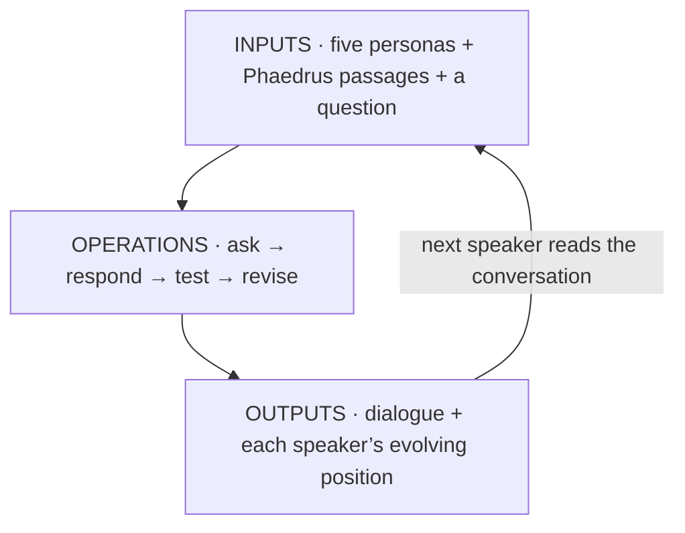

# A Socratic classroom: what counts as learning?

One question, five seats, four rounds. An **imagined Socrates** facilitates;
four fictional students arrive with different ideas about learning. Each
has a separate system prompt, reading packet and continuity memo. They
respond to one another, test examples, and can change their minds.

**[Enter the classroom](outputs/index.html)** ·
[Read the Markdown dialogue](outputs/conversation.md) ·
[Three places to pause](outputs/reading-notes.md)

| Seat | Starting claim |
|---|---|
| Socrates · facilitator | Ask for a definition, then test its limits. |
| Leonie | Learning means recalling something accurately. |
| Nico | Learning means using something in a new situation. |
| Iris | Learning means explaining why an answer is right. |
| Sam | Learning can include knowing how to use people, notes and tools. |

These are starting positions, not fixed personality types. The tutor has no
answer key. This is an authored contemporary dialogue inspired by the form
of Plato’s dialogues, not a historical reconstruction or a new text by Plato.

## Inputs → operations → outputs



**Inputs:** the [full *Phaedrus*](inputs/readings/phaedrus.md), copied from
the course context in Jowett’s translation; selected passages about writing,
memory and knowledge; five persona files; and three timed seminar prompts.
Each packet separates direct quotation, workshop interpretation and an
invented opening commitment. The [research papers from the first simulation](../inputs/papers/README.md)
remain the background for the agent design.

**Operations:** Socrates opens a round, then Leonie, Nico, Iris and Sam
speak. Each call receives only that participant’s private persona and memo,
two retrieved cards, the public roles, and the conversation so far. New
prompts introduce a memorized proof, a cook using a notebook, and a chatbot
that answers follow-up questions. Prompts appear at the start of rounds
two, three and four; participants do not see them early.

**Outputs:** twenty actual Claude-generated replies, as a Markdown dialogue
and a standalone HTML classroom. Click a seat to follow a voice; open a
turn to inspect its readings, citations and memo. Exact API requests and
responses accompany the transcript. Reading or replaying it needs no key.

## Try it with Claude Code

> Read `01-use-cases/simulation/02-socratic-classroom/CLAUDE.md`.
> Open the saved classroom dialogue. Follow one student’s definition across
> all four rounds: where did it change, and what prompted that change?
> Then help me add the chatbot I built as another student, run the dialogue
> again, and make a Markdown transcript and HTML page for comparison.

From the repository root, replay the saved example without API calls:

```bash
python3 01-use-cases/simulation/02-socratic-classroom/operations/run.py
```

To run a fresh conversation, use the same local key setup and dependency
as the first simulation:

```bash
python3 -m pip install -r 01-use-cases/simulation/operations/requirements.txt
python3 01-use-cases/simulation/02-socratic-classroom/operations/run.py --live
```

Live mode uses `ANTHROPIC_API_KEY` from the environment or the repository’s
ignored `.env`, with `claude-sonnet-5-5` by default (`--model` overrides it).
It creates a new `outputs/runs/<timestamp>-<id>/` containing both views,
run data and input snapshots. It does not overwrite the worked example.
API usage is billed separately from a Claude Code subscription.

## Add a student

Copy the [persona template](inputs/templates/persona.md) to
`inputs/personas/student.md` and the [knowledge template](inputs/templates/knowledge.md)
to `inputs/knowledge/student.md`. Give the student an initial claim, a
concrete example, and a reason they might revise it. Bring your earlier
chatbot’s voice and readings; it need not agree with this classroom’s premise.

```bash
python3 01-use-cases/simulation/02-socratic-classroom/operations/run.py --live \
  --add-persona inputs/personas/student.md
```

The runner keeps **four complete rounds**. Five participants make twenty
turns; adding a fifth student makes six participants and twenty-four turns.
Each person still speaks four times, and the seminar prompts move to the
start of the corresponding rounds. Added students speak at the end of each
round; edit the roster in `inputs/config.json` to explore a different order.

## Read the dialogue as a dialogue

- Find a definition, a counterexample and a revision. Does the revision
  answer the objection, or just change the wording?
- Is anyone merely agreeing with the tutor? Can a student challenge the
  question’s assumptions as well as its answers?
- Which examples require practical knowledge, verbal explanation or a tool?
  Does one criterion fit them all?
- What does the chatbot example leave unsettled about the very simulation
  you are reading?

The memos record performed changes of position. They are not measurements
of learning. All voices use one model; disagreement is authored and agreement
is not independent corroboration. Compare repeated runs before attributing
a difference to your new student alone.
