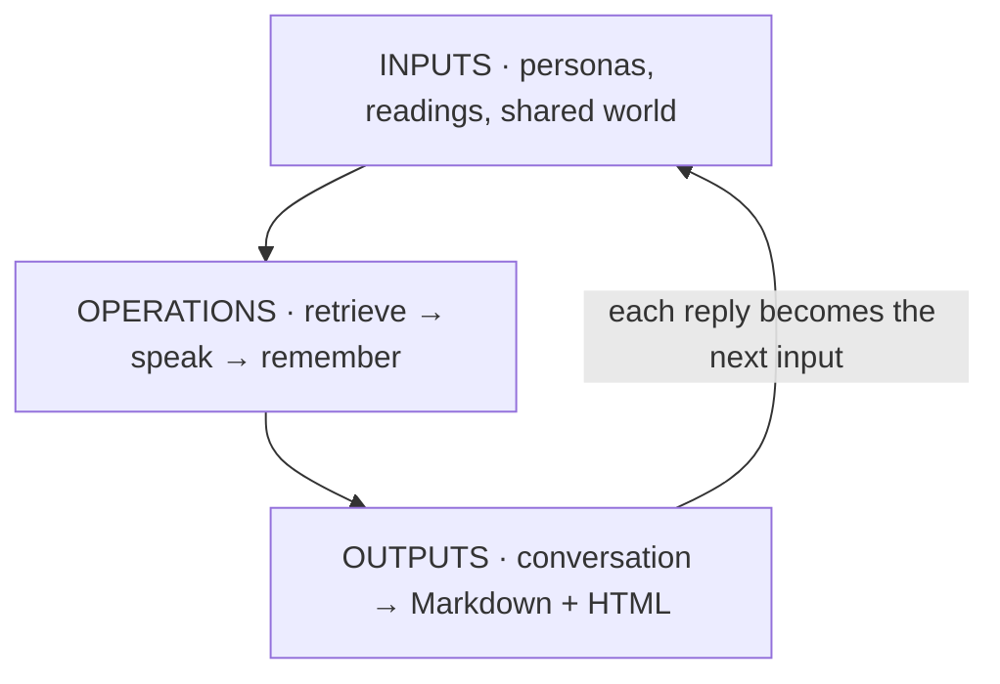

# Simulation: invite your chatbot into a room

Two rooms to try: **[The Common Room](outputs/index.html)**, a library
committee, and **[A Socratic classroom](02-socratic-classroom/README.md)**,
where an imagined Socrates and four students test what counts as learning.
Each has its own inputs, operations and outputs.

Last time, you made a chatbot from a **system prompt + retrieved knowledge**.
Now give several of those chatbots a shared world and let them respond to
one another. One speaker’s output becomes the next speaker’s input.

**[Open the HTML conversation](outputs/index.html)** ·
[Read the Markdown transcript](outputs/conversation.md)

Our example is a fictional library committee deciding whether to build an
AI oral-history exhibit. Four personas, twenty turns, two changes to the
situation. Each persona has its own Markdown prompt and reading packet.
The HTML lets you inspect the passages supplied on each turn, the passages
actually cited, and the short memo carried into that persona’s next turn.



## Try it in Claude Code

Open this repository and ask:

> Read `01-use-cases/simulation/CLAUDE.md`. Walk me through the saved
> conversation and show me how one persona’s prompt and knowledge shaped
> a reply. Then help me add the chatbot from our last activity and run
> another twenty-turn meeting. Make both a Markdown transcript and an HTML
> page, keeping the original example for comparison.

No API key is needed to read the saved example. To regenerate its two views,
run this from the repository root:

```bash
python3 01-use-cases/simulation/operations/run.py
```

## Add your chatbot to the room

1. Copy [`inputs/templates/persona.md`](inputs/templates/persona.md) to
   `inputs/personas/student.md`. Give it a unique `id`, a name, a public
   role, and your chatbot’s system prompt. Make its interests specific
   enough that it has something to contribute—or disagree about.
2. Copy [`inputs/templates/knowledge.md`](inputs/templates/knowledge.md) to
   `inputs/knowledge/student.md`. Add a few short passages from its earlier
   knowledge base. Include a source and a locator for each. The persona’s
   `knowledge` field points to this file, relative to `simulation/`.
3. Ask Claude Code to run the loop with your persona added. Or, with Python
   3.10+ and the `anthropic` package installed, use:

   ```bash
   python3 -m pip install -r 01-use-cases/simulation/operations/requirements.txt
   python3 01-use-cases/simulation/operations/run.py --live \
     --add-persona inputs/personas/student.md
   ```

Live mode uses `ANTHROPIC_API_KEY` from your environment or the repository’s
ignored `.env`. It defaults to `claude-sonnet-5-5`; `--model MODEL_ID`
overrides that. API usage is billed separately from a Claude Code
subscription. No key belongs in a persona, prompt, transcript or commit.

Each live run creates `outputs/runs/<timestamp>-<id>/`, containing
`index.html`, `conversation.md`, `conversation.json`, exact requests and
responses, and input snapshots. Open that run’s `index.html`. The saved
example stays intact. New runs are ignored by Git until you choose to share
one. **Twenty turns means twenty replies total**: five per original persona,
or four each if you add a fifth. Speakers take turns in roster order.

## What to look for

- Which proposal changes after someone speaks? Which ideas simply repeat?
- Does a source support the speaker’s claim, or just decorate it?
- What does your added persona make discussable? What disappears?
- Does the group agree suspiciously quickly? Try changing the order or
  giving one role a different goal. Run more than once before interpreting
  a difference; both the input change and model variability may matter.

The saved run abandons the first-person voice early, then narrows the scope
after the budget cut. Payment and event estimates remain unresolved. Those
open decisions give the next run concrete questions to pursue.

## From one bot to communities and worlds

The [research packet](inputs/papers/README.md) contains **four full papers
as structured, LLM-readable Markdown**. Park et al.’s *Generative Agents*
builds a small simulated town; Horton’s *Homo Silicus* explores economic
choices and a hiring scenario. *Role-Play* gives us language for describing
these performances; *RAG* supplies the retrieval background.

This workshop makes a small part of that design visible: multiple roles,
different knowledge, a shared history, memory, and changing conditions.
It uses keyword retrieval, a fixed speaking order, short continuity memos,
and one model with separate contexts for each persona. The research papers
provide more elaborate architectures to compare and extend. This run
explores the behavior of the roles and conditions specified in the inputs.

To level up, change one dimension: more people, competing goals, a different
language, a larger archive, a different turn order, or tools that change a
shared world. Start by making the small loop legible.
