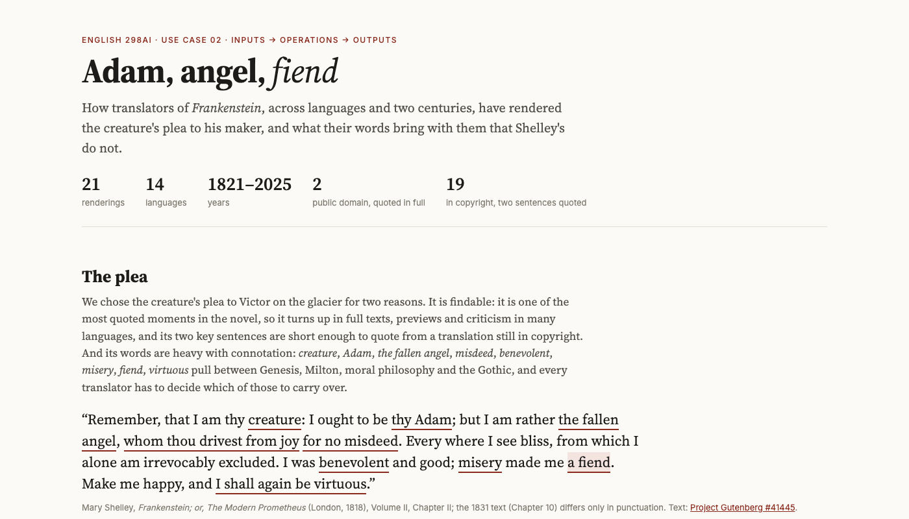
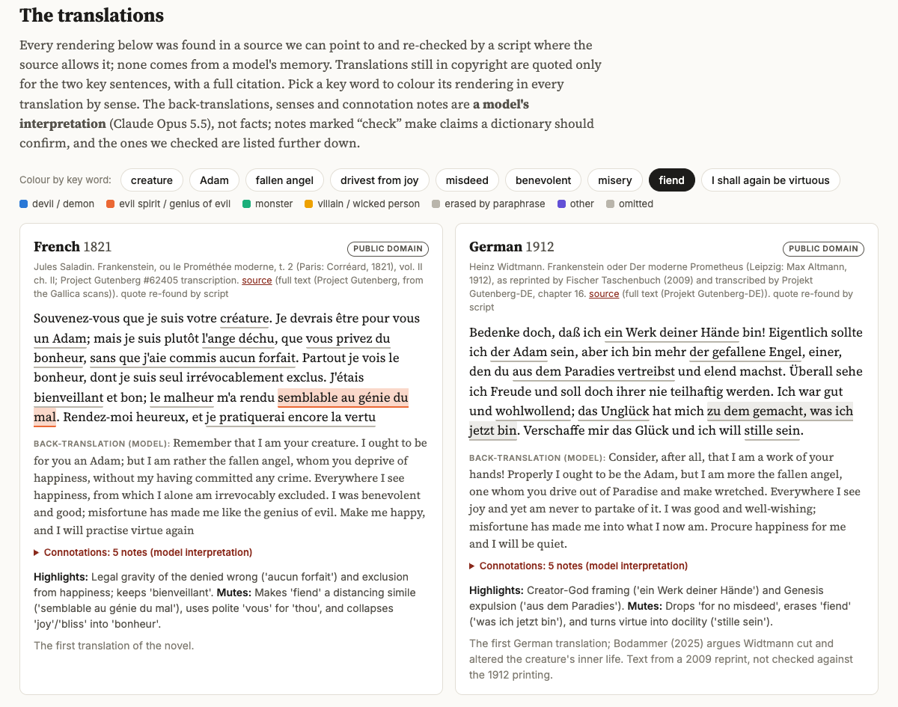
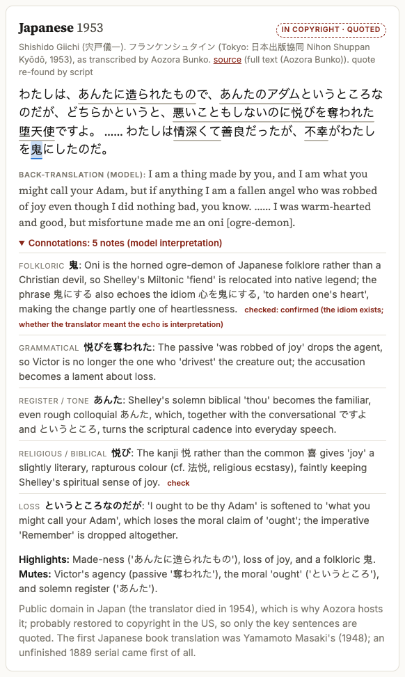
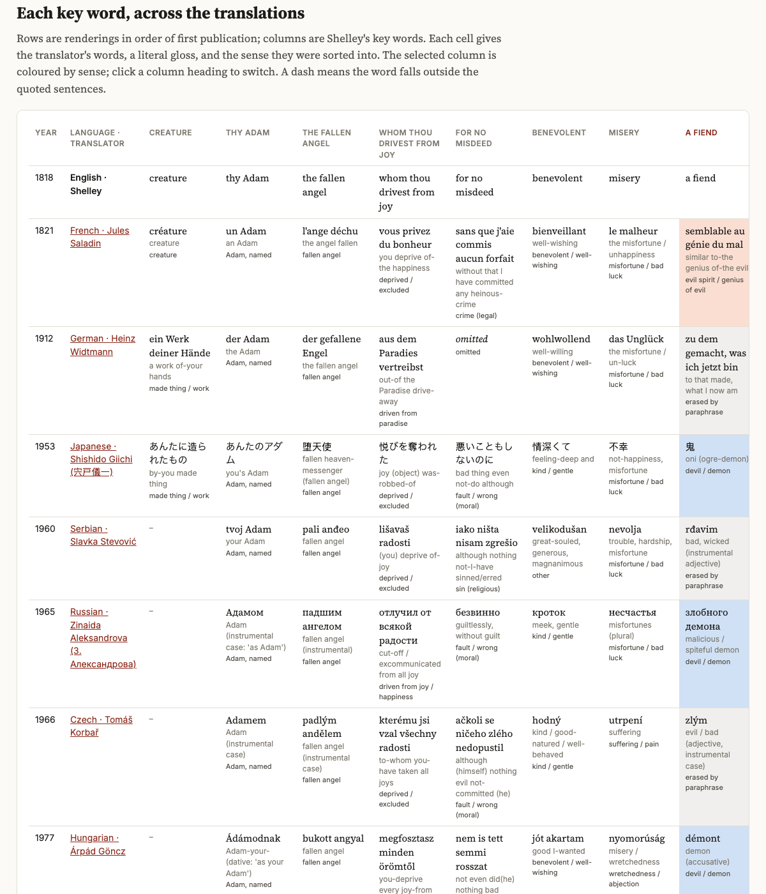
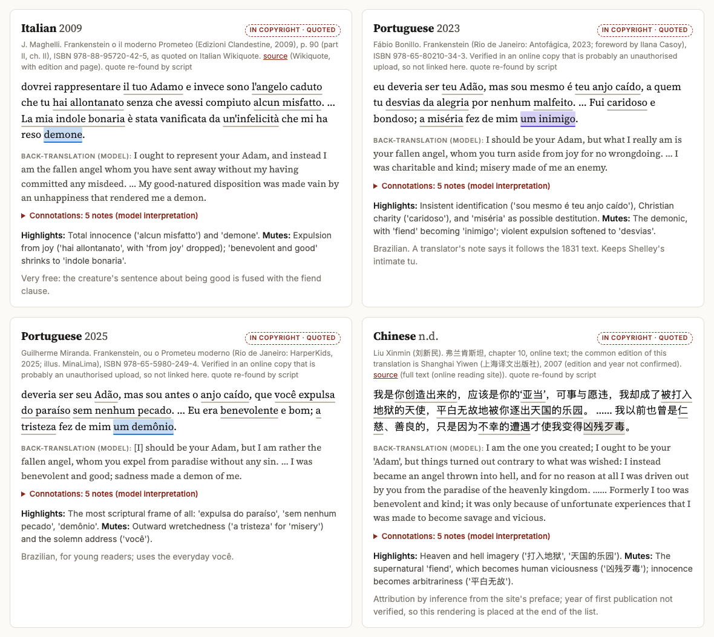
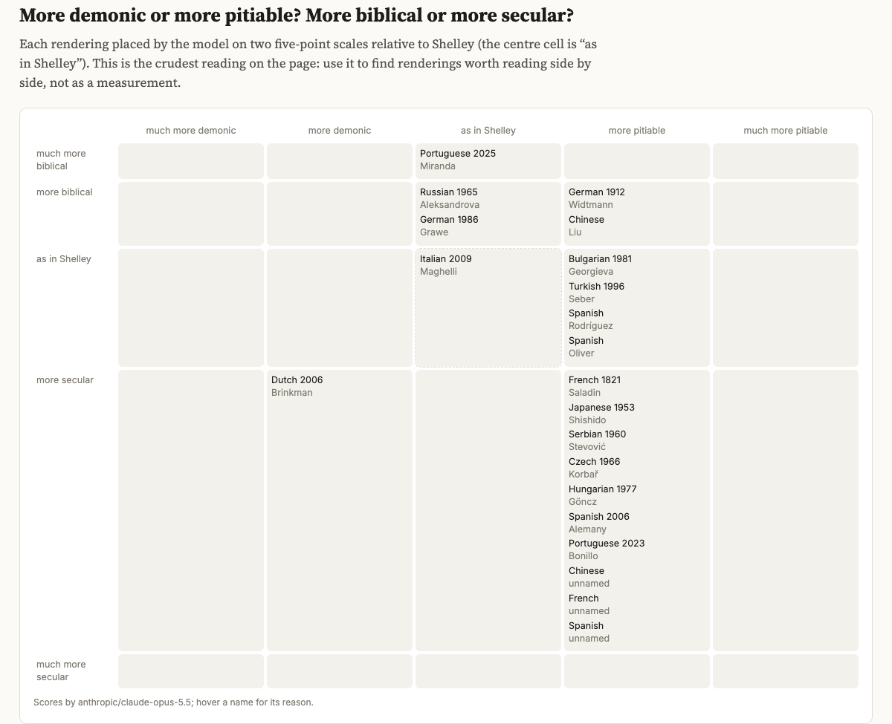
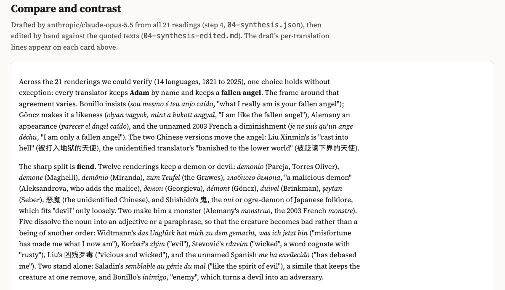
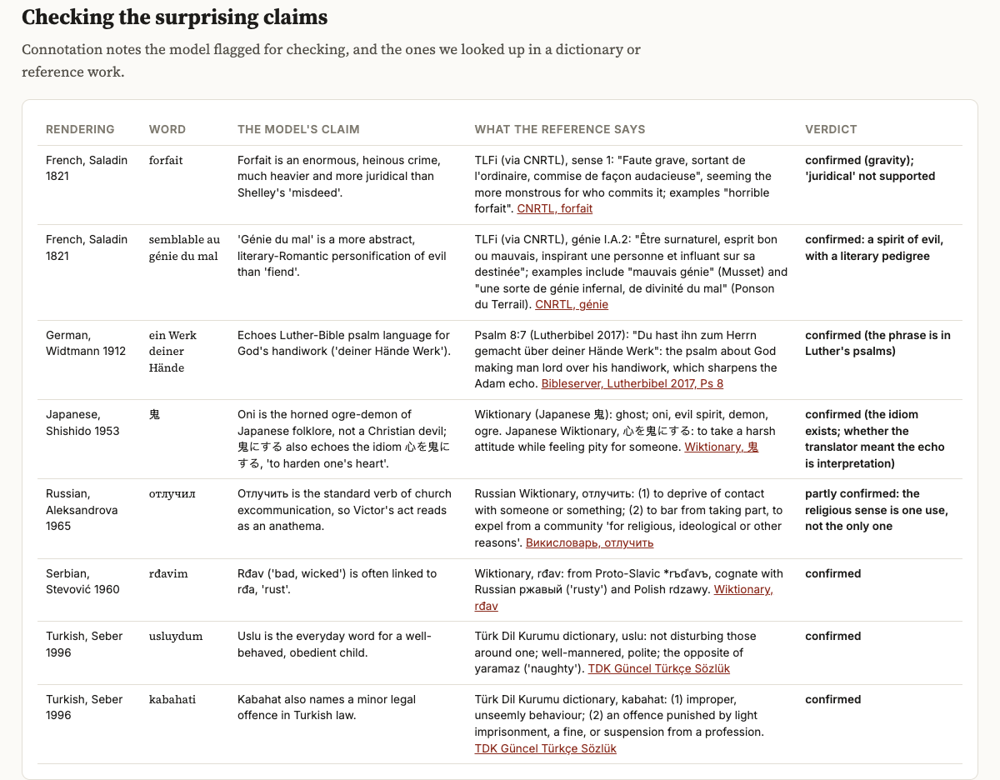
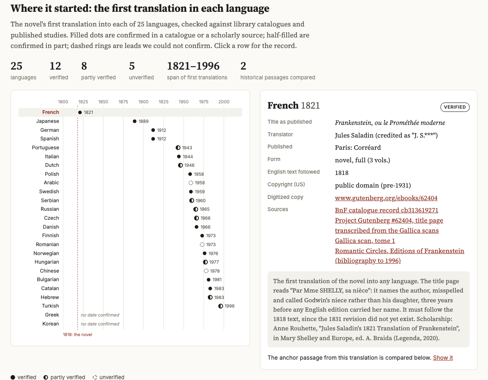
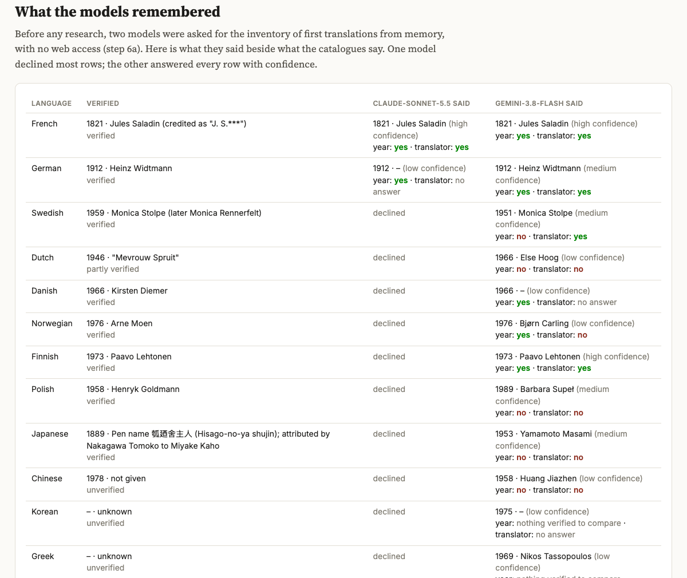

# Adam, angel, fiend: one plea in twenty-one translations

*How a small pipeline of searches, scripts, model readings and dictionary checks lays out what translators of Frankenstein did with "I was benevolent and good; misery made me a fiend", and what that pipeline can and cannot tell a reader.*

On the Mer de Glace, halfway through *Frankenstein*, the creature finally speaks to the man who made him. Before he tells his story he makes a short argument, one of the most quoted passages in the novel:

> Remember, that I am thy creature: I ought to be thy Adam; but I am rather the fallen angel, whom thou drivest from joy for no misdeed. Every where I see bliss, from which I alone am irrevocably excluded. I was benevolent and good; misery made me a fiend. Make me happy, and I shall again be virtuous.

That is the 1818 text (Volume II, Chapter II); the 1831 revision (Chapter 10) changes only the punctuation. Every translator of the novel has had to decide what to do with *Adam*, *the fallen angel*, *misdeed*, *benevolent*, *misery* and, above all, *fiend*.

The Frankenstein translations project is a worked example of comparing those decisions. It gathers 21 published renderings of the plea in 14 languages, from Jules Saladin's French of 1821 to Guilherme Miranda's Brazilian Portuguese of 2025. It verifies that every quotation exists where it says it does, asks a model to back-translate each one and say what its words carry in their own language, checks some of those claims in dictionaries, and draws the results as one web page: a card per translation, a matrix of key words, a grid of tendencies, and an edited synthesis. Below that, the page adds a researched inventory of the first translation of the novel into 25 languages, and a test of what two models remembered about that history before anyone looked it up.

This essay walks through the project as a seminar might: why this passage, how each step works and what kind of step it is, what the comparison shows, and where it is weak.



*The output page opens with its counts (21 renderings, 14 languages, 1821 to 2025; 2 quoted in full, 19 quoted for two sentences) and Shelley's plea with the key words underlined.*

# Why one passage, in many languages

*A translation comparison works best on a passage that is short, famous, and overloaded. The plea is all three.*

## Findable and loaded

The project's rationale, shown at the top of the page, gives two reasons for the choice. The first is practical: the plea is findable. It turns up in full texts, previews, reviews and criticism in many languages, which matters when the research has to locate a published translation rather than invent one. Its two key sentences are also short enough to quote from a translation still in copyright. So the page quotes the whole passage only from the two public-domain translations (Saladin's 1821 French and Heinz Widtmann's 1912 German) and only the two key sentences from the other 19, each cited to its printed edition.

The second reason is literary. The key words "pull between Genesis, Milton, moral philosophy and the Gothic, and every translator has to decide which of those to carry over." The creature argues from *Paradise Lost*, which he has read. He casts himself in two roles from it at once, the Adam his maker ought to cherish and the Satan his maker has made of him, and he claims both his innocence ("for no misdeed") and his transformation ("misery made me a fiend"). No translator can keep all of those threads at full strength. The project asks which ones they kept.

## The problem of "fiend"

"Fiend" is the hard word. In Shelley's English it is a devil or evil spirit, or by extension a cruel and wicked person. Its history goes further back: Old English *fēond* meant "enemy", and its German cognate *Feind* still does (Wiktionary, "fiend"). Few target languages have one word with the same spread. A translator chooses between a theological being (devil, demon), a creature of horror (monster), a moral quality (wicked, evil), or something else, and each choice shifts who the creature is and how much he is to blame. Most of the findings below turn on that hinge.

## Inputs, operations, outputs

Like the other worked examples for ENGLISH 298AI, the project has three folders. **Inputs** are the 1818 and 1831 English texts and Saladin's translation from Project Gutenberg, two Widtmann chapters from Projekt Gutenberg-DE, and the passages cut from the English by script. **Operations** are numbered steps: prompts, scripts, and the files they pass along. **Outputs** is one HTML page that opens without a server.

The syllabus describes the session's aim as making new kinds of analysis possible and "exposing assumptions that implementation forces us to specify." This project shows that second idea at work. To have a machine compare 21 translations, someone had to write down what counts as a rendering of "fiend", which senses a word may fall into, and what "more demonic" or "more secular" means. Those choices usually sit silently in a scholar's head. Here they sit in a file, where a reader can disagree with them.

# How the pipeline works

*Ten numbered steps, each labeled as code, model judgment, or verified research. The labels matter more than the models.*

The README labels every step by kind. That labeling is the most transferable idea in the folder.

| step | what it does | kind |
| --- | --- | --- |
| 0 | download public-domain texts; cut the passages by first and last words | code |
| 1 | find published renderings of the plea | research by agents, reconciled by hand |
| 2 | re-find every quotation in its source | code |
| 3 | back-translate, fill key-word slots, write connotation notes, score two scales | model judgment, checked by code |
| 4 | draft a synthesis across all 21, then edit it | model judgment, then hand editing |
| 5 | look up flagged claims in dictionaries | verified research |
| 6a to 6c | first translations: from memory, verified, compared | model memory, research, code |
| 7 to 9 | a second passage, the awakening | model points, code checks; model judgment |
| 10 | merge every data file into one page | code |

## Finding the renderings (steps 1 and 2)

The brief in `01-renderings-prompt.md` went to three Claude Code agents with web search, one per group of languages. Its central rule: "every quotation must be copied from a page you actually fetched or a snippet you actually saw, character for character, with its URL. Never supply a translation from memory or reconstruct one." A lead session reconciled their reports into `01-renderings.csv`, one row per rendering, with the translator, year, edition quoted, source, copyright status and how it was verified. The sources vary widely: full texts on Project Gutenberg or Aozora Bunko, national e-library PDFs, Wikiquote with an edition and page, a magazine excerpt, two book reviews, an essay quoting a translation with its page number, and online reading sites. Seven leads were dropped because their attribution was too weak, among them a Greek newspaper quotation with no translator named and a Korean line seen only in search snippets.

Step 2, `02-check-quotes.mjs`, is plain code. For each row it opens the local public-domain file or fetches the source now and searches it sentence by sentence, after folding case, quotation marks and whitespace. It decodes legacy encodings, HTML entities, Japanese ruby glosses and OCR line-end hyphens, and saves nothing it fetches, so no in-copyright page enters the repository. The results are honest about their limits: 17 rows found in full; three "not checkable by script" (two PDFs a script can't read, and a Serbian scan whose OCR is garbled); and the Dutch only partly found, one of two sentences.

## Reading each rendering (step 3)

Here a model does interpretive work, and the prompt constrains it. Claude Opus 5.5 receives Shelley's passage and one translation and must back-translate "as literally as readable English allows" ("Do not smooth it back toward Shelley"); fill nine key-word slots with the translator's exact words, a gloss, and a sense from a fixed list; write two to five notes on connotations the words carry *in that language*, flagging claims a dictionary should confirm; and score the rendering from -2 to 2 on two scales, demonic to pitiable and biblical to secular.

The fixed sense lists are the clearest example of an assumption made explicit. For "fiend" a rendering can be "devil / demon", "evil spirit / genius of evil", "monster", "villain / wicked person", "erased by paraphrase", or "other". The README says it plainly: "The sense lists and the scales are an interpretive scheme made for this page." One slot in `03-connotations.json`, for Saladin, looks like this:

```
"fiend": {
  "rendering": "semblable au génie du mal",
  "gloss": "similar to-the genius of-the evil",
  "sense": "evil spirit / genius of evil",
  "found": true
}
```

The `found` field is code's contribution: after the model answers, the script checks that every word it copied into a slot occurs in the quotation. Every filled slot passed. The model wrote 105 connotation notes and flagged 47 for checking.

## Synthesis, dictionaries, and cost (steps 4, 5 and 10)

Step 4 sends all 21 readings to the model in one call for a comparative note, a line per rendering on what it highlights and mutes, and a few striking contrasts, telling it to treat the readings as "evidence to weigh, not facts". The draft was then edited by hand against the quotations and the dictionary checks; the edit corrected a misquotation and a miscount. The page shows the edited version, and keeps the draft's per-rendering lines on the cards. In step 5, eight flagged claims were looked up in the TLFi, the Luther Bible, Wiktionary in three languages, and the Türk Dil Kurumu dictionary. The other 39 stay marked "check" on the page.

Step 10 merges every data file into the page. A shared client caches every model response and logs every live call. The log has 39 calls totaling $1.75: $1.38 for Claude Opus 5.5, $0.27 for Claude Sonnet 5.5, $0.10 for Gemini 3.8 Flash. The agents' web research (roughly 1.1 million tokens) ran under a subscription and is not in that log.

# What translators did with "fiend"

*Everyone keeps Adam and the fallen angel. Almost nobody keeps the same fiend.*

## The one point of agreement

The edited synthesis opens with the finding that holds without exception: all 21 translators keep **Adam** by name and keep a **fallen angel**. The frame varies. Fábio Bonillo's Brazilian Portuguese (2023) insists, *sou mesmo é teu anjo caído*, "what I really am is your fallen angel"; Árpád Göncz's Hungarian (1977) makes it a likeness, *olyan vagyok, mint a bukott angyal*, "I am like the fallen angel"; an unattributed French e-text of 2003 a diminishment, *je ne suis qu'un ange déchu*, "I am only a fallen angel". The Chinese text attributed to Liu Xinmin has an angel "cast into hell" (被打入地狱的天使).



*The cards for the two public-domain translations, coloured by the "fiend" key word: Saladin's "semblable au génie du mal" as an evil spirit, Widtmann's "zu dem gemacht, was ich jetzt bin" as erased by paraphrase.*

## Saladin's "spirit of evil"

Saladin's *Frankenstein, ou le Prométhée moderne* (Paris: Corréard, 1821), the first translation into any language, renders the key sentence *J'étais bienveillant et bon; le malheur m'a rendu semblable au génie du mal*: "misfortune has made me like the genius of evil." The noun becomes a simile, so the creature is not a fiend but *like* one, and the fiend becomes a spirit of evil. The dictionary check confirms the reading: the TLFi defines this *génie* as a supernatural being, "esprit bon ou mauvais", with examples such as "une sorte de génie infernal, de divinité du mal".

Saladin also makes the misdeed heavier: *sans que j'aie commis aucun forfait*. The model read *forfait* as an enormous crime, "much heavier and more juridical" than "misdeed". The TLFi confirmed half of that. Its first sense is a grave, out-of-the-ordinary fault, so the gravity holds, but nothing supports "juridical". The model was right about the force of the word and wrong about its register, and only a lookup could tell the two apart.

## Widtmann's disappearing fiend

Widtmann's German of 1912 (Leipzig: Max Altmann) is the first German translation, and the CSV notes Bodammer's argument (2025) that he cut and altered the creature's inner life. The plea, as transcribed from a 2009 reprint, supports it:

> Bedenke doch, daß ich ein Werk deiner Hände bin! Eigentlich sollte ich der Adam sein, aber ich bin mehr der gefallene Engel, einer, den du aus dem Paradies vertreibst und elend machst. Überall sehe ich Freude und soll doch ihrer nie teilhaftig werden. Ich war gut und wohlwollend; das Unglück hat mich zu dem gemacht, was ich jetzt bin. Verschaffe mir das Glück und ich will stille sein.

The fiend is gone: "misfortune has made me into what I now am." The claim of innocence is gone, replaced by *und elend machst*, "and make wretched". And "I shall again be virtuous" becomes *ich will stille sein*, "I will be quiet": a moral claim turns into a promise of docility. Yet Widtmann adds scripture where Shelley has none. "Thy creature" becomes *ein Werk deiner Hände*, and the dictionary step found the phrase in Luther's Psalm 8:7, "Du hast ihn zum Herrn gemacht über deiner Hände Werk". "Drivest from joy" becomes *aus dem Paradies vertreibst*, an expulsion that, as the model notes, belongs to Adam rather than the fallen angel, "so the two figures blur." Widtmann's creature is less demonic and more biblical at once, which is one reason a single demonic-to-pitiable score is too crude for this material.

## Shishido's 鬼

Shishido Giichi's Japanese (Tokyo, 1953), transcribed by Aozora Bunko, ends the key sentence 不幸がわたしを鬼にしたのだ: "misfortune made me an oni [ogre-demon]." The model's note says 鬼 is the horned ogre-demon of Japanese folklore rather than a Christian devil, so "Shelley's Miltonic 'fiend' is relocated into native legend", and that 鬼にする echoes the idiom 心を鬼にする, "to harden one's heart". Wiktionary confirms both, glossing the idiom as taking a harsh attitude while feeling pity for someone. The page's verdict is careful: the idiom exists, but "whether the translator meant the echo is interpretation."



*The Shishido card with its notes opened: one carries a dictionary verdict, another is still marked "check".*

The other notes show how a translation changes the plea's posture without changing its nouns. The passive 悦びを奪われた ("was robbed of joy") drops the agent, so Victor no longer drives the creature out. The familiar あんた replaces "thou". And "I ought to be thy Adam" becomes something like "what you might call your Adam", which "loses the moral claim of 'ought'". The inventory adds that Shishido's version, often called the first Japanese translation, was neither the first (an unfinished serial ran in 1889 and 1890) nor the first book (Yamamoto Masaki's, 1948).

## Twelve demons, two monsters, five adjectives, and an enemy

The synthesis sorts all 21 renderings of "fiend". Twelve keep a demon or devil: *demonio* (Alejandro Pareja Rodríguez and Francisco Torres Oliver, Spanish), *demone* (J. Maghelli, Italian), *demônio* (Miranda), *zum Teufel* (Ursula and Christian Grawe, German, 1986), *злобного демона* (Zinaida Aleksandrova, Russian, 1965, who adds "malicious"), *демон* (Zhechka Georgieva, Bulgarian, 1981), *démont* (Göncz), *duivel* (Sophie Brinkman, Dutch), *şeytan* (Yeşim Seber, Turkish), 恶魔 (an unidentified Chinese translation), and Shishido's 鬼. Two make him a monster: Silvia Alemany's *monstruo* and the 2003 French *monstre*. Five dissolve the noun: Widtmann; Tomáš Korbař's Czech *zlým*, "evil"; Slavka Stevović's Serbian *rđavim*, "wicked"; Liu's 凶残歹毒, "vicious and wicked"; and an unnamed Spanish ebook's *me ha envilecido*, "has debased me". Saladin's simile stands alone, and so does Bonillo:

> Fui caridoso e bondoso; a miséria fez de mim um inimigo.

"Misery made of me an enemy." The model reads this as a loss: the creature "becomes an adversary rather than a devil", and *o Inimigo*, a traditional Portuguese epithet for Satan, is "barely" evoked by the indefinite form. There is an irony the model did not mention. If Old English *fēond* meant "enemy", Bonillo's word reaches past Milton to the oldest sense of Shelley's own. Whether that was his reason the data cannot say.



*The key-word matrix: rows in order of first publication, a column per key word, each cell with the translator's words, a gloss, and the assigned sense.*

The matrix makes these choices scannable: down a column, the range of solutions to one problem; across a row, one translator's strategy. Stevović's row, for example, turns "for no misdeed" into *iako ništa nisam zgrešio*, "although I have sinned in nothing", a sin-word, while making the fiend a mild adjective. The dictionary step confirmed the odd fact the model raised about that adjective: *rđav* is cognate with Russian *ржавый*, "rusty". Corrosion, not damnation.

# Meekness, misfortune, and paradise

*Around the fiend, the translators tend to make the creature a wronged child rather than a self-made devil.*

## "Benevolent" and "misery"

Shelley's "benevolent" is a word from eighteenth-century moral philosophy: active good will toward others. Of the 20 renderings that include it, the model sorted only seven as "benevolent / well-wishing". Many move it toward meekness or a child's good behaviour: Aleksandrova's *кроток* and Georgieva's *кротък*, "meek", the word of the Beatitudes; Korbař's *hodný*, which the model calls "the usual word for a well-behaved child"; Seber's *uslu*, which the Türk Dil Kurumu dictionary defines as not disturbing those around one, the opposite of *yaramaz*, "naughty". The Spanish versions choose warmth (*cariñoso*, *afectuoso*), and Maghelli shrinks the pair to a temperament, *indole bonaria*.

"Misery" in Shelley is a state, the wretchedness that cruelty produced. Ten renderings were sorted as "misfortune / bad luck": *le malheur*, *das Unglück*, *la desgracia*, *несчастья*, *nevolja*, 不幸, and Georgieva's *злата участ*, "the evil lot". Only three keep wretchedness itself: Göncz's *nyomorúság*, Bonillo's *miséria*, Brinkman's *Ellende*. Göncz's line deserves a second look: *A nyomorúság faragott belőlem démont*, "It was misery that carved a demon out of me". In a novel about being made, the sculptor's verb is the kind of detail a close reader would want to test.

## Paradise added, misdeed moved

The most consistent move toward scripture is to name **Paradise** where Shelley has only "joy": Widtmann, the Grawes (*aus dem Paradies verstößt*), Miranda (*expulsa do paraíso*) and Liu (逐出天国的乐园). The secularizing moves cluster on **misdeed**. Three translators drop it. Four move the injustice from the creature's innocence to Victor's arbitrariness: the Grawes' *grundlos*, "without reason"; Brinkman's *op onredelijke wijze*, "unreasonably"; and the Chinese idioms 平白无故 and 无缘无故, "for no reason at all". Two make it a crime (Saladin's *forfait*, Alemany's *delito*), and only Miranda (*pecado*) and Stevović (*zgrešio*) make it a sin.

## Two Brazilians, two years apart

The page's first contrast sets two Brazilian translations side by side. Bonillo (Antofágica, 2023): *a quem tu desvias da alegria por nenhum malfeito … a miséria fez de mim um inimigo*, "whom you turn aside from joy for no wrongdoing … misery made of me an enemy". Miranda (HarperKids, 2025, for young readers): *que você expulsa do paraíso sem nenhum pecado … a tristeza fez de mim um demônio*, "whom you expel from paradise without any sin … sadness made a demon of me".



*Bonillo (top right) and Miranda (bottom left): same language, same decade, opposite choices.*

One secular adversary, one fully scriptural demon. Miranda's is the only rendering the model placed at the far biblical end of its scale. Even the address differs: Bonillo keeps an intimate *tu*, Miranda uses the everyday *você*. The pair is a good warning against any story in which period or language explains a translator's choices. So is a second contrast: within six years, Aleksandrova (1965) heightens the demon with an added "malicious", while Korbař (1966) and Stevović (1960) reduce it to a moral adjective.

## The grid, and why it is the crudest part



*Each rendering placed by the model on two five-point scales relative to Shelley. The page calls this "the crudest reading on the page".*

The grid's distribution says as much about the model as about the translators. On the demonic-to-pitiable axis the model gave 16 renderings a 1 ("more pitiable"), four a 0, and one, Brinkman's *duivel*, a -1. It never used the outer values, and on the biblical-to-secular axis it used an outer value only once, for Miranda. A five-point scale became, in practice, a three-point one, and the "more pitiable" column holds Seber's *şeytan* and Shishido's 鬼 beside Korbař's adjective *zlým*. The README and the synthesis both say so: use the scores to find renderings worth reading side by side, "not as a measurement."



*The edited synthesis as the page shows it: drafted by the model from all 21 readings, then edited by hand against the quoted texts.*

The synthesis concludes that 21 renderings, most languages with one or two and six undated, cannot carry claims about periods or national traditions, but that one tendency recurs: "translators more often make the creature a wronged child than a self-made devil." As a hypothesis to test against more translations, that is a good sentence. As a finding about translation history, it would claim too much.



*Eight flagged claims and what the reference works say: six confirmed, one partly, one confirmed for gravity but not for "juridical".*

# Where it started: the first translations

*The first translation came three years after the novel. For most languages, the first came more than a century later.*

## A late arrival

The lower half of the page asks when each language first got the novel. In step 6b, agents checked 25 languages against national library catalogues, WorldCat, digitized title pages and reception studies. The resulting `06b-translations-inventory.csv` has 12 rows verified, 8 partly verified, and 5 unverified, with first dates from 1821 to 1996; Greek and Korean have no date at all.



*One row per language by year: filled dots verified, half-filled partly verified, dashed rings unverified. The panel shows the record for Saladin's French.*

French came almost at once: Saladin's title page of 1821 reads "Par Mme SHELLY, sa nièce", naming the author (misspelled, and as Godwin's niece rather than daughter) three years before any English edition did. After that the dates are startling. Only four of the 23 dated languages got a first translation before 1940: French, Japanese (the 1889 serial), German and Spanish (both 1912). Twelve of the 23 got theirs in 1965 or later, from Russian (1965) to Turkish (1996).

"First" keeps needing qualification. The first Spanish translation appeared in Buenos Aires, not Spain (Luis Costarias, Biblioteca de La Nación, 1912). Brazil came before Portugal. The Dutch first is a 1946 Flemish pocketbook from Brussels, earlier than the 1968 translation most references give. Polish Wikipedia's 1925 date has no support in the National Library's records, so 1958 stands. The Danish first was abridged.

Why so late? This is interpretation, not a finding, but the inventory's notes point somewhere. Two Turkish books came before Seber's 1996 translation, and neither was the novel: one (1944) was built from the Universal films, and the other (1971), by its translator's later account, was novelized from a British film's dialogue list. The 1943 Brazilian first is subtitled *o criador e o monstro*, which the inventory says "may point to a popular or film-influenced version". In many languages, it seems, the story arrived through the cinema well before Shelley's book did. Testing that would need film release dates by country and a fuller search of serials and abridgements, which the inventory says it did not do.

## What the models remembered

Before any research, step 6a asked two models, with no web access, for the first translations from memory, with a confidence rating; step 6c compared the answers with the inventory by script.



*What Claude Sonnet 5.5 and Gemini 3.8 Flash said from memory, beside what the catalogues say.*

The two behaved in opposite ways. Claude Sonnet 5.5 answered only French (correctly) and German (right year, no translator), and declined the other 23. Gemini 3.8 Flash answered all 25, and of the 23 years that can be compared, got 10 right. Its confidence ratings are instructive. All six "high confidence" answers (French, Finnish, Catalan, Russian, Czech, Hungarian) matched on year and translator, though three of those rows are only partly verified on the research side. Its "medium" answers had the right year in two of nine cases, its "low" ones in two of eight. Some misses are near (Bulgarian 1980 for 1981), and some look like blends: for Japanese it gave "Yamamoto Masami", 1953, which reads to me like the first book translator's surname joined to the year of Shishido's later version. Model memory, in short, gives leads, and a confident answer and a correct one only sometimes coincide.

## A second passage

Two further sections use public-domain text. In step 7 a model only points: it returns the first and last words of the awakening scene in Saladin and Widtmann, and code cuts the translator's words out between them, so "the text we keep is always the translator's, never the model's paraphrase." Step 8 sorts every departure from Shelley into six categories: 13 for Saladin, eight of them "shift in meaning", and 12 for Widtmann, including three omissions. Shelley's plain "It was already one in the morning" becomes Saladin's *L'airain avait déjà sonné la première heure après minuit*, "the bronze had already struck the first hour after midnight", and her rain that "pattered dismally against the panes" becomes rain that *battait, avec un sifflement horrible*, "beat, with a horrible hissing". Step 9 adds a translate, critique, revise chain (Gemini translating, Claude Sonnet critiquing) so the model's French and German can stand beside the historical ones.

# Methods, findings, and adaptation

*The pipeline records the source checks and the interpretation attached to each passage.*

## Methods and findings

The README’s “Methods and findings” section records the interpretation choices, source coverage and unresolved checks.

- **The model's readings.** Back-translations, senses, notes and scores are interpretations. Some notes are speculative; the README names a Lermontov echo in Russian *демон* and a 2011 political ring for Brazilian *malfeito*. Of 47 flagged claims, eight were checked, and those eight produced one partial confirmation and one split verdict, leaving 39 claims without a recorded check. Even a correct note can drift from what a word *can* mean to what a translator *meant*: the page marks that line for 鬼, but not for every note.
- **Dates and names.** Six renderings are undated; three texts name no translator; Liu Xinmin's name rests on a reading site's preface page. Maghelli's Italian was checked only against Wikiquote, the Grawes' against a magazine excerpt, Brinkman's against two reviews that never show "benevolent", Seber's against an essay. Widtmann's text comes from a 2009 reprint not checked against 1912.
- **Transcriptions.** Most in-copyright quotations come from OCR or PDF text. Aleksandrova's Russian has an OCR slip where a comma belongs; Stevović's Serbian was read from a scan's text layer. Check page images before quoting in print.
- **Sources.** Seven renderings were checked against uploaded copies. The page cites the printed editions; the research records retain the source locations used for those checks.

## Adapting the pattern

The project is a template for a common humanities question: how has a loaded text been carried into other languages or forms, and what did each carrier choose? A student could swap in another passage, author, or kind of rewriting (abridgements, children's editions, subtitles). What transfers is less the code than the habits:

- **Choose a passage that is findable and overloaded.** A passage nobody quotes defeats the search; one with no hard words makes a dull matrix.
- **Separate finding from reading.** Research may not translate and the reader may not find. Quotations come only from fetched sources, and a script re-finds them, so each card distinguishes source wording from the model's interpretation.
- **Write the scheme down.** The sense lists, scales and categories are where the assumptions live. Expect to spend real thought on them, and expect a classmate to propose better ones.
- **Let code check what code can check:** slots against quotations, quotations against sources, passages cut between words a model pointed to. That doesn't make an interpretation right, but it removes silent misquotation.
- **Check the surprising claims, and say which you didn't.** Expanding the dictionary table from eight of 47 is the most valuable addition a student could make, and it needs no code: a dictionary, a concordance, a reader of the language.
- **Edit the synthesis, and treat memory as leads.** The draft had errors; the edit is part of the record. Asking a model from memory and then checking it is a small study of the tools in itself.

Adding a rendering takes a row in `01-renderings.csv` with its exact quotation and source, then rerunning steps 2, 3 and 4 and re-editing the synthesis. With the cache, unchanged steps cost nothing.

What the project produces is not a verdict on any translator. It is a well-lit table. Every translator faced the same eight words, and the page shows in one place that Saladin made the creature like a spirit of evil, Widtmann made him quiet, Shishido made him an oni, Bonillo made him an enemy, and Miranda a demon expelled from paradise. Why they chose as they did remains a question for a reader who knows the languages, editions and periods. The pipeline's job is to make that reader's questions sharper and better sourced, and to show its own uncertainty along the way.
