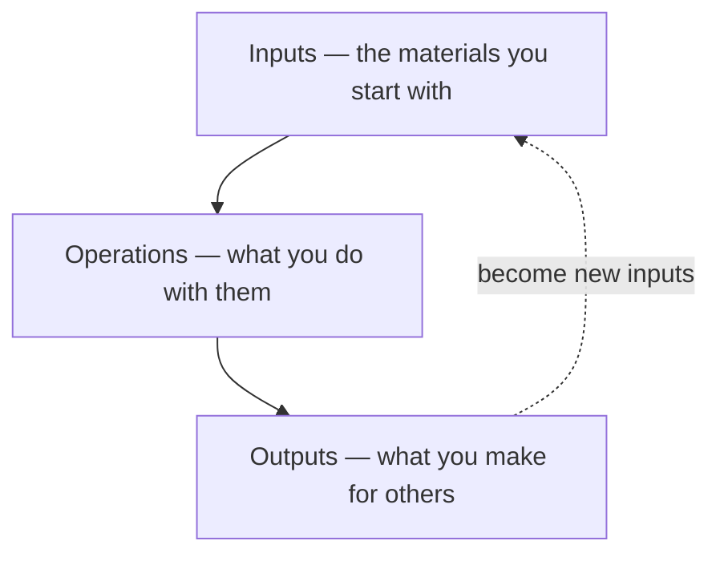

# AI Humanities Lab: Claude Code & vibe coding

**ENGLISH 298AI · Seminar 9 · November 3, 2026 · Bok Center Learning Lab**

An introduction to Claude Code and *vibe coding* for the humanities: describe
what you want in plain language, have Claude build it with you, then inspect,
test, and revise the result. You don't need programming experience to start.

## A familiar shape

Use this simple mental model to plan your work:



Humanists have worked this way for years. **Inputs** are the books and articles
you read. **Operations** happen in your notebook: pulling out quotations,
putting down thoughts, taking notes in lecture or seminar, making connections.
**Outputs** are the papers, articles, and books you produce for others to read.
Those outputs become someone else's inputs—or your own next starting point.
An ouroboros of reading, thinking, and making.

That familiar shape is a heuristic and a guide for working with Claude. You
can keep the same readings, notebook, and paper, using Claude to **organize,
sort, and search**. Or you can **level up any part of the process**:

| Part | What could change? |
|---|---|
| **Inputs** | **Scale and language:** work across a collection of texts; explore material in another language with translation support. |
| **Operations** | **Tools and loops:** build a search tool, compare passages, or save a process to repeat on each new batch of material. |
| **Outputs** | **Form:** make an annotated edition, interactive map, searchable archive, or small app. Feed it into the next round of work. |

The workshop use cases demonstrate these possibilities. You still choose
the question, check the evidence, and decide what is worth sharing.

## Start here

1. [Download the ZIP](https://github.com/ll-26-27/eng298ai-20261103/archive/refs/heads/main.zip)
   and unzip it, or clone the repository:

   ```sh
   git clone https://github.com/ll-26-27/eng298ai-20261103.git
   cd eng298ai-20261103
   ```

2. Open the folder in Claude Code. See the
   [setup guides](resources/handouts/setup-checklists/code-ide/) if needed.
3. Go straight to the use cases in [`01-use-cases/`](01-use-cases/README.md).

## What's here

| Folder | Contents |
|---|---|
| [01-use-cases/](01-use-cases/README.md) | Start with translation: a French source, a prompt chain, and an interactive bilingual HTML page. |
| [02-your-project/](02-your-project/) | Your workspace: `inputs/`, `operations/`, and `outputs/`. |
| [context/](context/README.md) | Shared context pack from `eng-298ai-context`: full-text course readings and AI papers, plus reading notes, in Markdown. |
| [resources/](resources/README.md) | Glossary, setup guides, and handouts adapted from the desktop-app workshop. |

Keep source material in `inputs/`, reusable prompts and scripts in `operations/`,
and results in `outputs/`. The files preserve your work across conversations.
Treat the shared `context/` pack as read-only; save your work in your project.

If a project needs API keys, keep them in a local `.env` file. Git ignores this
file; don't paste keys into prompts or other project files.
