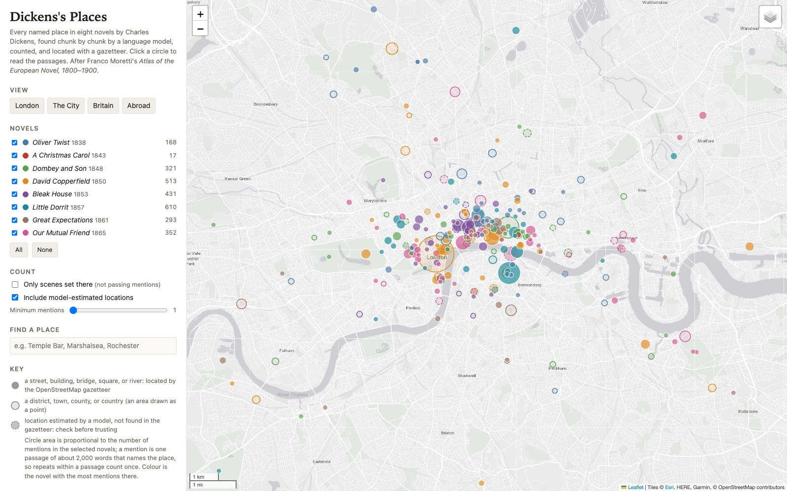
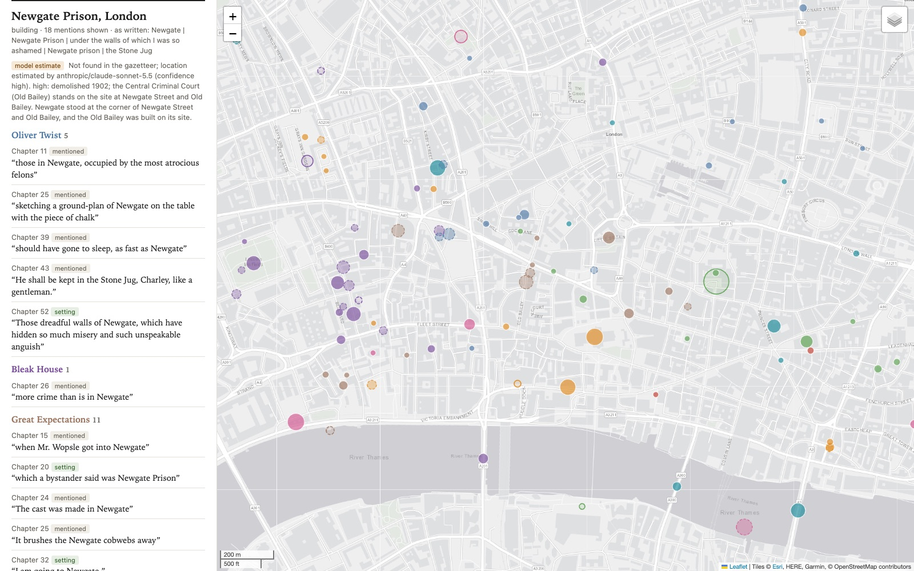
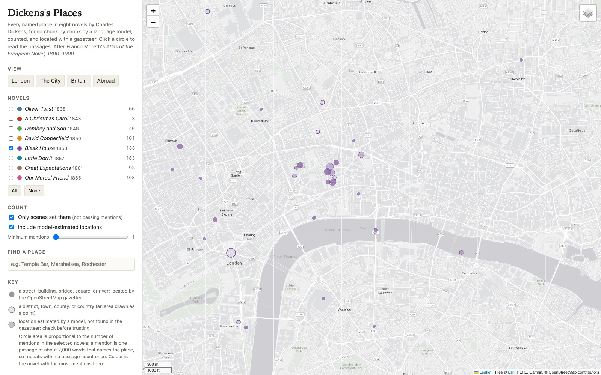
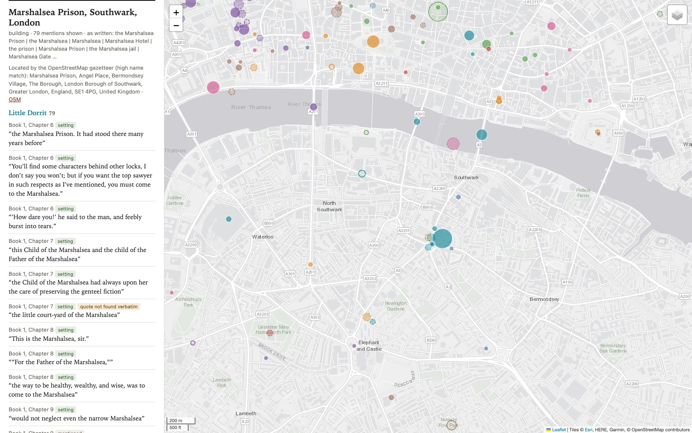
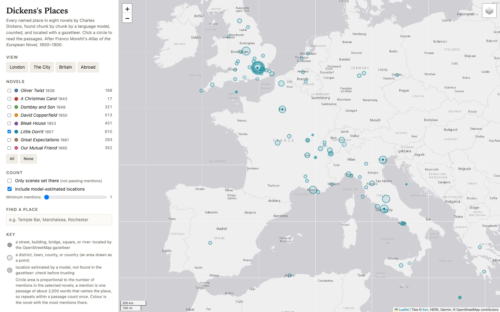
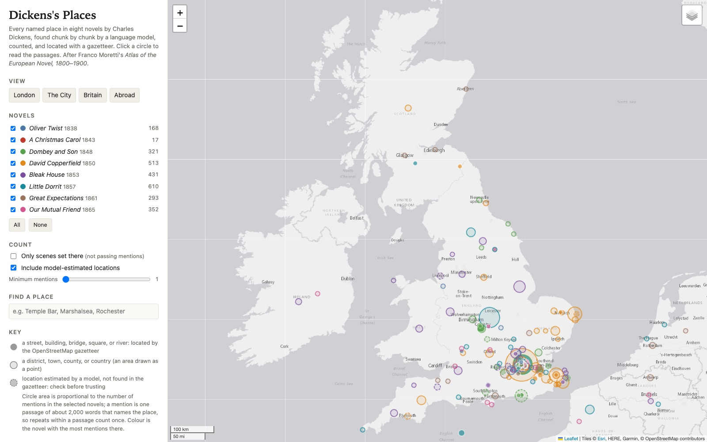
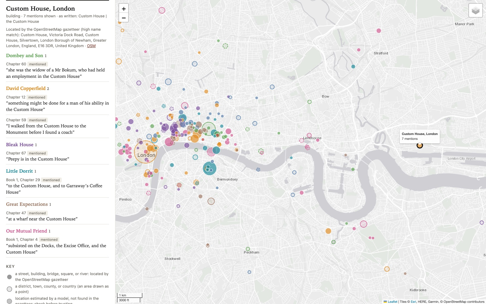
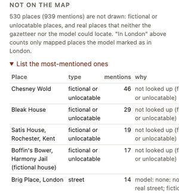

# Dickens's Places: a map after Moretti, made in a morning

*Eight novels, 1,290 passages, 3,644 mentions of 1,116 places, and about a dollar and a half of model calls. An essay on what a language model and a free gazetteer can do with Franco Moretti's question about where novels happen, what the resulting map shows, where it misleads, and which assumptions had to be written down before any of it could run.*

This essay is about one of six worked examples prepared for ENGLISH 298AI, *AI Humanities Lab*, for its November 3, 2026 session, "Introduction to vibe-coding." The example lives in `mk-projects/01-dickens-places-map/`. Its inputs are eight Dickens novels from Project Gutenberg, *Oliver Twist* (1838) to *Our Mutual Friend* (1865). Its operations are a short chain of numbered prompts and scripts, each leaving a file behind. Its output is one web page, `outputs/index.html`, that opens with a double-click and maps every place the novels name.

*The output page as it opens. Each circle is a place; its area grows with the number of passages that name it, its colour is the novel that names it most, and dashed circles are locations a model estimated.*

The numbers in the sidebar (168 for *Oliver Twist*, 610 for *Little Dorrit*) count mentions of mapped places. The rest of this essay is about where such numbers come from, which are solid, and which are artefacts of decisions made along the way.

# The question: where does a novel happen?

*Moretti's wager was that a map is not an illustration of a novel but a question put to it. The question here is the simplest one he asked: which places do these novels name, and how are those places distributed?*

## Moretti's atlas

Franco Moretti's *Atlas of the European Novel, 1800–1900* (Verso, 1998) maps where nineteenth-century novels take place. Its publisher describes it as revealing "the secret structure of Dickens's and Conan Doyle's London." The book belongs to the line of work Moretti later called distant reading: instead of reading one text closely, you reduce many texts to a model (a graph, a tree, a map) and look at the shape that only appears when the texts are seen together. A map of a novel's places does not say what any scene means. It shows where the novel's attention goes, which parts of a city it lives in and which it never enters, and how that differs between novels, and those patterns send you back to the text with a sharper question.

Dickens is a natural test case. His London is crowded with streets, courts, inns, and prisons a reader could walk to, and also with invented places (Bleak House, Chesney Wold, Satis House, Tom-all-Alone's). A map has to deal with both, and with the fact that much of the real London he named has since been demolished or renamed.

## What changes when one person can do it

Work of this kind used to take a team, or years: someone had to read every page, record every place, decide what counts as one, and find each on a map. The worked example compresses that to a morning. The README reports that the model extraction took about ten minutes and the gazetteer lookups about twenty, and the model calls cost about $1.55 in all, logged line by line in `operations/cost-log.csv`.

That compression is the point of the exercise and also its danger. A map made in a morning is much rougher than one made over years, and the README says so. But the speed changes what kind of object the map is: not a finished result but a draft that can be rerun with a different prompt, a different definition of "place," or different novels, and compared. In the syllabus's terms, the value lies partly in "exposing assumptions that implementation forces us to specify," and partly in giving an idea a form that readers can explore.

# The pipeline, step by step

*Inputs, operations, outputs. Each operation is either deterministic code (same input, same output, every time), model judgment (a language model reading and deciding), or a check on one of the others. Knowing which is which is most of what it takes to trust the result.*

## The chain at a glance

| step | file | kind | what it produces |
| --- | --- | --- | --- |
| 0 | `00-fetch-texts.mjs` | code | the eight Gutenberg texts, unchanged |
| 1 | `01-clean-and-chunk.mjs` | code | 1,290 chunks of about 2,000 words, each labelled by novel and chapter |
| 2 | `02-extract-places.prompt.md` + `.mjs` | model judgment | 3,700 raw place entries as JSON |
| 3 | `03-inventory.mjs` | code + check | 3,644 mentions, 1,116 places, quotations checked |
| 3b | `03b-recall-check.mjs` | check | a list of names the model may have missed |
| 4 | `04-geocode.mjs` | lookup + check | coordinates from OpenStreetMap's Nominatim, or "unresolved" |
| 4b | `04b-geocode-model-help.mjs` | model judgment | estimated locations for the gazetteer's failures, with confidence |
| 5 | `05-map-design.prompt.md` | design brief | what the map should make visible |
| 6 | `06-build-map.mjs` + template | code | `outputs/index.html` |

## Steps 0 and 1: fetch and chunk (code)

The texts are kept exactly as downloaded from Project Gutenberg. Step 1 strips Gutenberg's front and back matter, finds the chapter headings with a regular expression (including *A Christmas Carol*'s "STAVE" and the "BOOK THE FIRST" divisions), and cuts each chapter into chunks of about 2,000 words at paragraph breaks.

Chunking looks like plumbing, but it is what makes the project auditable. The script's comment puts it plainly: "Asking a model to 'list every place in Bleak House' in one go is brittle and impossible to audit. Small chunks guarantee that every page of every novel is read." Every place found later carries the id of its chunk, so any circle on the map can be traced to a passage.

## Step 2: find the places (model judgment)

This is the one step where a model reads Dickens. For each of the 1,290 chunks, `anthropic/claude-haiku-5.5` received the same prompt, which defines a place as "anything that could, in principle, be put on a map," and returned, for each place, seven fields:

- `as_written`, the name exactly as it appears ("Smiffeld", "Lunnun");
- `normalized`, a modern name to search for ("Smithfield, London");
- `type`, from a fixed list: street, square or park, district, building, bridge, river or water, town, region, country, or fictional;
- `role`, either `setting` ("characters are there or the action happens there in this passage") or `mentioned`;
- `in_london`, true, false, or null;
- `quote`, "copied exactly, character for character," no more than 25 words;
- `note`, for anything a human should look at.

The answer had to match a strict JSON schema, so the model could not drift into prose or invent a category. Calls used temperature 0 and are cached, so a rerun costs nothing.

The prompt also carries a small theory of what a place is. Include figures of speech ("as much mud as … up Holborn Hill" counts); list a place once per passage; mark invented places `fictional` "even if a real place may have inspired them"; and exclude "institutions used only as institutions ('the Court of Chancery' as a legal body is not a place; 'Lincoln's Inn Hall' where the court sits is)." Each rule is an interpretive decision.

## Step 3: inventory and check (code)

Step 3 checks each quotation against its chunk (ignoring curly quotes, dashes, spacing, and case), merges entries for the same place using the part of the normalised name before the first comma, so "Cook's Court" and "Cook's Court, Cursitor Street" become one row, and counts mentions per place, novel, and chapter. The 3,700 raw entries become 3,644 mentions of 1,116 distinct places, and 3,606 of the quotations were found verbatim. The top rows of `03-places-inventory.csv`:

| place | type | mentions | set there | novels |
| --- | --- | --- | --- | --- |
| London | town | 244 | 59 | 8 |
| England | country | 81 | 0 | 7 |
| Marshalsea Prison, Southwark | building | 79 | 47 | 1 |
| City of London | district | 77 | 19 | 8 |
| Chesney Wold | fictional | 46 | 19 | 1 |
| Canterbury, Kent | town | 35 | 12 | 3 |
| Great Yarmouth, Norfolk | town | 34 | 17 | 2 |
| Paris, France | town | 32 | 4 | 7 |
| Temple, London | building | 31 | 21 | 4 |
| Bleak House | fictional | 29 | 15 | 1 |

## Step 3b: what did the model miss? (check)

Failures of omission are invisible in a model's output, so step 3b is a crude, independent audit. A regular expression finds capitalised names ending in a place word (Street, Square, Court, Inn, Gate, and so on) and asks whether the model listed each. Of 531 such names, the model had listed 500 (94 percent). The 31 misses are mostly courts in the legal sense ("Prerogative Court", "Admiralty Court"), which the prompt said to skip, or pattern false alarms ("As Miss Abbey", "Money Market"); a few are real, such as "Marshalsea Gate" in *Little Dorrit* and "Stepney Fields" in *Our Mutual Friend*. Recall for single-word places such as towns was not measured.

## Step 4: find the coordinates (lookup, with a check)

Each real place is looked up in OpenStreetMap's Nominatim gazetteer, once a second at most and cached, as its usage policy asks; London places are searched inside a box around Victorian London, and places in a British county only in Britain and Ireland. The key decision is what the script refuses to do: a result is accepted only if its name contains the words of the place's name and it is the right kind of feature (a road for a street, a settlement for a town). Otherwise the place stays unresolved. The rejections show why. For "River Thames" the gazetteer's best match was a statue, "George III and the River Thames," in a courtyard off the Strand. For "Brighton, Sussex" it returned the Royal Sussex County Hospital. For "West Indies" it returned a ward in Kenya, for "British Empire" an address in Nuremberg, and for "Russian Empire" a statue of a soldier in Kaliningrad Oblast. All of these were rejected. Of the 1,116 places, 496 were located by the gazetteer, 131 were not looked up because the model had called them fictional, 321 got no result, and 78 got a result that failed the check.

## Step 4b: ask a stronger model about the failures (model judgment, labelled)

For unresolved places mentioned at least twice, step 4b asks `anthropic/claude-sonnet-5.5`, as "a historical geographer," where each was "in Dickens's time (roughly 1830-1870)," with a confidence level and a one-sentence reason. It returned answers for 154 places: 50 high-confidence answers, 40 medium, 48 low, and 16 "none." Only high and medium answers are mapped, drawn dashed and labelled "model estimate". This is where demolished London comes back: Newgate Prison ("demolished 1902; the Central Criminal Court (Old Bailey) stands on the site"), the King's Bench Prison, Barnard's Inn, Symond's Inn, Cook's Court.

*The gazetteer found no Newgate Prison, so its location is a model estimate, labelled as such, with the model's stated reason. The passages beneath come from three novels, including "He shall be kept in the Stone Jug, Charley, like a gentleman," which the model correctly read as Newgate.*

## Steps 5 and 6: decide what the map should show, then build it

Step 5 is a short design brief, written before the map, listing what it should make visible: which parts of London each novel lives in; settings versus passing mentions; "how sure we are," with model estimates drawn differently and unlocated places listed rather than dropped; and the evidence behind every circle. Areas should look lighter than points, "because a circle for 'Southwark' means something different from a circle for 'the Marshalsea'." Step 6 pours the data into a Leaflet template as one self-contained page. The brief ends with the two right questions: "Are the clusters about Dickens's London, or about which places the gazetteer could find?" and "Does counting mentions measure importance?"

# What the map shows

*Some findings drawn from the data, with the caveat that each is a count of passages produced by a model and a gazetteer. Read them as leads to take back to the novels, not as conclusions.*

## London first, and the City at its centre

London is named in 244 of the 1,290 passages, in all eight novels, across 189 chapters. The City of London, the old square mile of trade and finance, is named in 77 passages, and in all eight novels too. Asked to mark each mention as in London or not, the model put 1,813 of the 3,644 mentions (about half) in London, and the share varies by novel:

| novel | mentions | distinct places | model marked in London | marked as setting |
| --- | --- | --- | --- | --- |
| *Oliver Twist* | 211 | 126 | 65% | 42% |
| *A Christmas Carol* | 22 | 18 | 68% | 18% |
| *Dombey and Son* | 463 | 207 | 42% | 22% |
| *David Copperfield* | 637 | 230 | 44% | 33% |
| *Bleak House* | 664 | 251 | 49% | 33% |
| *Little Dorrit* | 704 | 278 | 48% | 30% |
| *Great Expectations* | 445 | 191 | 49% | 36% |
| *Our Mutual Friend* | 498 | 238 | 61% | 32% |

Setting aside the short *Christmas Carol*, the most London-bound novels by this measure are the first and the last, *Oliver Twist* and *Our Mutual Friend*. The middle novels spread further: *Dombey and Son* to Brighton (22 of Brighton's 24 mentions), *David Copperfield* to Yarmouth, Canterbury, and Dover, *Little Dorrit* to the continent. A reader might sense this; here it is counted. (The page's own table gives lower London shares because it counts only mapped places.)

Landmarks behave differently from settings. St Paul's Cathedral is named in 28 passages across seven novels but is a setting in only two of them. The Bank of England is named in 17 passages across six novels and is never a setting. My interpretation: these are places the novels steer by rather than enter, and the setting/mention distinction is what makes that visible.

## Each novel has its own London

The most interesting view is one novel at a time, with "Only scenes set there" switched on. *Bleak House* then collapses into a small, dense knot around Chancery Lane: Lincoln's Inn (11 setting passages), Cook's Court (11), Chancery Lane (9), Lincoln's Inn Fields (7), Symond's Inn (6), Thavies Inn (5), Cursitor Street (5). The novel opens "London. Michaelmas term lately over, and the Lord Chancellor sitting in Lincoln's Inn Hall," and the map shows how rarely it leaves that quarter when it is in London at all.

*Only* Bleak House, *only scenes set there. The legal quarter around Chancery Lane and Lincoln's Inn is almost the whole of the novel's mapped London. Chesney Wold, Bleak House itself, and Tom-all-Alone's are fictional and appear nowhere on the map.*

The other novels have their own signatures. In *Great Expectations*, London settings are Barnard's Inn (8), the Temple (8), Little Britain where Jaggers has his office (7), Walworth where Wemmick lives (4), and Newgate (3). In *David Copperfield* they include Doctors' Commons (11), Buckingham Street (6), the King's Bench Prison (5), and Highgate (5). *Our Mutual Friend* has the Temple (10), the Six Jolly Fellowship Porters (8, the riverside pub), Duke Street (7), and St Mary Axe (5). *Oliver Twist* is the most scattered: no London place is set in more than three passages, and the list runs through the Three Cripples, Saffron Hill, Field Lane, Clerkenwell, Islington, St John's Road, and Pentonville, several of them stops on the way by which the Dodger brings Oliver into the city.

## The Marshalsea

One place dominates a single novel more than any other. The Marshalsea Prison is named in 79 passages of *Little Dorrit*, and in no other novel; 47 are settings. The novel places it precisely in Book 1, Chapter 6: "Thirty years ago there stood, a few doors short of the church of Saint George, in the borough of Southwark, on the left-hand side of the way going southward, the Marshalsea Prison." Clicking the circle opens a panel of quotations that begins in that chapter, with the model's chosen words from that sentence and the next: "the Marshalsea Prison. It had stood there many years before."

*The Marshalsea, in Southwark, with the evidence for the circle beside it. The gazetteer found it because OpenStreetMap records the site by name. Note the third quotation, which does not contain the word "Marshalsea" at all.*

The panel shows something else too. Among the names the model treated as the Marshalsea are "the prison," "the Marshalsea Hotel," and, in at least one passage, a quotation that does not name it at all: "'How dare you!' he said to the man, and feebly burst into tears." The quotation is real and verified, but it is evidence for the Marshalsea only if you already know the scene is set there. Verification proves the passage exists, not that it names the place.

## Abroad

Switch to "Abroad" and *Little Dorrit* again stands apart. It names Rome in 21 passages, Venice in 17, Marseille in 16, Italy in 15, and Paris in 14. Marseille is where the novel opens ("Thirty years ago, Marseilles lay burning in the sun, one day"), and Book 2 takes the Dorrits on their travels through Switzerland and Italy.

*Only* Little Dorrit, *zoomed to Europe. The continental journey of Book 2 is the clearest non-London shape in the whole set.*

Paris is the most widely spread foreign place, named in seven of the eight novels. India is named in 25 passages across six novels and China in 22 across five, never as settings. On my reading, empire and trade are present as places people come from or make money in, not places the novels go.

## Britain

The Britain view shows how much of the non-London geography belongs to *David Copperfield*: 32 of Canterbury's 35 mentions, 33 of Great Yarmouth's 34, 20 of Dover's 24. Those are the novel's other homes: Mr. Peggotty's boat, Mr. Wickfield's house, Betsey Trotwood's cottage. Lincolnshire, county of the fictional Chesney Wold, is named in 20 passages of *Bleak House*.

*Britain, all eight novels. London and the south-east dominate; most of the east-coast and Kentish circles come from one novel,* David Copperfield.

# What went wrong, and what that teaches

*Every step that involves judgment or lookup makes mistakes. A pipeline with a file at every stage lets them be found, counted, and named.*

## Modern namesakes

The gazetteer knows today's map, and a name match is not an identity match. The clearest case is the Custom House. Dickens's Custom House stood on Lower Thames Street, by the river below London Bridge; Pip mentions "a wharf near the Custom House" in *Great Expectations*, and David Copperfield walks "from the Custom House to the Monument." The gazetteer returned Custom House, a district by the Royal Docks in Silvertown, in the London Borough of Newham. The name matched perfectly, the feature type was acceptable, and the check passed. By my rough calculation the circle sits about 7.7 kilometres east of the building the novels mean.

*The Custom House as mapped: a modern namesake in Silvertown, miles downriver from the building on Lower Thames Street that six of its seven passages mean (the seventh is Plymouth's, merged in by mistake). The gazetteer's check passed because the name matched exactly.*

Norwood is a quieter case: Mr. Spenlow's house is "at Norwood," and the gazetteer chose Upper Norwood, in Croydon, which is plausible but more precise than the novel.

## Demolished and renamed London

Places that no longer exist mostly fail in the gazetteer. The model step rescues the best known, but its two-mention threshold leaves many off the map. Jacob's Island, where Bill Sikes dies in *Oliver Twist*, is named in one passage and is unresolved, although Folly Ditch, which surrounded it, is named twice and does get a model estimate. The Fleet Prison and Hungerford Stairs are unresolved too. In all, 530 places with 939 mentions are listed beside the map but not drawn: the fictional places, and the real ones that neither the gazetteer nor the model could locate.

*The "Not on the map" list in the sidebar. The four most-mentioned places that are not drawn are all fictional; the fifth, Brig Place, is one the two models disagreed about.*

The README draws the consequence: "the map under-represents the London that no longer exists, much of it the poorer London Dickens wrote about." That is a systematic bias, not noise. The courts, yards, and rookeries cleared for railways and roads are disproportionately where Dickens's poor characters live, and a map that silently dropped them would make his London look more respectable than it is. This one lists them, which is the minimum.

## Merged homonyms, and a split

The merge rule is simple and mostly right. It joins "London" with "Lunnun" (dialect in *Bleak House*), "Londra" (Cavalletto in *Little Dorrit*), "Londres" (Mr. Podsnap's "London, Londres, London" in *Our Mutual Friend*), and "the Modern Babylon" (*David Copperfield*), because the model normalised all of them to "London." But it also merges different places that share a name. "Custom House, Plymouth," where Mrs. Micawber's family think "something might be done for a man of his ability," is merged into the London Custom House. The "Theatre Royal" row merges the Covent Garden theatre in *David Copperfield* with a play-bill in *Dombey and Son*: Paul reads "Theatre Royal" over one of Miss Blimber's "sparkling spectacles, and 'Brighton' over the other," because she has curled her hair in it, and the gazetteer then placed the merged row at the Theatre Royal, Drury Lane, a third theatre.

The opposite also happens. Miss Havisham's house appears as "Satis House" (19 mentions, typed fictional, not mapped), as "Miss Havisham's house" (3 mentions, mapped by the model at Restoration House in Rochester, which it calls "the main model for Satis House"), and as two further rows for the brewery and Miss Havisham's room. One house, four rows, one of them on the map. The inventory's `variants` column shows both kinds of error and is worth reading for any place an argument depends on.

## Phantom places from the prompt's own example

One error is not in the README, and it is instructive. The prompt's example of a figurative mention is "as much mud as … up Holborn Hill," from the opening of *Bleak House*. Holborn Hill ends up with 10 mentions in six novels, but six of those entries have an empty quotation and notes such as "Not present in this passage; remove." Shown Holborn Hill as an example, the model listed it where it is absent, and said so in the note. A seventh, in *Our Mutual Friend*, quotes "up Holborn Hill," which a search of the Gutenberg text does not find in that novel (nor in *Little Dorrit* or *Dombey and Son*). By my count seven of the ten are phantoms; only the *Bleak House* opening, *Oliver Twist* Chapter 26, and *Great Expectations* Chapter 21 are real, so the map overstates Holborn Hill more than threefold.

A second lesson sits inside the first. The quotation check counts a quotation as verified if the chunk contains it, and every text contains the empty string, so the six empty quotations (and one more, for "Holborn") passed. The README's 3,606 verified is slightly generous; excluding empty quotations it is 3,599. The fixes are one line of code (reject very short quotations) and a sentence in the prompt (drop a place rather than list it with a note). The general lesson: an example in a prompt is not inert. The model sees it on every call, 1,290 times.

## Small category errors

In *Great Expectations* Chapter 54, the ships "the John of Sunderland" and "the Betsy of Yarmouth" were counted as mentions of Sunderland and Great Yarmouth; the model flagged both ("Name of a ship, referring to Sunderland"), and the inventory counted them anyway. Brig Place, Captain Cuttle's lodging in *Dombey and Son*, is a street to the extraction model and "Dickens's invention" to the geocoding model. Blunderstone, David's birthplace, was typed fictional, though it is commonly identified with Blundeston in Suffolk. Each is a call a human with a spreadsheet would also have to make; here the call is recorded and can be changed.

## How much does it matter?

The large circles that carry the findings above (the Marshalsea, the legal quarter of *Bleak House*, Yarmouth and Canterbury, the Italian journey) rest on dozens of passages each, so a few misread entries would not change their shape. The errors cluster at the edges: single-mention places, homonyms, demolished sites, and whatever the prompt suggested. A working rule follows: trust the shape, and check any particular an argument rests on by opening its passages.

# What implementation forced into the open

*Building the pipeline meant writing down decisions that a scholar making a map by hand might make case by case, or never notice making. Each is visible in a file and could be made differently.*

## What is a place?

The prompt answers: "anything that could, in principle, be put on a map," excluding "institutions used only as institutions." So the Court of Chancery, around which *Bleak House* is built, is therefore not a place, while Lincoln's Inn Hall, where it sits, is. That is defensible, but it has consequences: it is why legal courts dominate the recall check's "misses," and why the map of *Bleak House* shows buildings rather than the institution that dominates the book.

## What is a mention?

A mention is one passage of about 2,000 words that names the place, counted once. The README calls this a choice: "it measures how widely a place is spread through a novel, not how often its name recurs." A long scene in the Marshalsea counts the same as a passing reference. Counting every occurrence, or words of text set there, would draw a different map.

## What is a setting?

The model decides whether "characters are there or the action happens there in this passage." That is a reading, made 3,644 times by a small model, surely wrong some of the time; the README advises spot-checking before arguing from the "only scenes set there" view. It is still worth having, because it separates the London a novel moves through from the London it talks about, which produced several observations above.

## What is the same place?

The merge key is a line of code, and its effects can be listed: London with Lunnun and Londres (right), London's Custom House with Plymouth's (wrong), Satis House apart from Miss Havisham's house (wrong in the other direction). Every map of named places makes these decisions; here they sit in `placeKey()` in `03-inventory.mjs`.

## What is London?

The prompt defines London "as it was in Dickens's day (including Southwark, Lambeth, Islington, Camden Town, Greenwich, and the river within the city)." The geocoder searches London places inside a box from roughly Hampstead to Greenwich and Hammersmith to Stratford. Those are two slightly different Londons, both different from Greater London today. And the circle for "London" itself (244 mentions) is drawn at the gazetteer's single point for Greater London, near Charing Cross: an area drawn as a point, a convention the key explains.

## What counts as located?

The gazetteer step demands that names and feature types agree; the model step reports a confidence; the map draws gazetteer points, lighter areas, and dashed estimates differently. A map without those distinctions would look more authoritative and be less honest.

## Fictional places

The 131 places typed fictional were never looked up, and they include some of the most important in the set: Chesney Wold (46 mentions), Bleak House (29), Satis House (19), Boffin's Bower (17), Salem House (14), Tom-all-Alone's (11). The novels' invented geography, which a literary map might most want to show, sits in the "Not on the map" list.

# Adapting the pattern

*The project is meant to be copied. Its shape (texts in, numbered operations with a file after each, one page out) works for many questions that start with "find every X in this corpus."*

## The shape

1. **Get the texts and keep them unchanged.** Note the edition: Gutenberg's transcriptions follow various later printings, fine for places, not for edition-level textual claims.
2. **Chunk deterministically**, with labels that let you trace any result back to a passage.
3. **Write the extraction prompt as a definition.** Say what counts and what does not, give a fixed set of types, and require a quotation for every item. Keep examples in the prompt short, and watch for them echoing back (see Holborn Hill).
4. **Require structured output.** A JSON schema keeps the model's answers comparable across a thousand calls.
5. **Check in code.** Verify quotations (and reject empty ones), merge with a rule you can state, and run a crude independent recall check.
6. **Look things up in a reference, and refuse bad matches.** A gazetteer, a catalogue, a dictionary. Leave unresolved what does not pass, and keep a list of it.
7. **Label model estimates as model estimates**, with confidence and reasons, and draw them differently.
8. **Write the design brief before the page:** what should the reader be able to see and ask?
9. **Cache and log.** Then a rerun is free and the cost is known.

## Variations worth trying

- **Another author, city, or genre.** The README suggests "a Paris novel, a travel narrative, a body of letters." Change the texts in step 0, the chapter pattern in step 1, and the prompt.
- **Another thing to find.** Not places but objects, institutions, foods, weather, or forms of transport, each with its own schema and its own reference to check against.
- **A historical base map.** A period map would at least show where vanished places stood. The README notes that a nineteenth-century Ordnance Survey layer from the National Library of Scotland "would be the obvious addition," but its tile terms could not be confirmed in time.
- **A different unit of counting.** Count words of text set at each place instead of passages, and compare the two maps.
- **A better reader for the hard step.** Run a stronger model on a sample of chunks and measure agreement with the small one, especially on `setting` versus `mentioned`.

## The one habit to keep

The most useful feature of this project is not the map. It is that every number on the map can be traced, through a CSV and a JSONL file, to a passage of a novel and a decision recorded in a script or a prompt. That is what made it possible to find the Custom House in Silvertown, the four rows for Miss Havisham's house, and the phantom mentions of Holborn Hill. The design brief sums up Moretti's point as "a map is a question asked of a text." A pipeline like this one makes the map a question asked of its own construction too, and in a single morning it is possible both to build the map and to check how it was built.
