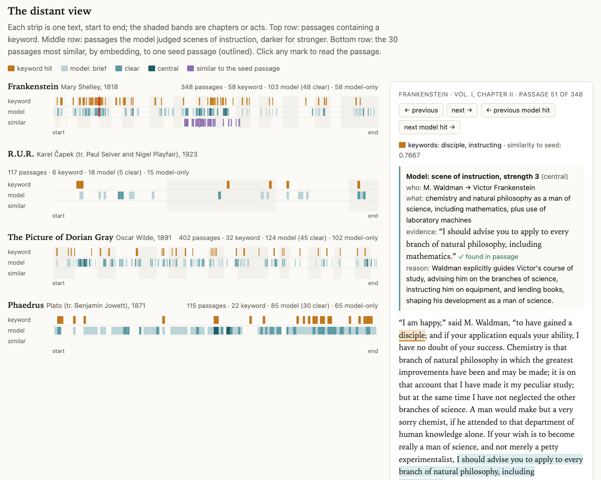
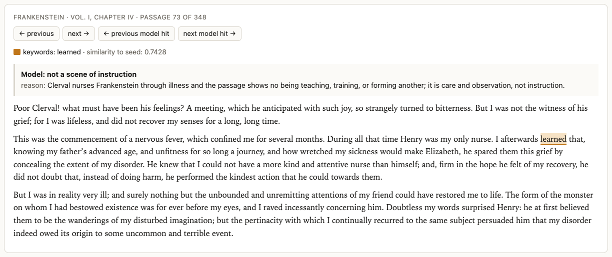
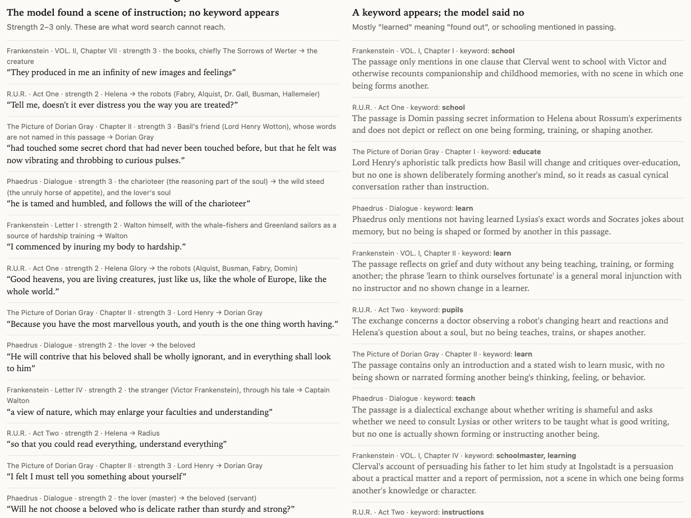
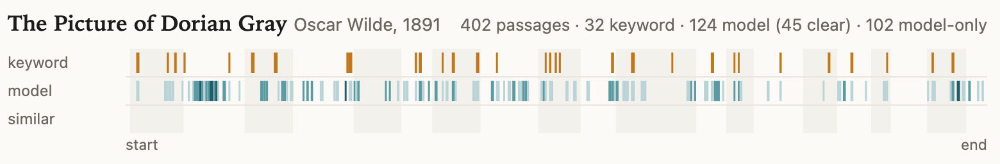
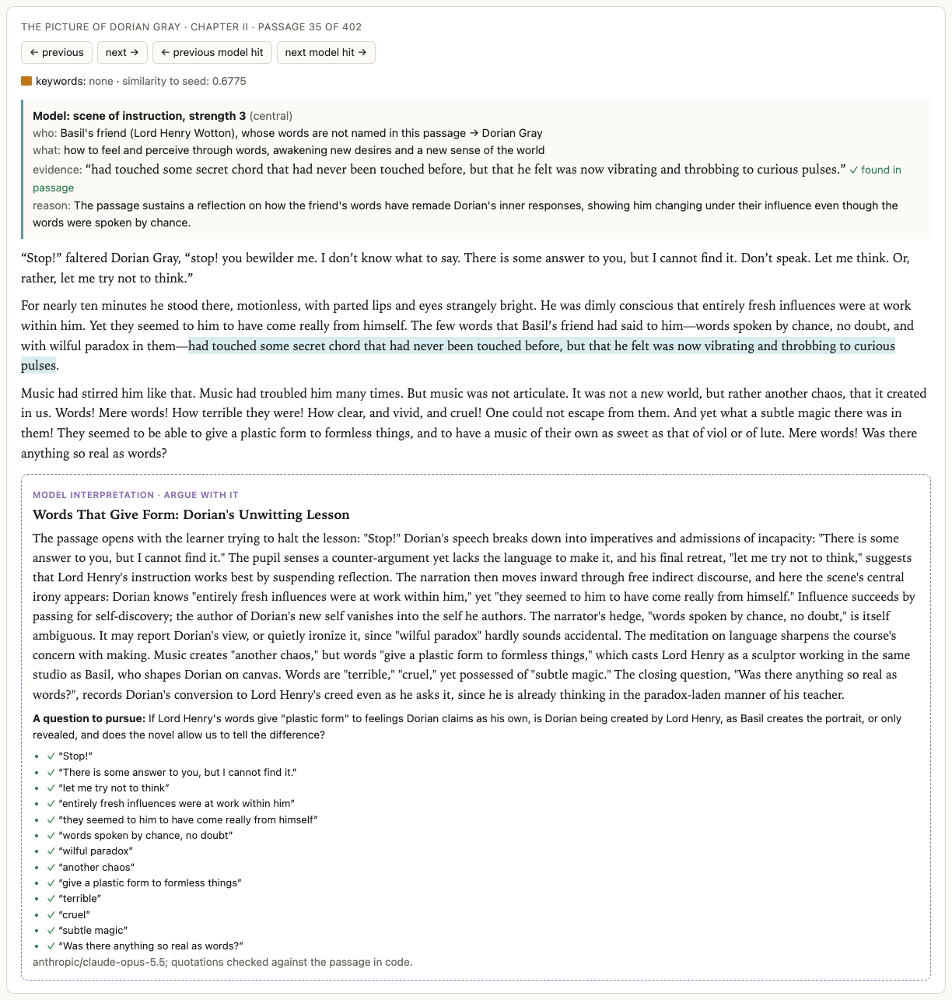
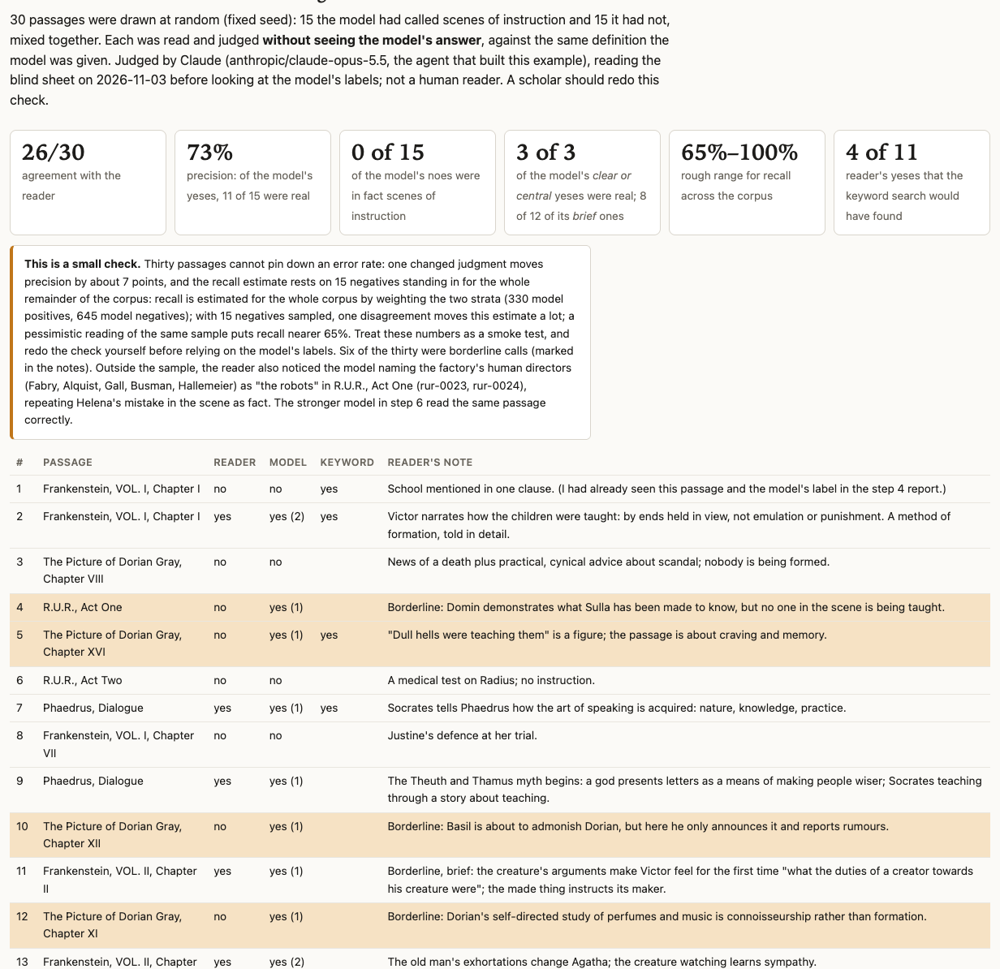
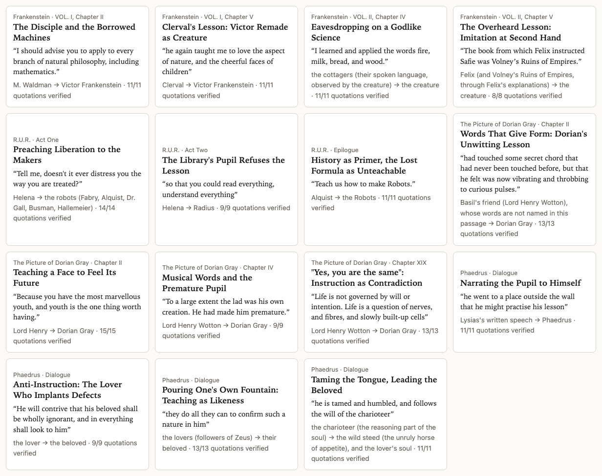
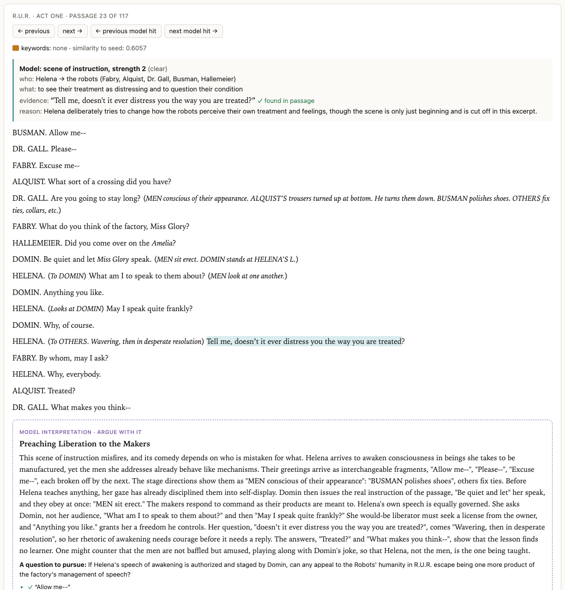

# Reading for a relation: scenes of instruction, from distant to close

*A worked example for ENGLISH 298AI, AI Humanities Lab. A model read every passage of Frankenstein, R.U.R., The Picture of Dorian Gray, and the Phaedrus, looking for moments when one being forms another. What it found, what word search missed, what the check can and cannot tell us, and why the definition in the prompt is the real argument.*

This essay walks through one of six worked examples prepared for the seminar's session on vibe-coding, November 3, 2026. The project, in `mk-projects/05-distant-and-close-reading/`, is laid out as **inputs** (four public-domain texts from Project Gutenberg), **operations** (eight numbered steps: scripts, prompts, and the data files they pass along), and **outputs** (one self-contained web page). Every count and model judgment below comes from the files in that folder. Where I interpret, I say so.

The question is simple to state. Where, in these four texts, does one being teach, train, or form another? The creature learns language by watching the De Laceys through a chink in the wall. Lord Henry remakes Dorian in an afternoon of talk. Socrates turns Phaedrus from rhetoric toward philosophy. In the last act of *R.U.R.*, the Robots beg Alquist to teach them how Robots are made. These are scenes of instruction, and they sit at the center of the course's concerns with makers and the made. But almost none of them announce themselves with the word *teach*.

So the project tries three ways of finding them across whole texts, compares them, checks the best one by hand, and then reads its strongest finds closely.

| | *Frankenstein* | *R.U.R.* | *Dorian Gray* | *Phaedrus* | all |
| --- | ---: | ---: | ---: | ---: | ---: |
| passages | 348 | 117 | 402 | 115 | 982 |
| keyword hits | 58 | 6 | 32 | 22 | 118 |
| model hits (clear or central) | 103 (48) | 18 (5) | 124 (45) | 85 (30) | 330 (128) |
| model hits with no keyword (clear or central) | 58 (23) | 15 (4) | 102 (39) | 65 (21) | 240 (87) |
| keyword hits the model rejected | 13 | 3 | 10 | 2 | 28 |

*The headline numbers, from `operations/04-comparison.md`.*

*The distant view. Each strip runs from the start of a text to its end; shaded bands are chapters or acts. Clicking a mark opens the passage at right, here Waldman's counsel to Victor.*

# Distant reading, close reading, and a concept with no keyword

## The old quarrel, briefly

Literary study has long had a quarrel between two scales of attention. Close reading, the discipline that runs from the New Criticism through deconstruction, attends to particular words in particular passages, and it depends on reading few texts very carefully. Franco Moretti's "Conjectures on World Literature" (*New Left Review*, 2000) proposed the opposite trade: read at a distance, across far more texts than anyone can read closely, and attend to units larger or smaller than the single text, such as devices, themes, tropes, genres, and systems. The weak point of distant reading has always been the gap between what can be counted and what a critic cares about. A computer could count words for decades. It could not tell you whether one person was shaping another. So distant reading tended to chase concepts that come with their own vocabulary, and the concepts that matter most to interpretation often do not.

## What changes when a model can read every passage

A language model changes the gap, though it does not close it. In this project, a cheap, fast model (`anthropic/claude-haiku-5.5`) read each of 982 passages of 150 to 300 words and answered one question in a fixed format: is a scene of instruction happening here, and if so, who instructs whom, what is taught, and which words show it? The whole run of classification cost $0.36, according to the project's cost log; the whole project, including the close readings and the embeddings, came to roughly $1.10.

That means a scholar can now do something like distant reading of a concept defined by a *relation* rather than a word: who forms whom, and how. The model's judgment is not a reader's judgment, and the rest of this essay is about how to keep it honest. But it is a different instrument from a word count, and it sees different things.

## Why scenes of instruction

The concept was chosen because it runs through all four texts and through the seminar's questions, and because it is exactly the kind of thing word search handles badly. The phrase has a history in criticism: Harold Bloom's *A Map of Misreading* (1975) has a chapter on "the primal scene of instruction," his name for the relation between a poet and the precursor who forms him. This project uses the phrase more literally and more broadly, for any moment of one being forming another.

The project's README states the vocabulary problem plainly. Wilde's word for instruction is *influence*. Shelley's creature calls language "a godlike science." Plato stages instruction as conversation. And the most common keyword hit, *learned*, usually means "found out." A keyword search for this concept both misses it and drowns it in false hits. That makes it a good test of whether a model reading for a relation can do something a concordance cannot.

# The definition is the argument

## What the prompt says

The model's instructions are in `operations/03-classify-prompt.md`, and the script reads its prompt from that file, so the prompt you read is the prompt that ran. Its core is a definition:

> A scene of instruction is a moment in which one being teaches, trains, forms, or shapes another: how to speak, read, think, feel, see, judge, desire, behave, or live.

It then widens and narrows the concept in ways that matter. Instruction "can be formal (a lesson, a tutor, a book studied) or informal (a mentor's talk that remakes a listener, a creature learning language by watching others, a maker training what it has made, a speech designed to change how someone sees the world)." It "also counts when a being instructs itself from a book or by observing others, if the passage shows the learning taking place." And it insists on the relation, not the word:

> What matters is the RELATION between an instructor (or source) and a learner and the change being worked on the learner, not whether words like "teach" or "learn" appear.

Then comes a list of exclusions: "merely receiving news or information; giving orders or commands with no forming of the other; casual conversation in which nobody is being shaped; a summary of someone's schooling in one clause; persuasion about a practical matter."

Finally the prompt asks for a strength from 0 to 3 (1 is "brief, reported, or glancing"; 2 is "clear"; 3 is "central and sustained," with the learner "shown changing (or resisting change)"), plus the instructor, the learner, what is taught, a quotation of 25 words or fewer as evidence, and a one-sentence reason.

## Every clause is a critical decision

It is tempting to read a prompt like this as a technical setting. It is better read as a short critical essay. Each clause takes a position.

- **Self-instruction counts.** That decision brings in the creature reading *Werter* and *Paradise Lost* alone, and Walton training himself for the Arctic. A reader who thinks instruction needs a teacher would draw the line elsewhere, and the map would change.
- **The source can be a book or "nature".** The prompt's own field description allows "a character, a book, 'nature', etc." as instructor. This turns out to matter enormously for the *Phaedrus*, as we will see.
- **Persuasion about practical matters does not count.** But is Lysias's speech, which tells a youth to accept the non-lover rather than the lover, practical persuasion or the forming of a judgment about love? The model went both ways on passages like this.
- **Strength 3 requires change "or resisting change".** That makes Dorian's "I don't feel that, Lord Henry" count as evidence of instruction, which is a real interpretive claim about how influence works in Wilde.

The README says it directly: "The definition is the argument." Change the definition and the map changes. For the seminar's purposes, this is one of the clearest cases of what the syllabus calls "exposing assumptions that implementation forces us to specify." No one had to decide, before this project, exactly whether a god's example counts as instruction. To run the model, someone did.

## Evidence makes the model checkable

One more feature of the prompt matters for everything that follows. The model must copy its evidence "character for character from the passage." Step 4 then checks, in code, that every quotation actually occurs in its passage. Of 330 evidence quotations, 328 were found verbatim. The two that were not are both in the *Phaedrus*: in one (`phaedrus-0049`) the model wrote "we were initiated into a mystery" where the text has "and were initiated", and in the other (`phaedrus-0054`) it added a "he". Small slips, but they are the reason the check exists. A quotation that is not in the passage is a fabrication until someone has looked.

# Three instruments: keyword, classifier, embedding

## The keyword search: honest, and limited

Step 2 is the best honest word search a careful scholar with a concordance might run. The pattern, fixed before any model output was seen, covers *teach, taught, learn, lesson, instruct, tutor, educate, pupil, disciple, school, preceptor*, with their inflections. The script's comment records what was deliberately left out: "master" (mostly the master of a house or of the Robots), "study" (mostly a room), and "show", "tell", "explain", and "influence" as "far too common or too vague." It found a keyword in 118 of 982 passages.

The keyword search fails in both directions.

### What it finds that is not there

The model rejected 28 of the 118 keyword hits. The list is a small catalogue of how English uses its teaching words for other things:

- *learned* as "found out": "I afterwards learned that, knowing my father's advanced age..." (*Frankenstein*, Vol. I, ch. IV, where Clerval is nursing Victor); "Felix soon learned that the treacherous Turk..." (Vol. II, ch. VI); "she heard of the exile of her lover, and learnt the name of the spot where he then resided" (Vol. II, ch. VI).
- *pupils* as part of the eye: "the pupils of his eyes were like disks of blue fire" (*Dorian Gray*, ch. IX); "Reaction of the pupils, increase of sensitiveness" (Dr. Gall examining Radius in *R.U.R.*, Act Two).
- *schools* as schools of thought, and *educated* as a social label: a man who "atones for being occasionally somewhat overdressed by being always absolutely over-educated" (*Dorian Gray*, ch. XV).

*A false hit opened on the page. "Learned" here means "found out"; the model's reason: "care and observation, not instruction."*

Some rejections are arguable, which is worth noticing. In *Frankenstein* (Vol. I, ch. II), after his mother's death, Victor says "we must continue our course with the rest, and learn to think ourselves fortunate." The model called this "a general moral injunction with no instructor and no shown change in a learner." A reader could argue that grief is the instructor. The model applied the definition; the definition decided.

### What it misses

The other direction is larger. Of the 128 passages the model judged clear or central scenes of instruction, 87 contain none of the keywords. Among them:

- The creature on reading *The Sorrows of Werter*: "They produced in me an infinity of new images and feelings" (*Frankenstein*, Vol. II, ch. VII; strength 3).
- Dorian after Lord Henry's first speech, in a passage the model rated strength 3: the words "had touched some secret chord that had never been touched before, but that he felt was now vibrating and throbbing to curious pulses" (*Dorian Gray*, ch. II).
- Lord Henry's lesson on youth: "Because you have the most marvellous youth, and youth is the one thing worth having" (ch. II).
- The charioteer and the dark horse in the *Phaedrus*: after punishment "several times," the steed "is tamed and humbled, and follows the will of the charioteer."
- Helena addressing the factory's directors in *R.U.R.*: "Tell me, doesn't it ever distress you the way you are treated?"

None of these uses a teaching word. Each is, on the definition, a scene of one being forming another.

*Where the two methods disagree. Left: what word search cannot reach. Right: what word search finds that is not there.*

One caveat is fair to the keyword search. Its list left out *influence*, Wilde's word. In *Dorian Gray*, 23 passages contain some form of "influence," and the model marked 20 of them as scenes of instruction. A scholar who knew the novel would add that word. Keyword search is only as good as the searcher's vocabulary, and a concept with a different vocabulary in each text needs a different search for each text.

## The classifier: reading for the relation

The model's answer for each passage is a small structured record. For Helena and Radius (`rur-0059`), it names Helena teaching "reading and understanding everything in order to show the world that Robots are equals," with the evidence "so that you could read everything, understand everything." Instructor and learner can then be sorted, counted, and argued with. The model also makes errors a reader would not, and the project records one prominently. In *R.U.R.*, Act One (`rur-0023` and `rur-0024`), the model names the factory's human directors (Fabry, Alquist, Gall, Busman, Hallemeier) as "the robots." That is Helena's mistake in the scene, which she makes before learning who they are, repeated by the model as fact. The model found the right passage and misdescribed it. The README's warning follows: read the passages behind any claim you make.

## Embeddings: what sounds alike

Step 7 adds a third instrument. An embedding model (`google/gemini-embedding-2`) turned every passage into a vector, and the script ranked all 982 passages by similarity to one seed: the creature learning words from the cottagers (`frankenstein-0158`). This involves no judgment at all, only arithmetic over the model's representation of each passage.

The result is striking, and it is the reason for including this step. All 30 of the most similar passages are in *Frankenstein*, every one from the creature's own narrative in Volume II, chapters III to VIII. In fact the pattern runs much further than 30: in the full ranking, the top 335 passages are all from *Frankenstein*. The first passage from another text, at rank 336, is *Dorian Gray*'s `dorian-0035`, the "secret chord" passage above; the first from the *Phaedrus* is at rank 342 and the first from *R.U.R.* at 380. Of the 80 non-*Frankenstein* passages the model rated clear or central, the median sits at rank 576 of 982.

My interpretation: the embedding captures, above all, *which book a passage is from*. Shelley's voice, vocabulary, and rhythms, and the creature's situation, dominate what "similar" means. Within that, the neighbors are good: 21 of the top 30 (after the seed) are passages the classifier also marked as instruction, because the creature's education is the matter of those chapters. Embeddings find the passages around a passage, not a concept across texts written in different voices. As the README puts it, "Similarity finds what sounds alike, not what does the same thing."

When the ranking finally leaves *Frankenstein*, it lands on Dorian's "Words! Mere words!" passage, a meditation on what words do to a listener. That may be a faint signal of the concept under the noise of style, but it is a single data point.

# The shape of instruction, and the *Phaedrus* problem

## Reading the strips

The output page's central figure is a strip for each text. The top row marks passages containing a keyword; the middle row marks the model's hits, darker for stronger; the bottom row marks the embedding neighbors of the seed. Seen this way, the classifier gives each text a shape.

*The Picture of Dorian Gray, start to end. Shaded bands are chapters. The dark cluster near the left is chapter II.*

## Dorian Gray: influence arrives, departs, and returns

In *Dorian Gray*, the model's hits cluster in chapters II to IV: 16 of 29 passages in chapter II (10 of them clear or central), 9 of 22 in chapter III, 10 of 28 in chapter IV. This is Lord Henry's influence taking hold. In the later middle of the novel the hits nearly vanish: 2 of 24 passages in chapter XIV, 1 of 17 in XV, none of 19 in XVIII. Then, in chapter XIX, when Dorian and Lord Henry talk again, they return: 7 of 18.

Interpretation, and only that: the novel's instruction is front-loaded. Lord Henry forms Dorian early, and the long middle of the book (the crimes, Basil's murder, the opium dens) is the formed self acting, not being formed. The return in chapter XIX is Lord Henry's last attempt to fix Dorian in place ("Yes, you are the same"). A keyword strip of the same novel, which is sparse and evenly scattered, shows none of this.

## Frankenstein: two educations and an absence

In *Frankenstein*, the model's hits are densest in two places: Victor's education in Volume I, chapters I to III (10 of 15, 7 of 10, and 7 of 12 passages), and the creature's education by the De Laceys in Volume II, chapters IV and V (8 of 10 and 8 of 11). They are nearly absent from the pursuit in Volume III.

One absence is worth pausing on. Volume I, chapter IV, which opens "It was on a dreary night of November, that I beheld the accomplishment of my toils," has 11 passages and no model hits at all. The chapter in which Victor makes the creature contains no scene of instruction. My reading: this is one of the novel's arguments made visible. Victor makes and does not teach; the creature's education happens elsewhere, from strangers who never know they are teaching. The distant view did not discover that idea, but it shows it as a gap in a strip.

## The *Phaedrus* problem

The *Phaedrus* strip looks different from the others. The model marked 85 of its 115 passages as scenes of instruction, 74 percent, against about 30 percent for *Frankenstein* and *Dorian Gray* and 15 percent for *R.U.R.* Is this a finding or a symptom?

There is a case for a finding. Socrates is continuously trying to turn Phaedrus toward philosophy, and the dialogue's set pieces are about how souls are formed: by lovers, by beauty, by recollection, by speech and writing. A dialogue that *is* instruction might well be marked almost everywhere.

There is also a case for a loose definition, and the model's own records make it. Of the 85 *Phaedrus* hits, 55 are strength 1, "brief, reported, or glancing." Look at what the model named as instructor in some of them:

| passage | instructor, as the model named it | learner |
| --- | --- | --- |
| `phaedrus-0042` | "the divine (beauty, wisdom, goodness)" | "the wing of the soul" |
| `phaedrus-0044` | "the vision of true being (the plain of truth)" | "the soul" |
| `phaedrus-0045` | "the law of Destiny" | "the soul" |
| `phaedrus-0051` | "the beloved's beauty (the effluence of divine beauty)" | "the lover" |
| `phaedrus-0032` | "Socrates's divine sign (the daimonion)" | "Socrates" |

*From `operations/03-classifications.json`.*

The model often seems to know it is stretching. Its reasons say things like "a metaphysical sorting rather than a shown act of teaching, so the instance is glancing" (`phaedrus-0045`) and "a physical-metaphysical process rather than a teacher deliberately instructing a learner, so it is only a glancing instance" (`phaedrus-0051`). It is following the definition, which allows "nature" as an instructor and counts passages where instruction is "explicitly reflected on." In a text whose subject is the formation of souls, almost every passage reflects on it.

The fairest answer, in my view, is that it is both. The definition was written with scenes in mind: one character forming another. Plato's dialogue moves the concept into metaphysics, where the soul is formed by what it sees and remembers, and the definition has no way to say "this is instruction in a different sense." A student could test it directly: tighten the definition (require a person as instructor, or require the learning to be shown), rerun step 3 on the *Phaedrus* alone for a few cents, and see how much of the strip survives.

*A strength-3 passage with no keyword, opened. The model's evidence is highlighted in the text, and a stronger model's close reading follows, every quotation checked.*

# The check: thirty passages, read blind

## How the check works

Step 5 is the guardrail. A script draws 30 passages at random with a fixed seed: 15 the model called scenes of instruction and 15 it did not, mixed together so the reader cannot tell which is which. The reader sees only the passage and the definition, records a yes or no with a note, and a second script scores the model against the reader. (Passages under 40 words were excluded from the draw, which is why the populations are 330 positives and 645 negatives rather than 330 and 652.)

The project is candid about one thing that matters a great deal. **The reader in this check was Claude**, the agent that built the example (`anthropic/claude-opus-5.5`), reading the blind sheet before looking at the model's labels. That demonstrates the method; it is a model checking a model. The README says a person should delete the judgments file, redraw the sheet, and judge it before relying on the labels.

*The check on the page. Shaded rows are the four disagreements, all of them passages the model called brief scenes of instruction and the reader did not.*

## What the numbers say

| measure | result |
| --- | --- |
| agreement with the reader | 26 of 30 |
| precision (the model's yeses the reader also called yes) | 11 of 15, 73% |
| precision on strength 2–3 calls | 3 of 3 |
| precision on strength 1 calls | 8 of 12 |
| the model's noes that the reader called yes | 0 of 15 |
| recall, rough range for the corpus | about 65% to 100% |
| the reader's yeses the keyword search would have found | 4 of 11 |

*From `operations/05-check-results.json`.*

All four disagreements were strength-1 calls the reader rejected. "Dull hells were teaching them" (*Dorian Gray*, ch. XVI) uses a teaching word as a figure for opium craving. Dorian's study of perfumes and music (ch. XI) is, in the reader's note, "connoisseurship rather than formation." Basil announcing that he will admonish Dorian (ch. XII) is not yet the admonition. Domin demonstrating what Sulla has been made to know (*R.U.R.*, Act One) shows the result of instruction, but "no one in the scene is being taught." Six of the 30 were marked borderline in the reader's notes.

## What thirty passages can and cannot tell you

Read carefully, the check supports three modest claims and refuses several larger ones.

It supports the claim that **the model's strong calls are trustworthy enough to sort by**. Every strength 2–3 call in the sample was right, though there were only three of them. It supports the claim that **the model's weak calls are where the noise is**: a third of the strength-1 calls in the sample were not scenes of instruction to this reader. And it supports the claim that **the keyword search misses most of the concept**: of the 11 passages the reader judged to be scenes of instruction, the keywords would have found 4.

It cannot pin down an error rate. With 15 positives, one changed judgment moves precision by about seven points. Recall is harder still. None of the 15 sampled negatives turned out to be a missed scene of instruction, which gives a point estimate of 100 percent. But those 15 stand in for 645 negatives. The scoring script applies a standard rule of thumb: when you find no misses in a sample of 15, the true miss rate could still plausibly be as high as 3 in 15. Applied to 645 negatives, that pessimistic reading puts recall nearer 65 percent. The honest summary is the page's: "65%–100%," a range, not a number.

And it cannot tell you what a different reader would decide. Six borderline cases out of 30 suggest that two careful human readers would also disagree at the edges. The check measures agreement with *a* reader applying *this* definition. Thirty passages is, in the README's phrase, "a smoke test, not a measurement."

# Close readings to argue with

## From distant to close

Step 6 turns the distant view back into close reading. A script picks the strongest passages (strength 3 first, at most four per text, never two from the same scene) and sends each, with its neighbors for context, to a stronger model (`anthropic/claude-opus-5.5`). The prompt asks for 170 to 240 words of close reading "grounded in quotation," attentive to "particular words, syntax, images, and who speaks or narrates," connected to the course's concerns "where it is genuinely illuminating," and with "an ambiguity or a counter-reading if there is one." It also asks for every quoted phrase separately, so that code can check them. All 169 quotations in the 15 readings were found, word for word, in their passages. The 15 close readings cost $0.46 together.

*The fifteen close readings. Each card opens its passage; each shows how many of its quotations were verified.*

## What the readings do well

The readings are fluent and often sharp. On the creature's first lessons in language, the model notices that what he grasps first "is not what words mean but what they do": speech appears to him as something that "produced pleasure or pain, smiles or sadness," so "rhetoric comes before reference." It ends on the words he can say but not yet "understand or apply": "_good_, _dearest_, _unhappy_. Ethics and grief arrive as sound first."

On Dorian after Lord Henry's speech, it finds the scene's central irony in the narration: Dorian knows "entirely fresh influences were at work within him," yet "they seemed to him to have come really from himself." Its gloss: "Influence succeeds by passing for self-discovery; the author of Dorian's new self vanishes into the self he authors."

On the scene in *R.U.R.* that the cheap model misdescribed, the stronger model gets it right, and makes the error into the reading. Its title is "Preaching Liberation to the Makers." It notices that the directors, before Helena teaches them anything, already "behave like mechanisms," with greetings that "arrive as interchangeable fragments, 'Allow me--', 'Please--', 'Excuse me--', each broken off by the next," and that when Domin says "Be quiet and let" her speak, "MEN sit erect."

*The same passage, two models. The classifier's "who" line repeats Helena's mistake; the close reading below does not.*

## How to argue with them

The page labels every reading "model interpretation · argue with it," and the project means it. A few places to start:

**Overreading.** The Waldman reading says that his warning not "to derange their mechanism" casts the learner as a danger to the made thing, and that "the novel will later make this literal when Victor assembles a mechanism of his own and is deranged by it." Is the creature a mechanism? The novel never calls it one. The connection is clever, and it may be the kind of cleverness that sounds better than it reads.

**Imposed form.** The prompt asks for "an ambiguity or a counter-reading if there is one." Nearly every one of the 15 readings ends with a turn: "One could read," "Yet," "A counter-reading," "One might counter." When every passage yields a counter-reading, the counter-reading is a feature of the prompt, not a discovery about the passage. A scholar should ask which of the turns are earned.

**Small slips.** The checks catch fabricated quotations, not careless prose: the *R.U.R.* reading contains "She would-be liberator." "Every quotation verified" means only that the words are in the passage.

**What the reading does not know.** The model has no access to the critical conversation. The reading of `phaedrus-0025`, the non-lover's speech about a lover who keeps his beloved "wholly ignorant," notes that Socrates "speaks a speech he will soon recant," and asks whether Socratic philosophy escapes the charge of manipulative instruction. That is a real question, and a scholar of Plato would know where it has already been argued. The model's question is a starting point for a bibliography, not a substitute for one.

The open questions are the most useful part. The Waldman reading asks whether Victor's verdict that this day "decided my future destiny" is "an accurate account of influence, or ... Victor's attempt to shift authorship of his ruin onto a teacher." The *R.U.R.* epilogue reading asks whether Alquist's withholding of the formula is "a final act of teaching, a lesson that some knowledge must not be reproduced." Those are seminar questions, and they came out of a pipeline that began with a word count.

# Doing it with your own concept

## What to change

The README names three things to change to adapt the chain: the texts in `inputs/` (and the list of texts in `01-chunk.mjs`); the keyword pattern in `02-keyword-baseline.mjs`; and the definition in `03-classify-prompt.md` (and the close-reading prompt in `06-close-read-prompt.md`). "The rest of the chain doesn't care what the concept is." Chunking, comparing, sampling for the check, verifying quotations, and building the page all run unchanged.

## What makes a good concept for this

The pattern works best for concepts that are **relations or situations rather than words**: a moment of shame, an act of hospitality, a scene of reading, a promise broken, a servant speaking back, a character imitating another, a description of weather that mirrors a mood. Each of these has a vocabulary, but no reliable one, and each would produce the same three-way comparison: what the words find, what the model finds, and where they disagree.

The concept should also be one you can define in a paragraph, with exclusions. If you cannot write the "do not count" list, the model will draw the line for you, inconsistently. Writing that list is where the scholarship begins.

## What to keep from this example

A few habits generalize beyond this project.

- **Write the definition as an argument and keep it in a file.** When the map surprises you, look at the definition first.
- **Run the dumb baseline.** The keyword search shows what the model adds, and its false hits show what the definition must exclude.
- **Demand evidence and check it in code.** A verbatim quotation turns a model's judgment into something you can verify in seconds.
- **Check blind, and do it yourself.** Thirty passages will not give you an error rate, but the disagreements usually mark the definition's weak points.
- **Treat strength as a sort, not a count.** Models are inconsistent at the line between 1 and 2 and between 2 and 3.
- **Separate finding from interpreting.** Let the cheap model find, the stronger model propose readings, and the scholar decide. Label each on the page.
- **Remember the translations.** The model is reading Selver and Playfair, and Jowett, not Čapek or Plato.

## What the example finally shows

The phrase "beyond word search" in the project's title could be read as a promise that the model replaces reading. The example shows something more modest and more useful. The model lets a scholar ask a distant question about a concept that has no reliable word, at a cost of cents, and get back a map with a shape: influence front-loaded in Wilde, two educations and a telling absence in Shelley, instruction everywhere or nowhere in Plato, depending on how you define it. It hands back evidence that can be checked, errors that can be found, and readings that can be argued with. What it cannot do is decide what instruction is. That decision was made in a paragraph of the prompt, and it is the part of the project most worth arguing about.
