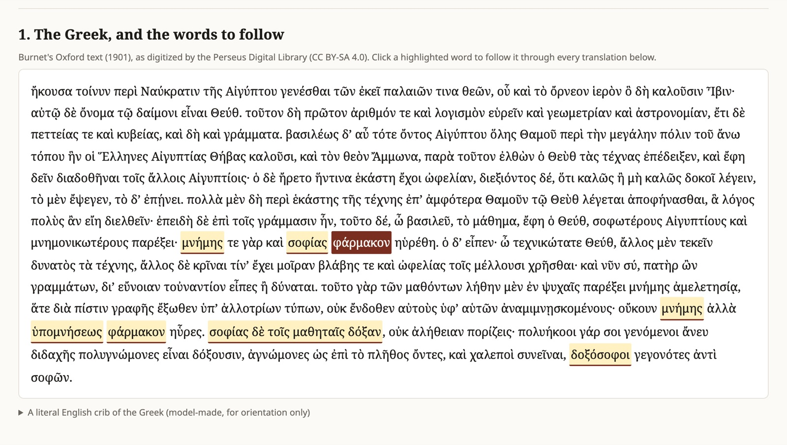
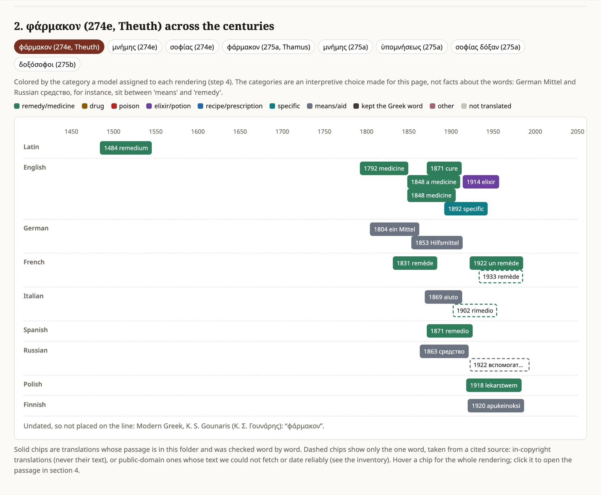
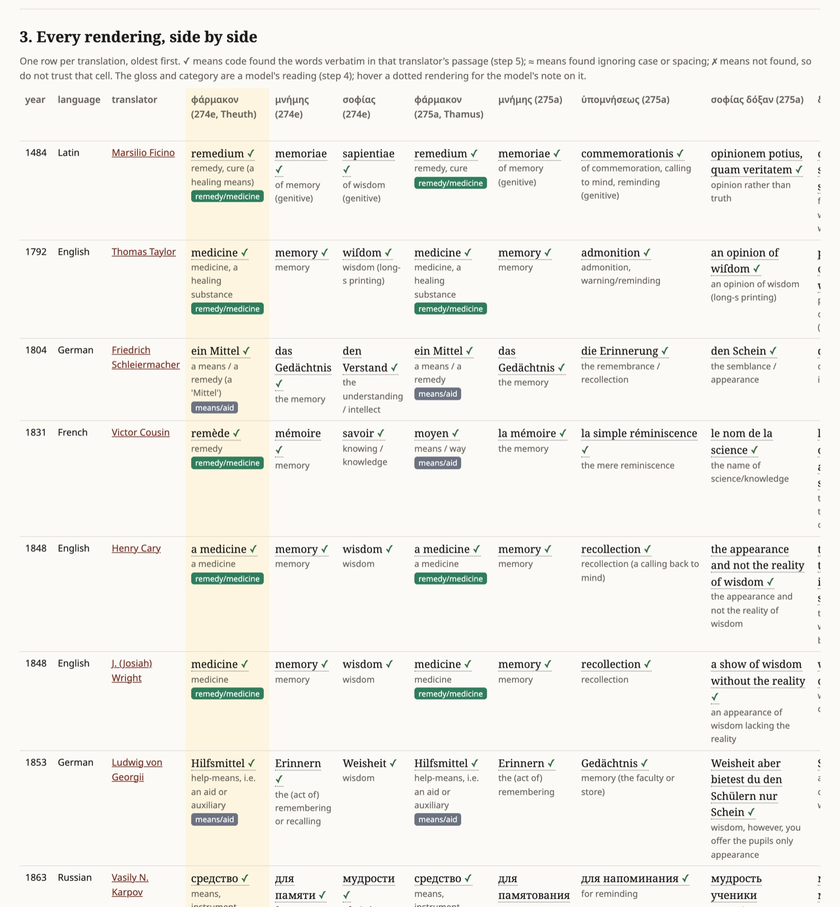
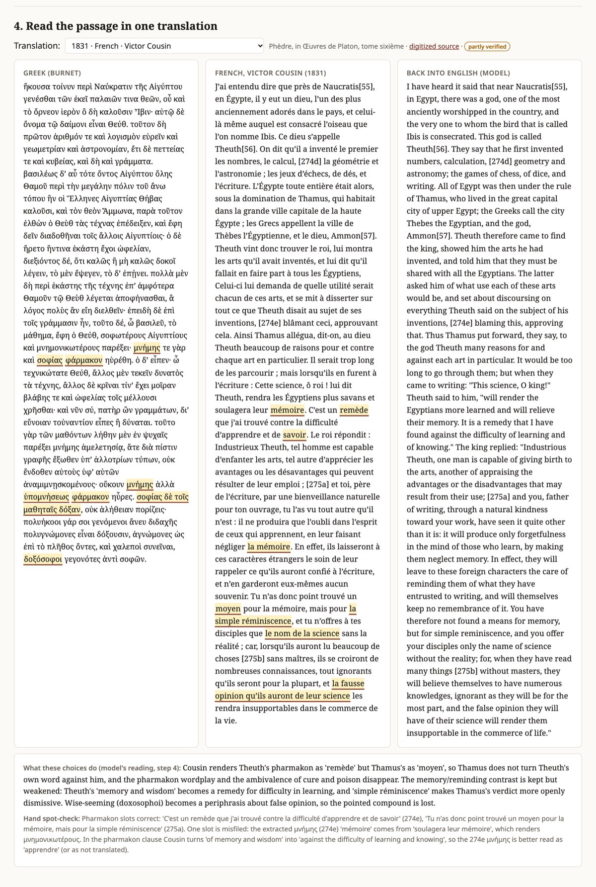
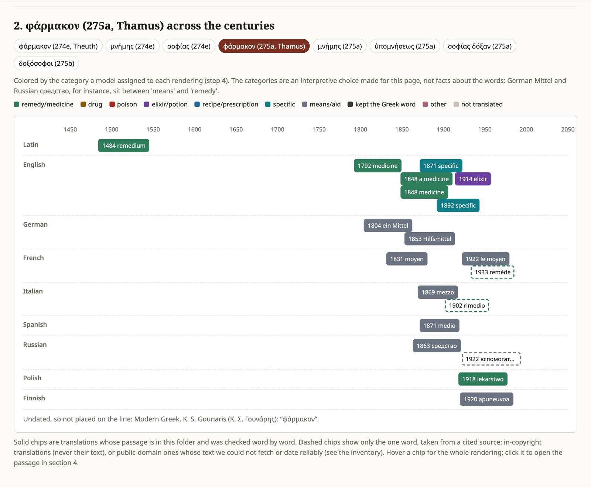
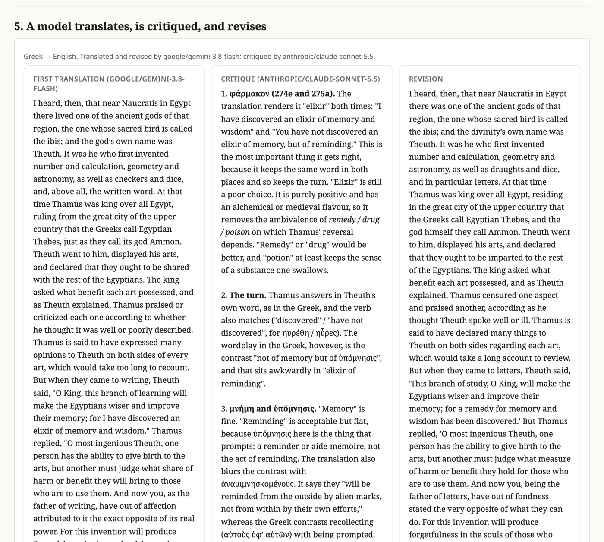

# One word, five centuries: following *pharmakon* through seventeen translations

*In the Phaedrus, writing is offered as a pharmakon for memory and judged a pharmakon only for reminding. This essay follows that one word through the Greek and seventeen public-domain translations, from Ficino's Latin to Meunier's French, using a pipeline in which code fetches and checks, a model reads and sorts, and a sentence-by-sentence spot-check asks what neither of them can.*

This essay is about a worked example built for ENGLISH 298AI, *AI Humanities Lab*, for its November 3, 2026 session on vibe-coding. Like the other five projects in `mk-projects/`, it is laid out as inputs (Burnet's Greek and seventeen translations), operations (numbered prompts, scripts, and data files), and an output (one HTML page, `outputs/index.html`). Every number and quotation below comes from that folder unless I say otherwise, and where I offer a reading of my own, I mark it as one.

*Section 1 of the output page: Burnet's Greek with the eight tracked words as buttons. Clicking one (here φάρμακον at 274e) re-colors the timeline and the table below it.*

The question is narrow on purpose: how have translators rendered *pharmakon*, *mnēmē*, *hypomnēsis*, *sophia* and *doxosophoi* in this passage, and what does each choice do to Plato's argument? A narrow question is what makes the method visible, including its limits, and what makes the irony hard to miss: this is a dialogue about writing as a crutch for memory, studied with tools that are the newest version of that crutch.

# The myth and the crux

*Theuth offers a pharmakon; Thamus hands the same word back with a different genitive. The whole argument turns on one noun that means remedy, drug, and poison at once.*

## The story Socrates tells

Near the end of the *Phaedrus*, Socrates tells Phaedrus a story he says he heard about Egypt. Near Naucratis lived an old god, Theuth, whose sacred bird is the ibis. Theuth invented number and calculation, geometry and astronomy, draughts and dice, and, in particular, letters (γράμματα). He brought his arts to Thamus, king of all Egypt at Thebes, and proposed that they be given to the other Egyptians. Thamus asked what use each one had, and praised or blamed them in turn.

When they came to letters, Theuth made his pitch (274e). This learning, he said, will make the Egyptians wiser and better at remembering, "for a *pharmakon* of memory and wisdom has been found": μνήμης τε γὰρ καὶ σοφίας φάρμακον ηὑρέθη.

Thamus answered that the one who begets an art is not the one who can judge its harm and benefit, and that Theuth, as the father of letters, had out of fondness said the opposite of what they can do. Writing will produce forgetfulness in the souls of learners through neglect of memory, since they will trust to external marks rather than remembering from within, by themselves. Then comes the sentence the whole passage is built to deliver (275a): οὔκουν μνήμης ἀλλὰ ὑπομνήσεως φάρμακον ηὗρες, "so it is not a *pharmakon* of memory but of reminding that you have found." Thamus goes on: you give your students the seeming of wisdom (σοφίας δόξαν), not its truth; having heard much without instruction, they will seem to know much while mostly knowing nothing, and will be hard company, δοξόσοφοι γεγονότες ἀντὶ σοφῶν, "become wise-seeming instead of wise" (275b).

## Why one word carries so much

The force of Thamus's reply is that he does not reject Theuth's noun. He keeps *pharmakon*, keeps the verb of finding (ηὑρέθη, ηὗρες), keeps the genitive construction, and changes only what the *pharmakon* is *of*: not *mnēmē*, memory, but *hypomnēsis*, reminding, a word built on the same root with a prefix that puts the prompt outside the one who remembers. Theuth's word is turned back on him. The same pattern repeats at the end with the *doxa* family: σοφίας δόξαν, then δόξουσιν ("they will seem"), then the compound δοξόσοφοι.

The noun itself is the difficulty. Greek *pharmakon* covers a medicine, a drug, a poison, a charm. A translator has to pick one, and the pick decides what kind of disagreement Theuth and Thamus are having. If *pharmakon* is a medicine, Thamus is saying the medicine treats the wrong condition. If it is a drug or a poison, Thamus is saying the gift harms what it claims to heal. If it is a neutral "means", the argument becomes a dispute about function, with no hint of harm in the word at all.

## Derrida's pharmacy

This choice became famous through Jacques Derrida's "La pharmacie de Platon", published in *Tel Quel* in 1968 (issues 32 and 33), reprinted in *La Dissémination* (Paris: Seuil, 1972), and translated into English by Barbara Johnson as "Plato's Pharmacy" in *Dissemination* (Chicago: University of Chicago Press, 1981). The project README gives these details; I confirmed the *Tel Quel* issues, the 1968 date, and the 1972 Seuil reprint with a web search, which also listed Johnson's 1981 translation. I did not open the essay itself today, so I do not quote it. Its central and widely known move is to keep the Greek word untranslated and to argue that any single rendering ("remedy", or "poison") suppresses the other sense, and with it the undecidability Derrida finds in Plato's treatment of writing.

The project's question is more modest and more empirical: not what *pharmakon* "really" means, but what translators did with it before Derrida made the choice famous.

# Seventeen choices

*Most older versions make pharmakon a medicine; German, Russian, Finnish and one Italian version make it a neutral "means"; none of the seventeen says "poison".*

## The corpus

The project gathered seventeen translations with machine-readable text in ten languages, from Marsilio Ficino's Latin (first printed 1484–85) to Mario Meunier's French (1922). Ten more appear in the inventory as metadata only: in-copyright translations, whose text the project does not reproduce, and public-domain ones it could not fetch or date.

| year | language | translator | 274e (Theuth) | 275a (Thamus) |
| --- | --- | --- | --- | --- |
| 1484 | Latin | Ficino | remedium | remedium |
| 1792 | English | Taylor | medicine | medicine |
| 1804 | German | Schleiermacher | ein Mittel | ein Mittel |
| 1831 | French | Cousin | remède | moyen |
| 1848 | English | Cary | a medicine | a medicine |
| 1848 | English | Wright | medicine | medicine |
| 1853 | German | Georgii | Hilfsmittel | Hilfsmittel |
| 1863 | Russian | Karpov | средство | средство |
| 1869 | Italian | Dalbono | aiuto | mezzo |
| 1871 | English | Jowett (1st ed.) | cure | specific |
| 1871 | Spanish | Azcárate | remedio | medio |
| 1892 | English | Jowett (3rd ed.) | specific | specific |
| 1914 | English | Fowler | elixir | elixir |
| 1918 | Polish | Witwicki | lekarstwem | lekarstwo |
| 1920 | Finnish | Lehmuskoski | apukeinoksi | apuneuvoa |
| 1922 | French | Meunier | un remède | le moyen |
| n.d. | Modern Greek | Gounaris | φάρμακον | φάρμακον |

*The pharmakon slots from `operations/04-renderings.json`, each confirmed verbatim in its passage by `05-check-renderings.mjs` and read against the Greek in `05b-spot-check.json`. Dates are first publication; the digitized text is often later (see "What not to trust").*

## Medicine first

Sorted by the model's categories (an interpretive scheme, discussed below), Theuth's *pharmakon* at 274e comes out as a remedy or medicine in nine versions: Ficino's *remedium*, Taylor's, Cary's and Wright's "medicine", Cousin's *remède*, Jowett's 1871 "cure", Azcárate's *remedio*, Witwicki's *lekarstwo*, and Meunier's *remède*. Five choose a neutral means or aid, one has Jowett's "specific", one Fowler's "elixir", and the Modern Greek keeps φάρμακον.

The medical reading is the oldest. Ficino keeps one word and Plato's genitives exactly: *memoriae namque et sapientiae remedium id est inventum* at 274e, *non memoriae, sed commemorationis, remedium invenisti* at 275a. Taylor (1792) does the same in English: "this invention is the medicine of memory and wiſdom", then "you have not diſcovered the medicine of memory, but of admonition" (the long s is Taylor's printing). Cary and Wright, both 1848, keep "medicine" twice. In all of these, Thamus's turn survives: the same medicine, aimed at a different target. What does not survive is any suggestion that the medicine might harm.

*Section 2 of the page, with φάρμακον at 274e selected. Solid chips are passages in the folder, checked word by word; dashed chips (Robin 1933, the 1902 Bocca Italian, Zhebelev 1922) are single words from cited sources, outside the pipeline.*

## The "means" tradition

The second tradition is a band of grey across the middle of the timeline. Schleiermacher's German (1804; the digital text is his 1817 revision) has *ein Mittel* in both places: *als ein Mittel für den Verstand und das Gedächtnis* at 274e. Georgii (1853) has *Hilfsmittel* twice. Karpov's Russian (1863) has средство twice: я изобрел ее, как средство для памяти и мудрости, "I invented it as a means for memory and wisdom." Lehmuskoski's Finnish (1920) uses two compounds on *apu-*, "help": *apukeino* at 274e and *apuneuvo* at 275a. Dalbono's Italian (1869) has *aiuto*, help, for Theuth, and *mezzo*, means, for Thamus. A metadata-only row, Zhebelev's Russian of 1922, is recorded with вспомогательное средство, "auxiliary means".

The README and the step 4 prompt both warn that German *Mittel* and Russian средство "sit between 'means' and 'remedy'": *Heilmittel* is a remedy, *Mittel* alone is a means, and средство can be a medicine in some contexts. So the grey band is partly an artifact of where the category line was drawn. Still, the choice is real. *Hilfsmittel* and *apukeino* have no medical sense at all. In these versions, as the model's note on Georgii puts it, "the argument becomes about utility rather than about harm." My own gloss is that the "means" tradition reads the myth as a story about a tool, which is how the passage is usually invoked in arguments about technology today.

## What nobody chose

None of the seventeen renders *pharmakon* as "poison", or as "drug" in the neutral pharmacological sense. The category list in the step 4 prompt included both, with examples in several languages (*Gift*, *venenum*, яд, *Droge*), so the absence is not a blind spot in the scheme; the model was offered those boxes and filled none of them. The few one-word metadata rows outside the pipeline agree: Robin's French of 1933 (in copyright in the US; only the word is recorded) has *remède*, Acri's Italian has *medicina*, the 1902 Bocca volume has *rimedio*.

This finding is easy to overstate. What the data show is that no public-domain translation the project could fetch, up to 1922, chooses poison, and neither do the three metadata words through 1933. The project did not check post-1968 translations; the words often attributed to Hackforth (1952, "recipe") and Nehamas and Woodruff (1995, "potion") could not be confirmed from a reliable source, and the inventory leaves them blank rather than repeat them. So the essay can say that "poison" is absent from this corpus before Derrida. It cannot say when, or whether, it entered the translations after him.

# Breaking the echo

*The most consequential choices are not which word a translator picks but whether they pick the same word twice.*

## Switchers

The step 5 script records whether the two *pharmakon* slots share a word. Six versions do not: Cousin, Meunier, Dalbono, Azcárate, Lehmuskoski, and Jowett's 1871 edition. Two more switch in ways the four-letter test misses.

*Section 3, the renderings table. Each ✓ is code confirming that the words occur in that translator's passage. Cousin's row shows remède at 274e and moyen at 275a; Georgii's shows Erinnern and Gedächtnis in the reverse of the expected order.*

Victor Cousin's French (dated 1831 by Wikisource) is the clearest case. At 274e Theuth says *C'est un remède que j'ai trouvé contre la difficulté d'apprendre et de savoir*, "it is a remedy that I have found against the difficulty of learning and knowing." At 275a Thamus replies *Tu n'as donc point trouvé un moyen pour la mémoire, mais pour la simple réminiscence*, "so you have not found a means for memory, but for mere reminiscence." Three things happen at once. The word changes, from remedy to means, so Thamus no longer answers in Theuth's term. The genitives of 274e become a remedy *against* a difficulty, so Theuth's claim is no longer about memory and wisdom. And *simple*, which has no counterpart in the Greek, makes Thamus's verdict openly dismissive.

*Section 4, with Cousin selected: Greek, French, and a model's back-translation in parallel. Below them, the model's reading of what the choices do and the spot-check that caught a misfiled slot.*

Patricio de Azcárate's Spanish (1871) follows Cousin almost step for step: *un remedio contra la dificultad de aprender y retener* at 274e, *un medio de cultivar la memoria* at 275a. The inventory notes that Azcárate "may have translated from the French"; the spot-check observes that the *remède*/*moyen* and *remedio*/*medio* pattern supports that. The method is good at exactly this: a pattern visible only when rows from two languages sit side by side.

Meunier (1922) follows the same French habit and goes further. Theuth offers *un remède pour soulager la science et la mémoire*; Thamus replies *Tu as trouvé le moyen, non point d'enrichir la mémoire, mais de conserver les souvenirs qu'elle a*, "you have found the means not of enriching memory but of preserving the memories it has." The spot-check calls this "a substantive reinterpretation": writing becomes a store of memories rather than a prompt from outside, which is close to the opposite of what *hypomnēsis* stresses. Dalbono's near-synonyms (*aiuto*, *mezzo*) and Lehmuskoski's two *apu-* compounds weaken the link without cutting it.

Witwicki's Polish (1918) switches inside a single sentence. Theuth's writing is *lekarstwem na pamięć i mądrość*, a medicine for memory and wisdom; Thamus says it is not a *lekarstwo* for memory, only a *środek*, a means, for reminding oneself. The four-letter test counts that as "same word for both", which is true of the slots but hides the switch: memory is denied a medicine, and reminding is granted a mere means. In my reading, it puts the downgrade into the vocabulary itself.

## Jowett changes his mind

The project includes two editions of Benjamin Jowett's *Dialogues of Plato*. The first (Oxford, 1871), from OCR of a Cornell copy, reads at 274e: "This, said Theuth, will make the Egyptians wiser and give them better memories; for this is the cure of forgetfulness and of folly." At 275a: "You have found a specific, not for memory but for reminiscence."

The third edition (1892), the text of Project Gutenberg #1636, reads at 274e: "it is a specific both for the memory and for the wit." At 275a: "The specific which you have discovered is an aid not to memory, but to reminiscence."

In 1871 Jowett inverted Theuth's genitives, making the *pharmakon* a cure of the ills it removes (forgetfulness, folly) rather than of the goods it gives, and he used two different words, so Thamus did not answer in Theuth's term. By 1892 he had carried "specific" back into Theuth's line, restoring the echo and the positive genitives, though "the wit" is narrower than wisdom. He also added a second noun at 275a, "an aid", to which the "not … but" contrast now attaches. A "specific" is a medicine for one particular disease, a word technical enough that the step 4 prompt gave it its own category. In my reading, Jowett noticed the broken echo and repaired it, at the price of a word that sounds more like a pharmacist's label than a god's gift.

*The same timeline for Thamus's φάρμακον at 275a. Compare with the 274e view: the French, Spanish, and Italian chips change color, and Jowett's 1871 chip changes from "cure" to "specific".*

## Memory and reminding

The *mnēmē*/*hypomnēsis* pair has its own history. Ficino's *memoria*/*commemoratio* and Karpov's памятование/напоминание keep a shared root. Taylor's "admonition" leans toward warning. Cary and Wright choose "recollection", Jowett "reminiscence", Cousin *réminiscence*: words that in a Platonic context call up *anamnēsis*, the recollection of the Forms, nearly the opposite of being reminded by external marks. Fowler (1914) is plainest: "an elixir not of memory, but of reminding."

Georgii's German (1853, from a 1940 reprint) does something the model noticed and the spot-check confirmed by reading: he puts *Erinnern* where Plato has *mnēmē* and *Gedächtnis* where Plato has *hypomnēsis*: *Nicht also für das Erinnern, sondern für das Gedächtnis hast du ein Hilfsmittel erfunden*. That is the reverse of Schleiermacher's mapping fifty years earlier, where *Gedächtnis* is memory and *Erinnerung* reminding. Whether Georgii meant a distinction between active remembering and a passive store, the data cannot say; the README flags it as the kind of thing a model's tidy gloss can smooth over.

The Modern Greek of K. S. Gounaris keeps φάρμακον, μνήμης and υπομνήσεως outright: δεν εύρες φάρμακον μνήμης, αλλ' υπομνήσεως. It is the only version that keeps Plato's own words, though modern φάρμακον mostly means "medicine", so even here the poison side is quieter. The edition is undated, so it sits below the timeline.

# The pipeline: code, model, check

*Every step says what kind of thing it is: deterministic code, model judgment with a fixed schema, or a verified reading. The design question is where each one belongs.*

## The chain, step by step

The README lists eight steps, each labeled by kind, which is the most useful thing about it for a seminar.

1. **Inventory (research, verified by hand).** Three Claude Code research agents with web search, one per group of languages, worked from the brief in `01-inventory-prompt.md` ("Never guess a fact; mark it unconfirmed"). Their reports were reconciled by hand into `01-inventory.csv`: imprint, year, the edition actually digitized, copyright, license, a status, and the catalogue URLs each fact rests on. About two dozen candidates came back; seventeen had a fetchable text.
2. **Fetch (code).** `02-fetch-texts.mjs` downloads each text byte for byte. Originals are never edited.
3. **Locate (code narrows, a model points, code cuts).** Code finds where Naucratis, Theuth and Thamus cluster in any spelling or alphabet; Gemini 3.8 Flash reads that stretch beside the Greek and names the translator's first and last words; code searches for those exact words and cuts the passage, or fails loudly. A stored passage is always the translator's text, never a paraphrase. The Greek is cut by fixed anchors with no model.
4. **Extract (model judgment, strict JSON schema).** Claude Sonnet 5.5 fills eight slots per translation with the translator's exact words, a literal gloss, a note, a category for the two *pharmakon* slots, and a few sentences on what the choices do to the argument. The script reads its prompt from `04-extract-prompt.md`, so the prompt a reader sees is the one that ran.
5. **Check (code), then spot-check (reading).** `05-check-renderings.mjs` confirms that each rendering occurs in its passage. Of 136 renderings (17 versions by 8 slots), 135 were found. The spot-check in `05b-spot-check.json`, made by the Claude Code session that built the folder and not by a human scholar, read the key sentences of every version against the Greek.
6. **Back-translate (model judgment).** Claude puts every non-English passage, and the Greek, into literal English.
7. **Translate, critique, revise (model judgment).** Gemini translates the Greek, Claude critiques, Gemini revises.
8. **Build (code).** `08-build-page.mjs` merges everything into one page that opens without a server.

A shared client caches every response in `operations/cache/`, refuses truncated or empty replies, and logs every live call to `costs.jsonl`. The model calls cost $1.10 for 71 live calls, including reruns while prompts were tightened; the inventory research (about 475,000 tokens across the three agents) ran under a Claude plan and is not in that log.

## Where the line between code and model falls

The interesting design decision is not "use a model" but where the model is allowed to touch the text. In step 3 the model never writes the passage; it only names two anchor phrases, and code does the cutting. In step 4 the model writes renderings, but step 5 makes every one of them answerable to the source string. That is the sense in which the project, in the syllabus's phrase, exposes "assumptions that implementation forces us to specify": to write the check, someone had to decide what counts as the same word (exact, case-insensitive, curly versus straight apostrophes) and accept that a footnote marker inside a phrase would cause a failure.

The one failure is instructive. Karpov's *sophias doxan* slot came back NOT FOUND, because the Wikisource text has a footnote marker in the middle of the phrase (приобретут[175] у тебя) and the model quoted it without the marker. The words are Karpov's; the reading is right; the guardrail was right to flag it anyway. A check that never fails is not checking much.

## What the check cannot see

A ✓ in the table means the words occur in the passage. It does not mean they render the Greek word they are filed under. The spot-check found two such misfilings, both in the *mnēmē* slot at 274e. For Cousin, the model filed *mémoire* from *soulagera leur mémoire*, which renders the earlier μνημονικωτέρους ("better at remembering"), because Cousin's *pharmakon* clause has no word for memory at all. For Jowett 1871, the model filed "better memories", again from the earlier clause, when the *pharmakon* clause actually has "forgetfulness", Jowett's inverted genitive. Both are versions that restructure Theuth's sentence, which is where a slot-filling scheme is most likely to grab the nearest plausible word.

This division of labor is, to my mind, the project's main methodological lesson. Code can prove provenance: these words are in this text. A model can propose an alignment: this word answers to that Greek word. Only a slow reading can confirm the alignment, and here even that reading was done by an agent and says so: "A scholar should repeat this before citing anything."

## One more translation, made by models

Step 7 runs a small experiment beside the historical versions. Gemini's first translation chose "elixir" in both places, like Fowler in 1914: "I have discovered an elixir of memory and wisdom" and "You have not discovered an elixir of memory, but of reminding." Claude's eight-point critique praised the repetition ("This is the most important thing it gets right, because it keeps the same word in both places and so keeps the turn") but called "elixir" "purely positive", removing "the ambivalence of *remedy / drug / poison* on which Thamus' reversal depends", and suggested "remedy" or "drug". It also objected that "its appearance, not its reality" drops the *doxa* vocabulary and turns "truth" into "reality", and that "wise in their own conceit" dissolves δοξόσοφοι. Gemini's revision adopted "remedy", "the semblance of wisdom, not truth", and "seeming-wise instead of wise".

*Section 5: one more translation to judge, not an answer. The first draft says "elixir", the critique objects, and the revision says "remedy".*

Two things are worth noticing, and both are my interpretation. First, the chain converged on the oldest choice in the corpus, Ficino's *remedium*, and its note claims that "remedy" "properly preserves the therapeutic ambivalence", which is close to the opposite of the critique's point and of Derrida's: "remedy" is precisely the word that loses the poison. A model's account of its own revision is another text to read critically. Second, the critique's best catches were small and checkable (the *doxa* family, the coinage δοξόσοφοι, and the point that the Greeks identify the king with Ammon, which is consistent with Fowler's "they call the god himself Ammon"). That is the kind of feedback a careful reader would also give. The page frames the result correctly: one more translation to set beside the seventeen, not a verdict on them.

# What not to trust

*The project's README is unusually frank about its weak points. They are the most transferable part of the method.*

## Editions, reprints, revisions

The timeline dates each translation by its first publication, but almost every digital text is a later edition, reprint, or modernized transcription. Schleiermacher is dated 1804, but the text is his 1817 revision in modern spelling (a researcher reported that an 1817 scan matches apart from spelling; the 1804 wording was not seen). Ficino is dated 1484, but the text is Bekker's 1816 reprint, not compared with the incunable. Karpov's 1863 text is in modernized Russian spelling. Georgii's comes from a 1940 reprint, Wright's from a 1900 reprint, Witwicki's from a 2005 edition. Jowett shows why this matters: his two editions disagree about the very word the project is tracking. A timeline that plots 1804 or 1484 is plotting a claim about first publication that the text in the folder does not by itself support. The inventory's `edition_used` column says which text was used for every row.

## OCR

Taylor, Cary, Wright, and Jowett 1871 come from Internet Archive OCR. Jowett 1871's passage includes strings like "forgetfulne^", which the model copied faithfully because it was told to copy exactly. Taylor's passage contains his long Neoplatonic footnotes, which the OCR runs into the text; the spot-check confirms the renderings come from the dialogue, not the notes. Check any word against the page image before quoting it.

## Dates and attributions

Cousin's tome 6 is dated 1831 by Wikisource, while its index page gives 1823 for the scanned set. Gounaris has no date at all. Wright's 1848 imprint was seen only in a catalogue search result. Lehmuskoski's and Dalbono's imprints come from transcribed title pages. The Polish text needs a copyright check before redistribution: if Witwicki revised his 1918 translation after 1930, the 2005-based text may still be in copyright in the US, and the README says to compare it with the 1918 scan on Polona or drop the row. This essay therefore quotes only single words and a short phrase from it.

## The categories are a scheme, not a finding

The colors on the timeline come from a category list written for this page: remedy/medicine, drug, poison, elixir/potion, recipe/prescription, specific, means/aid, kept the Greek word, other, not translated. The README calls them "an interpretive scheme made for this page, not facts about the words." *Mittel* and средство sit on the line between means and remedy; "specific" has its own category because nothing else fits Jowett. Moving that line would recolor the grey band. The categories are useful for seeing a pattern at a glance; the words themselves are what an argument should rest on. The glosses, back-translations, and "what these choices do" notes are a model's readings too, and two runs would differ somewhat; the Georgii back-translation even begins with a stray phrase of the German.

## Small mechanical blind spots

The four-letter "same word for both" test misses a switch inside a sentence, which is why Witwicki's *lekarstwo* to *środek* and Jowett 1892's "specific" plus "aid" appear as matches. The README names what the simple test misses, which is the honest course.

# A pharmakon for memory

*A dialogue that warns against outsourcing memory to external marks, studied with tools that are external marks of a new kind. The irony is the point, and it suggests a pattern any student can reuse.*

## The irony, taken seriously

Thamus's charge is that writing gives the seeming of wisdom rather than its truth, and produces people who are wise-seeming instead of wise. It is hard to read that sentence in 2026 without thinking of language models, and the seminar's reading list invites the comparison. The project is a small test of the charge. A model asked to extract eight words from seventeen passages produced output that looks like philology: glosses, categories, two or three fluent sentences on the argument for every version. Some of it is good philology. Some of it, like the two misfiled slots or the revision note that calls "remedy" ambivalent, is the seeming of it.

What keeps the project on the right side of Thamus's line, in my reading, is the same thing Plato's Socrates values: the ability of a text to answer for itself. Plato's complaint about writing, a few lines after the myth (275d–e), is that a written text cannot defend itself when questioned; in Jowett's 1892 English, written words "cannot protect or defend themselves." The pipeline's response is to make every model output questionable by something outside the model. The passage must be the translator's words, cut by code at anchors the code can find. Each rendering must be found in that passage. Each slot must survive a reading against the Greek. Each cost, prompt, and response is logged and cached, so that the work can be inspected and rerun. In the dialogue's own vocabulary, the cache and the logs are *hypomnēmata*, reminders. Socrates himself allows the one who knows to write for that purpose at 276d, storing up reminders for himself (ἑαυτῷ τε ὑπομνήματα θησαυριζόμενος) in case he reaches forgetful old age. Such reminders do not make anyone wiser, but they let someone else check what was done. The project uses AI tools as a *pharmakon* in the full sense, and spends much of its code on the dose.

There is a quieter irony too. The pattern the timeline shows, the old consensus on "medicine" and the nineteenth-century turn to "means", can only be seen by laying seventeen versions side by side, relying on external marks rather than memory. Such a tool does not replace the close reading of Cousin's *simple réminiscence* or Jowett's revision; it tells you where to look.

## How a student could adapt the pattern

The method is not specific to Plato. Any crux where a single word carries an argument and has been translated many times would work: *Ungeziefer* in Kafka's *Die Verwandlung*, *polytropos* in the first line of the *Odyssey*, *Trieb* in Freud, *logos* in John 1:1, *saudade* in Portuguese lyric, or the "too too solid/sallied/sullied flesh" crux across editions of *Hamlet*. The steps transfer directly.

1. **Name the question and the slots:** the exact words to follow and where they occur. Start with two slots, not eight.
2. **Build an inventory before fetching anything.** Ask research agents to cite catalogue records and mark what they could not confirm, then reconcile by hand. Keep in-copyright translations as metadata and, at most, one confirmed word.
3. **Keep originals untouched and cut passages by code,** failing loudly when an anchor is missing.
4. **Extract with a schema and keep the prompt in a file.** If you sort renderings into categories, write the list down and call it an interpretive scheme.
5. **Check every extraction against the source by code, then read a sample yourself,** and record what the reading found, errors included.
6. **Record which edition each text really is,** and expect revisions to matter.
7. **Lay it out so a reader can explore it:** a timeline, a table with the check marks, a side-by-side view. The goal, in the syllabus's words, is to give ideas forms that readers can explore.

Across the five centuries this corpus covers, translators kept making the choice Thamus made, deciding what the gift was really for. They were mostly generous to Theuth: a medicine, a remedy, a means. None of them, in this corpus, called it poison. The project lets a reader see that pattern in a few seconds and then spend as long as they like with the words that make it up.

## Sources and verification

All renderings, quotations from translations, counts, costs, and caveats come from this folder's `README.md`, `operations/` files (01 through 07), and `outputs/index.html`; the Greek is Burnet's text as digitized by Perseus (CC BY-SA 4.0), and literal glosses of it are mine. Derrida's publication details come from the README and a web search on November 3, 2026 (*Tel Quel* 32–33, 1968; Seuil, 1972; Johnson's translation, 1981); I did not consult the essay's text, so it is not quoted. In-copyright translations appear only as single recorded words. Screenshots are of `outputs/index.html` in headless Chrome.
